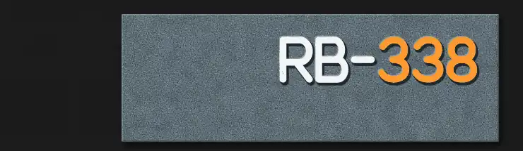

<p align="center">
  
</p>

<div align="center">

# OpenRB-338

</div>

<p align="center">
  <a href="https://pingw33n.github.io/OpenRB-338/"><b>Website</b></a> ·
  <a href="https://github.com/pingw33n/OpenRB-338/releases"><b>Download</b></a> ·
  <a href="https://raw.githubusercontent.com/pingw33n/OpenRB-338/main/assets/readme/screenshot.png"><b>Screenshot</b></a> ·
  <a href="https://github.com/pingw33n/rb-songs"><b>Song collection</b></a> ·
  <a href="https://github.com/pingw33n/rb-mods"><b>Mod collection</b></a>
</p>

OpenRB-338 is a reimplementation of [ReBirth RB-338](https://en.wikipedia.org/wiki/ReBirth_RB-338),
the 1997 software synth of two 303 bass lines, an 808 and a 909, for today's macOS, Linux
and Windows.

## Features

- **Sounds exactly like the original.** The audio engine was rebuilt from ReBirth 2.01 to the
  bit. A song's exported loop equals the original's "Export Loop as Audio File" byte for byte. This
  is tested on 1,268 songs of the song collection, 531 of them on 43 third-party mods, and on a
  175-render reference corpus.
- **The whole machine on screen:** the two 303s, the 808 and the 909, the mixer, the delay,
  distortion, PCF and compressor, with pattern and song mode, the loop, shuffle and recording.
- **A scalable vector-graphics panel** in the original's layout and look, drawn from scratch,
  that stays sharp at any window size and pixel density.
- **A classic theme:** View > Classic / Modern switches the standalone's panel to the loaded
  mod's original panel art, fully playable, with a short crossfade between the two.
- **Songs:** opens ReBirth 2.x songs (`.rbs`, RBS 4.0 to 4.2) and ReBirth 1.x songs, and saves
  RBS 4.2 files that the original opens. File > Info shows and edits the song's title, text, web
  page and copyright.
- **Mods:** plays the drum samples of ReBirth mods (`.rbm`), chosen per song, with the mod's
  startup sound. The standard kit is built in, so no file of the original is needed.
- **Audio export** of the loop to WAV, FLAC or Ogg Vorbis.
- **Plays from the computer keyboard:** program the synths and select patterns without a mouse
  (Help > Keyboard Shortcuts).
- **Pattern commands:** cut, copy, paste and duplicate a pattern, with one level of undo (the
  Edit menu).
- **A VST 3 instrument plugin** with the same engine and panel (see The plugin below).
  Besides the Mix it has outputs for the 303-1, 303-2, 808 and 909, tapped like ReBirth's
  ReWire channels, after each channel's effects and before its level and pan.
- **`orb`, a command-line tool,** to work with songs and mods from the terminal:
  - `orb render`: render a song's loop to WAV, FLAC or Ogg, far faster than real time (a
    five-minute song takes about a second and a half);
  - `orb play`: play a song without the UI;
  - `orb info`: print a song's facts (format, title, mod, tempo, loop), also as JSON;
  - `orb mod`: recrypt mods, and unpack a mod to a folder or pack one from it.
- **Packages** for macOS (Apple silicon and Intel), Windows (x64 and ARM64) and Linux (x86_64 and
  ARM64).

## Not implemented

- ReWire, and MIDI input or sync in the standalone application (the VST 3 plugin below takes
  the MIDI of its host).
- Mod themes other than the classic panel: a mod's panel art is drawn as it is, with no
  higher-resolution sets.
- The original's other Edit menu functions on patterns (clear, shift, randomize and the like).
- The original's preferences and its Windows menu.
- Export to AIFF (use WAV, FLAC or Ogg).

## The plugin

OpenRB-338 also comes as an instrument plugin in the VST 3 format (`OpenRB-338.vst3`), with the
same engine and panel inside a DAW. Quick start step 2 installs it;
[docs/plugin_usage.md](docs/plugin_usage.md) is the guide to its modes and MIDI mappings (also
in the plugin: Help > Plugin Usage), and docs/plugin.md describes how it works.

## Quick start

1. **Download** the package for your system and CPU from
   [Releases](https://github.com/pingw33n/OpenRB-338/releases):

   | System | File |
   |---|---|
   | macOS, Apple silicon | `OpenRB-338-<version>-aarch64-apple-darwin.dmg` |
   | macOS, Intel | `OpenRB-338-<version>-x86_64-apple-darwin.dmg` |
   | Windows, x64 | `OpenRB-338-<version>-x64-setup.exe` |
   | Windows, ARM64 | `OpenRB-338-<version>-arm64-setup.exe` |
   | Linux, x86_64 | `OpenRB-338-<version>-x86_64.AppImage` |
   | Linux, ARM64 | `OpenRB-338-<version>-aarch64.AppImage` |

   Plain archives (`.tar.gz`, or `.zip` on Windows) with the two binaries are there too.
   The Linux `.tar.gz` also holds an icon and a `.desktop` file; its `README.txt` shows how to add
   a menu entry.

2. **Install it.**
   - macOS: open the `.dmg` and drag OpenRB-338 to Applications. The image opens normally;
     macOS refuses the unsigned app the first time you start it (Open Anyway in System Settings >
     Privacy & Security on macOS 15, or right-click > Open on macOS 14 and older).
     The plugin (a VST3 instrument) is a separate download,
     `OpenRB-338-Plugins-<version>-<target>.pkg`: open it (it is unsigned, so right-click >
     Open, or Open Anyway in System Settings > Privacy & Security on macOS 15). It installs
     for all users (asks for an admin password) `OpenRB-338.vst3` into
     `/Library/Audio/Plug-Ins/VST3`; to remove the plugin, delete that bundle. The Linux and macOS
     archives hold the bundle in `plugins/`, and their `README.txt` lists the plugin folders.
   - Windows: run the installer. It can add `orb` to the PATH.
   - Linux: make the AppImage executable (`chmod +x OpenRB-338-*.AppImage`).
     It holds its own icon and menu entry: for a menu item, open it with an AppImage tool such
     as Gear Lever or AppImageLauncher.

3. **Optionally, get songs and mods:** download the
   [song collection](https://github.com/pingw33n/rb-songs) and the
   [mod collection](https://github.com/pingw33n/rb-mods), and unpack them anywhere.

4. **Run OpenRB-338.** The binaries are not signed, so the first start needs your permission:
   - **macOS:** the first launch is refused. Open System Settings > Privacy & Security, click
     "Open Anyway" next to OpenRB-338, and confirm. On macOS 14 and older, right-click the app >
     Open > Open works too. Or, in Terminal: `xattr -dr com.apple.quarantine
     /Applications/OpenRB-338.app`.
   - **Windows:** SmartScreen says "Windows protected your PC". Click "More info", then
     "Run anyway". If v2026.1103.0917 exits silently at start on a PC with an Intel GPU (a
     crash in Intel's Vulkan driver), set the environment variable `WGPU_BACKEND=dx12` (for
     example `set WGPU_BACKEND=dx12` in `cmd`, then start `OpenRB-338.exe`); newer releases
     use DX12 on Windows by default.
   - **Linux:** nothing more. If the AppImage does not start because FUSE is missing, install
     `libfuse2` or run it with `--appimage-extract-and-run`.

5. **Point it at your songs and mods.**
   - **Songs:** File > Open... opens the file browser. Go to the folder of your songs and click
     "Use as songs folder", so the browser starts there next time. Then open a song (`.rbs`).
   - **Mods:** Mods > Choose file... opens the browser on mods. Go to your mods folder and click
     "Use as mods folder". The Mods menu then lists every mod in it, and a song finds its mod
     there by name. Mods must be recrypted to load (see below); the mods of the mod collection
     already are.

6. **Play:** press Play, or Space.

## Making mods work in OpenRB-338

The mods of the [mod collection](https://github.com/pingw33n/rb-mods) already work: open them
as they are.

Other mods need one step first. A ReBirth mod's samples are encrypted with a key that ReBirth
reads from `RB20FUL.DAT`, a file on the ReBirth CD. Instead of making you keep that file around,
OpenRB-338 carries the small part of the key that mods use, and needs mods re-encrypted with that
part. `orb mod recrypt` does this:

```sh
# one mod
orb mod recrypt --rb20ful RB20FUL.DAT MyMod.rbm -o MyMod-recrypted.rbm

# every mod of a folder, into another folder
orb mod recrypt --rb20ful RB20FUL.DAT ~/Mods -o ~/Mods-recrypted

# the key read straight from the ReBirth CD image
orb mod recrypt --iso "ReBirth.iso" ~/Mods -o ~/Mods-recrypted
```

Recrypting changes nothing else in the mod: its samples, panel pictures and text stay as they
were. The recrypted file is still a complete mod, and the original ReBirth opens it as before.
`RB20FUL.DAT` must be the one of the 2001 reissue CD (its checksum is checked). A mod that is
already recrypted is only checked and copied.

## Building

See [docs/building.md](docs/building.md).

## License

OpenRB-338 is free software under the [GNU General Public License v3.0](LICENSE) (GPL-3.0-only).
Copyright (C) 2026 the OpenRB-338 authors.

The Windows x86_64 build can play through ASIO drivers, with Steinberg's ASIO SDK under the GPL
Version 3 option of its license ([third_party/asiosdk](third_party/asiosdk/README.md)).
ASIO is a trademark and software of Steinberg Media Technologies GmbH.

ReBirth RB-338 is a trademark of Propellerhead Software (now Reason Studios). OpenRB-338 is not
affiliated with or endorsed by them. The built-in standard kit (`assets/Standard.rbm`) holds
ReBirth's own drum samples and panel pictures. See [assets/README.md](assets/README.md). The
panel's labels are outlines of the Inter typeface (SIL Open Font License 1.1,
[crates/orb-ui-art/fonts/LICENSE.txt](crates/orb-ui-art/fonts/LICENSE.txt)).
