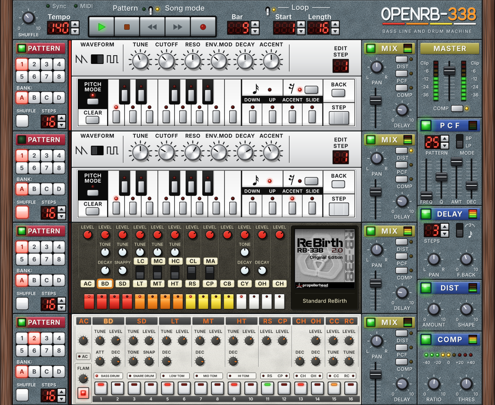

# UI spec: the ReBirth RB-338 2.01 panel

The layout and behavior of the original's song window ("the panel"), written for OpenRB-338's own UI
(milestone m-3: task-042 draws the art, task-044 builds the widgets, task-045 wires them to the
engine, task-047 adds the menu). It describes the original, not its art: OpenRB-338 draws its own
graphics at these positions. Written for task-041 (2026-10-27).

**Sources.**
- `Rebirth.exe` in IDA (`Rebirth.exe.i64`, headless copy, read-only). The panel is a tree of
  views with RTTI names (`CTransportView`, `CTB303View`, `CTR808View`, `CBitmapKnob`, ...). Each
  view has a layout method (vtable slot 22) that places its children with `sub_47E10F(x, y)`
  (move) or `sub_47E04C(x, y, w, h)` (frame), relative to the parent; a constructor that creates
  the children (class and bitmap); and a poll method (vtable slot 17) that reads each child's
  pending change and sends it to the engine. Matching the child offsets (`ecx = this + off`)
  across the three gives each control's position, class and parameter.
- The panel art: 64 JPEG resources (type 1053) in `Rebirth.exe`, registered by `CReBirthBitmaps`
  (0x4287A0) with their frame counts. Each section background is a JPEG of exactly the section's
  size, which makes them the measurement reference. They are Propellerhead artwork and are **not**
  committed; extract them with any PE resource reader if needed.
- Screenshots of the running app on the test machine (`docs/test_machine.md`), at the native
  size (no scaling): `ui_spec/panel.png` and the others in section 14.
- The manual (`rebirth_2.01_manual.pdf`, pages 16-87, 143-180, 221-226). Where the manual and the
  code disagree the code wins; the differences are listed in section 13.

**Marks.** [C] = read in the code (address given) or observed in the app; [G] = guessed or only
partly traced. Addresses `0x4xxxxx` are `Rebirth.exe`.

**Coordinates.** All positions are in pixels of the original panel, origin top left, x right,
y down. Tables give the control's rectangle relative to its section (`x y w h`) and, for a
scalable UI, the rectangle's top-left corner and size as fractions of the whole panel (`x/W`,
`y/H`, `w/W`, `h/H` with W = 624, H = 510). A control's rectangle is its hit area and its drawn
area (the views have no separate hit margins). The overlay `ui_spec/panel_controls.png` draws
every rectangle of this document over the screenshot (2x) as a check.

**Engine parameters.** "ctrl n" is the device controller n of `docs/song_load.md` (section 4 for
the chunk bytes, section 5 for the controller numbers, which are equal to the RBS chunk offsets);
"msg 35 id n" is the global set message of `docs/song_load.md` section 3. The device numbers are
the track numbers: 0 mixer, 1 and 2 TB-303, 3 TR-808, 4 TR-909, 5 delay, 6 distortion, 7 PCF,
8 compressor.

## 1. The window and the panel

**Size [C].** The panel is 624 x 510 px (`sub_42A8FE`). The song window's client area is limited
to the panel's width and to a height between 165 (transport plus one row) and 510
(`sub_42D77F`). The transport stays at the top; the rest (the "rack", 460 px high) scrolls
vertically when the window is lower than 510: the scroll bar is enabled when the visible rack
height is below 460, with a line step of 14 px and a page step of 115 px (`sub_42AF63`).

**The app's windows (task-283).** Song Information, Mod Information, About, Keyboard Shortcuts,
and the 303, 808 and 909 pattern editors are `egui::Window`s of the one app
viewport. Choosing the command of a window that is already open (a menu item
or a shortcut) brings it to the front, above any window that covers it, and leaves its place,
size and contents as they are (`App::raise_window`, `Context::move_to_top` at the end of the
frame; the editors do it through `Placing::front`). A window that is closed opens as before.
A raise does not move keyboard focus: a field being edited keeps it.
`crates/orb-ui/tests/raise_windows.rs` checks every pair.

**Sections [C]** (`sub_42A8FE`; the rack is placed at (16, 50), its children are listed here in
panel coordinates):

| Section | x | y | w | h | x/W | y/H | w/W | h/H |
|---|---|---|---|---|---|---|---|---|
| Wood, left | 0 | 0 | 16 | 510 | 0.0000 | 0.0000 | 0.0256 | 1.0000 |
| Wood, right | 608 | 0 | 16 | 510 | 0.9744 | 0.0000 | 0.0256 | 1.0000 |
| Transport | 16 | 0 | 592 | 50 | 0.0256 | 0.0000 | 0.9487 | 0.0980 |
| Pattern section, row 1 | 16 | 50 | 70 | 115 | 0.0256 | 0.0980 | 0.1122 | 0.2255 |
| Focus bar, row 1 | 86 | 50 | 4 | 115 | 0.1378 | 0.0980 | 0.0064 | 0.2255 |
| 303-1 | 90 | 50 | 366 | 115 | 0.1442 | 0.0980 | 0.5865 | 0.2255 |
| Mixer channel 1 | 456 | 50 | 70 | 115 | 0.7308 | 0.0980 | 0.1122 | 0.2255 |
| Pattern section, row 2 | 16 | 165 | 70 | 115 | 0.0256 | 0.3235 | 0.1122 | 0.2255 |
| Focus bar, row 2 | 86 | 165 | 4 | 115 | 0.1378 | 0.3235 | 0.0064 | 0.2255 |
| 303-2 | 90 | 165 | 366 | 115 | 0.1442 | 0.3235 | 0.5865 | 0.2255 |
| Mixer channel 2 | 456 | 165 | 70 | 115 | 0.7308 | 0.3235 | 0.1122 | 0.2255 |
| Pattern section, row 3 | 16 | 280 | 70 | 115 | 0.0256 | 0.5490 | 0.1122 | 0.2255 |
| Focus bar, row 3 | 86 | 280 | 4 | 115 | 0.1378 | 0.5490 | 0.0064 | 0.2255 |
| TR-808 | 90 | 280 | 366 | 115 | 0.1442 | 0.5490 | 0.5865 | 0.2255 |
| Mixer channel 3 | 456 | 280 | 70 | 115 | 0.7308 | 0.5490 | 0.1122 | 0.2255 |
| Pattern section, row 4 | 16 | 395 | 70 | 115 | 0.0256 | 0.7745 | 0.1122 | 0.2255 |
| Focus bar, row 4 | 86 | 395 | 4 | 115 | 0.1378 | 0.7745 | 0.0064 | 0.2255 |
| TR-909 | 90 | 395 | 366 | 115 | 0.1442 | 0.7745 | 0.5865 | 0.2255 |
| Mixer channel 4 | 456 | 395 | 70 | 115 | 0.7308 | 0.7745 | 0.1122 | 0.2255 |
| Master | 526 | 50 | 82 | 98 | 0.8429 | 0.0980 | 0.1314 | 0.1922 |
| PCF | 526 | 148 | 82 | 111 | 0.8429 | 0.2902 | 0.1314 | 0.2176 |
| Delay | 526 | 259 | 82 | 93 | 0.8429 | 0.5078 | 0.1314 | 0.1824 |
| Dist | 526 | 352 | 82 | 65 | 0.8429 | 0.6902 | 0.1314 | 0.1275 |
| Comp | 526 | 417 | 82 | 93 | 0.8429 | 0.8176 | 0.1314 | 0.1824 |

The layout gives the woods a frame of 16 x 395 (`sub_42A8FE`); their art (resource 12062) is
16 x 510 and fills the panel height in the screenshot. Draw them full height [C: screenshot].

**Focus [C].** One of the four rows has the focus (window byte `+140`, 1..4; 1 at creation,
`sub_42DA72`). It is shown by the row's focus bar (resource 12068, two frames: off, lit orange).
The focus moves by a click anywhere inside a row (`sub_42ADBB` tests the four row rectangles), a
click on a focus bar, the selection of a pattern in a row, and the Up/Down arrow keys
(section 10). Up from row 1 goes to row 4 and Down from row 4 to row 1 (`sub_42D1D3`, key codes
'T' and 'V'). The focus decides where the computer keyboard's synth and tap keys go and which
pattern the Edit menu's pattern items act on.

**The theme is always dark (task-127).** The colors of orb-ui's windows (`INK`, `INK_DIM`, the
panel fill) assume a dark background, so the UI ignores the system theme: `main.rs` calls
`set_theme(ThemePreference::Dark)` at start and `App::show` sets it again on every frame when it
differs. The preference is Dark and the window theme is set to Dark, so a change of the system
theme at run time cannot alter the visuals (winit 0.30 reports `WM_SETTINGCHANGE` as a theme
event only for a window without a preferred theme). The menu bar, the menus, the file browser and
every window are egui-drawn and follow; nothing is a native dialog. egui's `sync_window_theme`
(on by default) then sends `ViewportCommand::SetTheme(Dark)`, which winit applies to the native
title bar (on Windows, its dark mode). `crates/orb-ui/tests/theme.rs` runs frames with a light
system theme and checks dark visuals, the text contrast and that only Dark is sent to the window.
The Windows title bar itself is unverified (no Windows machine for the UI).

**Pattern mode and song mode [C].** The transport's Pattern/Song switch sets global byte 0
(msg 35 id 0). The UI does not change layout between the modes. In pattern mode the bar and loop
displays are disabled (dark; `sub_42A058` calls `sub_47DCFB(0)` on the three displays) and the
loop does nothing; in song mode they show the song position and the loop, and every automated
control moves with the song (the panel shows the engine's live values; `docs/song_load.md`
section 6 for which values the engine takes from the tracks). Turning song mode off also turns
record off (`sub_42A058`).

## 2. Widget classes

The panel uses a small set of widget classes. Each control's class is in its table's "Kind"
column. Values passed to the engine are 0..127 unless stated.

**Knob** (`CBitmapKnob`, ctor 0x4A60D0, mouse-down 0x4A6437, drag 0x4A64E5) [C].
- The knob keeps a position p in 0..1000. Mouse down anywhere on the knob grabs it (no jump).
  Dragging changes p by `1000 * (y_down - y) / span`, clamped to 0..1000: **up increases**, down
  decreases, horizontal motion is ignored. `span` is the ctor's fourth argument, in pixels for
  the full range: TB-303 62, TR-808 36 (the instrument selector 40), TR-909 41, all other knobs
  (transport shuffle, mixers, delay, dist, comp) 64.
- **Fine adjust:** with Shift held at mouse down (`GetKeyState(VK_SHIFT)`, the ctor's fifth
  argument 35 selects Shift, `sub_4A659C`) the span is 5 times larger.
- Value sent = `(127 * p + 500) / 1000` (integer, `sub_467F1A`), sent only when it changes
  (`sub_4A631A`). A value from the engine sets `p = (1000 * v + 63) / 127` (`sub_4A637D`).
- Drawn frame = `((n - 1) * p + 500) / 1000` of an n-frame film strip (`sub_4A6204`; n = 32 for
  the 18 x 19 knobs, 54 for the 303's 30 x 30, 36 for the 808's 13 x 13, 41 for the 909's
  12 x 12, 12 for the 808 instrument selector).
- No detents: every knob is continuous over 0..127 (the 808 selector is quantized by its user,
  section 6). The original's knob has no double-click, wheel or keyboard behavior; orb adds a
  double-click reset of its own (the **orb** item below).
- Measured in the app (2026-10-27): CUTOFF dragged to 0, then 31 px up, saved as 64
  (`1000*31/62 = 500`, value 64); RESO with Shift, 31 px up from 0, saved as 13 [C].
- **orb** (an extension; the original has no reset gesture): a double click sets a knob to its
  value in a new empty song (File > New), whatever song is open (`Link::knob_default`): a pan
  knob to the center (64), a mixer delay send to 0. The value is sent and recorded as a drag's.
  The faders and the demo panel have no reset.

**Fader** (`CBitmapFaderView`, ctor 0x469240, mouse-down 0x469708, drag 0x46965F) [C].
- Handle 15 x 11 (resource 12031) on a 15 x 54 track (12032); position p in 0..999.
  Travel = 54 - 11 = 43 px; scale `k = 10000 / 43`.
- Mouse down on the handle grabs it; mouse down elsewhere on the track jumps the handle's center
  to the pointer: `p = (bottom - y - 11/2 + 2) * k / 10` (integer), clamped.
- Drag: `p = p_down + k * (y_down - y) / 10`, clamped to 0..999; up increases. No fine mode.
- Value sent = `(127 * p + 500) / 1000` (`sub_469614`).

**Toggle button** (`CToggleBitmapButton`, mouse-down 0x425092) [C]: each mouse-down flips the
state (two frames: off, on). Used for on/off switches, the Pattern/Song switch, Record and Loop.

**Trigger button** (`CTriggerBitmapButton`, mouse-down 0x425187, mouse-up 0x4251EA) [C]: shows its
pressed frame while held; the action runs once at mouse-down (the polls act on the "pressed"
event only, e.g. `sub_43ED76`). Used for Play, Stop, the 303's keys and step buttons.

**Repeat button** (`CRepeatBitmapButton`, ctor 0x4A6A70, timer 0x4A6CB6, count 0x4A6C30) [C]:
one step at mouse-down [G: the press handler at vtable +100 was not read; one click gave one step
in the app], then, while held, the number of extra steps after t ms is
`(t >= 400 ? min(t - 400, 2399) / 100 : 0) + (t >= 2400 ? (t - 2400) / 20 : 0)` (integer
divisions, `sub_4A6C30`): one per 100 ms from 400 ms, and from 2400 ms one more per 20 ms. The
steps are counted and taken by the poll (`sub_4A6DD9`). Used for the value-display arrows.

**Wind button** (`CWindButton`, `sub_429132`) [C for the class, G for the timing]: a repeat button
of the transport (rewind, fast forward, bar up/down); the counts are taken by the transport poll
like the repeat buttons'.

**Two-position switch** (`CBitmapSwitch`, ctor 0x4247D3, hit 0x424805) [C]: the value is set by
where the click lands, not toggled: for a horizontal switch (ctor argument 13) the left half
gives 0 and the right half 1; for a vertical one (argument 12) the top half gives 0 and the
bottom half 1. Dragging across the middle changes it (mouse-move 0x4245B2).
- **A value out of 0..1** (task-156) [C for the code, G for what shows]. The switch draws the
  controller byte itself as the frame of its strip, with no clamp, rule, or `!= 0`: every poll
  passes the device byte to `sub_424548` (0x424548, `mov [eax+22h], cx`) after a `movzx` (the
  303's waveform `+0x504` at 0x43F3B6 in `sub_43ED76`, the delay's mode `+0x1B6` at 0x4081DA in
  `sub_407F7A`, the PCF's mode `+0x23A` at 0x41BC25 in `sub_41B914`, the 808's five selectors
  `+0x65B`, `+0x65E`, `+0x661`, `+0x663`, `+0x665` at 0x4426F5..0x4427ED in `sub_441E79`); the
  update 0x4244E8 copies `+0x22` to `+0x26` and redraws; the draw 0x4243C2 hands `+0x26` to
  `sub_46F84D`, whose `CBitmapSequence` frame rectangle (vtable 0x4BD664 slot 1, 0x46DC43) is
  `x = frame * (fw + 1)` with `fw = (w + 1) / n - 1`, unbounded; the blit is `sub_488B1E`
  (SRCCOPY). The byte comes unchanged from the song and from the DLL's echo (`sub_43EB64`,
  msg 40: `+0x504 = v` at 0x43EC2F). So a value above 1 shows pixels from outside the strip
  (OB-23 in docs/original_bugs.md). Two inputs do normalize: the Pattern/Song switch draws 1 or 0
  from the mode flag (0x42A6B3..0x42A6D9), and a MIDI controller for the 303's waveform (CC 23
  and 30, `sub_4405B5`) stores `v >= 64` (0x4405F9). No switch of the panel has more than two
  positions; the pattern grid (`CABCPositionView`, `sub_41AB67`) computes its frame itself.
- **orb** cannot draw the original's out-of-strip pixels, so it draws the position the DLL plays
  (`behavior::switch_position`): the PCF's mode is low-pass only at 1 (`cmp dl, 1` at
  0x10016921), and the 303's waveform, the delay's mode and the 808's selectors take any value
  but 0 as their second position. The stored value stays the song's, so a save writes it back,
  as the original's does: its data block handlers store the byte unchecked into the pattern-mode
  copy (and live, in pattern mode), and the save writes the copy (`docs/song_load.md` section 8
  for the store addresses, 4.11 for the save) [C: the code; not observed in the app]. A click flips the position shown. A part name the art lacks draws nothing
  and is reported once on stderr; it never closes the app.

**Position grid** (`CABCPositionView`, mouse-down 0x42445E) [C]: a picture with n+1 frames
(frame 0 = nothing lit, frame k = button k lit) whose click position selects a button; the
pattern grid is 4 x 2 (`sub_41A5B0`: `col = clamp(4 * dx / 68, 0, 3)`,
`row = clamp(2 * dy / 40, 0, 1)`, button = `4 * row + col + 1`), the bank row 4 x 1 [G: same
class, the bank's hit function was not read].

**LED** (`CLEDView`, `sub_424612`): two frames (off, lit), display only [C].

**Seven-segment display** (`CLEDNumberView`, `sub_4252DD`) [C]: n digits of 9 x 16 px (resource
12015, 11 frames: frame 0 blank, frames 1..10 the digits 0..9, section 21), right-aligned, leading zeros blank (screenshots:
"16", " 3", "140"). A disabled display shows all segments dark.

**Meters** (`CPeakMeterView` `sub_4248B6`, `CHorisontalMeterView` `sub_424ACC`): display only.
The peak meters (the mixer channels', the master's two, the effects' input meters) take the
engine's meter byte through the table `sub_424220` (`L[0] = 0`,
`L[i] = __ftol(log(i) / log(127.0) * 127.0)`, 0x424258..0x424294) and store it with
`sub_424A7E` (view `+0x22`); the update `sub_424A96` copies it to `+0x20` and redraws when it
changed; the draw `sub_4249A8` shows frame `trunc(L * (F - 1) / 127)` (`sub_467F31`:
`fild; fimul; fidiv; __ftol`, the exact quotient truncated), F the word at `+4` of the view's
bitmap object (`+0x1C`, read by 0x46DBC3) [C, task-253]. The polls pass the engine's byte
straight in (master `sub_412DC7`: `+0xF4`/`+0xF5` at 0x412E73..0x412EB8; mixer `sub_413F47`
0x414407, delay `sub_407F7A` 0x4081FB, dist `sub_408AF5` 0x408C16, PCF `sub_41B914` 0x41BC60,
comp input `sub_404396` 0x4044DD).

F is the frame count [C, task-253]: the bitmap objects are built in the resource list
`sub_4287A0` by `sub_46DB82` (`CBitmapSequence` `sub_46DBFD`, `CFilmStrip` `sub_46DCB6`), which
stores its second argument, the frame count, at `+4` (0x46DB90) and the resource id at `+8`.
The meters' strips: 12067 (0x2F23, the effects' input meters) at `+0x124` with 4 frames
(0x428A09); 12558 (0x310E, the mixer channels') at `+0x13C` with 4 (0x428A3B); 12557 (0x310D,
the master's) at `+0x148`, a `CFilmStrip` of 11 frames, cells 15 x 56 (0x428A54..0x428A5E). The
views take them from there: master `sub_412AF0` `[+0x30] + 0x148` (0x412B84..0x412BC1), mixer
`sub_413B55` `[+0x2C] + 0x13C` (0x413CAE), and the delay, dist, PCF and comp sections
`[+0x30] + 0x124` (0x4077DD, 0x408642, 0x41B4D9, 0x403CBB).

So `L(b) = trunc(ln(b) / ln(127) * 127)`, `L(1) = 0`, `L(2) = 18`, `L(127) = 127` (only 1 and
127 are exact; every other value is at least 0.003 from an integer, so a last-bit difference of
`log` changes nothing), and the frame by meter byte b:

| Strip | Frames | Frame k from byte (k = 1, 2, ...) |
|---|---|---|
| 12557 master | 11 | 2, 3, 5, 7, 12, 19, 30, 49, 81, 127 |
| 12558 mixer channel, 12067 effect input | 4 (off, green, amber, red) | 6, 26, 127 |

The four-frame meters show red only at full scale (byte 127). The table has 128 entries
(`byte_4DABA8`, 0x424250: `i < 0x80`); the lookup masks the byte with 0xFF (0x4242A6), so a byte
above 127 would read past it, but the engine writes none. orb: `model::peak_meter_level`,
`model::peak_meter_frame` (the classic skin, section 21, and the main panel's meters by
decision task-254, section 16).

**Gain-reduction meter** (task-252) [C]: the comp section's nine LEDs (bitmap 12570) are a
`CHorisontalMeterView` at section `+0xD4`, built by the section ctor `sub_403BE0` with
`sub_424ACC(bitmap, 9 LEDs, 10 high, 7 wide)` (0x403C90..0x403CB0: fields `+0x24`, `+0x26`,
`+0x28`) and placed by the layout `sub_4040CE` at (8, 25, 63, 10). The section's poll
`sub_404396` reads the compressor's gain byte (section `+0x127`, its live byte 3,
`trunc(min(G*18, 127))` of the engine, 0x1000EB48; `+0x128`, live byte 4, is the input meter)
and passes it through the table `sub_4044FD`, then stores it with `sub_424D45` (view `+0x20`)
(0x4044AD..0x4044CE):

    t(0) = 0
    t(b) = __ftol(((log(b / 16.0f) - log(0.0625)) / (log(7.9375) - log(0.0625))) * 127.0)

(0x4046AC..0x404708; `flt_4BA2F0` = 16.0f, `dbl_4BA2F8` = 127.0, the two other constants
pushed as doubles 0x3FB00000:0 = 0.0625 and 0x401FC000:0 = 7.9375; `fsubr` and `fdivr` give
the order shown). The table is filled once for b = 1..N, where N is a copy-protection
expression: 127 when `\\.\SICE` opens, else `(dword_4DA0AC >> 16) - ([dword_4DFB24 + 0x13C](..,
-6) & 0x7F)`, whose intended value is also 127 (`docs/standard_midi_mapping.md` section 3, the
same expression + 1 = 128). The view's update `sub_424D5D` (vtable 0x4BBB44 slot 18) computes
`n = sub_467F31(t, 9, 127)` = `__ftol(t * 9 / 127)` (`fild`, `fimul`, `fidiv`; for these
integers the integer quotient), stores it at `+0x22` and redraws when it changed; the draw
`sub_424C20` (slot 15) blits columns `0 .. 7n` from the strip's lit row (source y 10) and the
rest from the unlit row: **a bar of n LEDs from the left**.

| Gain byte | 0..1 | 2..3 | 4..5 | 6..8 | 9..15 | 16..25 | 26..43 | 44..74 | 75..126 | 127 |
|---|---|---|---|---|---|---|---|---|---|---|
| Lit LEDs | 0 | 1 | 2 | 3 | 4 | 5 | 6 | 7 | 8 | 9 |

So the idle compressor (unity gain, byte 18) lights LEDs 1 to 5, up to the "0" mark, and all
nine need the byte at its top, as the screenshots of task-187 show (section 21). No table value
but those of 1 (0.0) and 127 (127.0) lies near an integer, so a log that differs in its last
bit gives the same table. A byte of 0 lights none: the engine clears byte 3 when the
compressor got no call since the last mixer update (0x1000EFB0), so the master's COMP switch
off (and the compressor off) shows no LED, also while playing. OpenRB-338: `model::gr_lit`,
shared by the modern skin (section 16) and the classic skin (section 21).

## 3. Transport

Section (16, 0, 592, 50). Layout `sub_4298B9`, ctor `sub_4291E9`, poll `sub_42A058` [C].

| Control | x | y | w | h | x/W | y/H | w/W | h/H | Kind | Drives |
|---|---|---|---|---|---|---|---|---|---|---|
| Shuffle knob | 11 | 13 | 18 | 19 | 0.0433 | 0.0255 | 0.0288 | 0.0373 | knob | msg 35 id 20 (GLOB shuffle 0..127) |
| Sync LED | 39 | 2 | 11 | 11 | 0.0881 | 0.0039 | 0.0176 | 0.0216 | led | MIDI sync (task-184) |
| MIDI LED | 74 | 2 | 11 | 11 | 0.1442 | 0.0039 | 0.0176 | 0.0216 | led | MIDI input (task-188) |
| Tempo display (3 digits) | 44 | 27 | 27 | 16 | 0.0962 | 0.0529 | 0.0433 | 0.0314 | display | tempo / 1000 |
| Tempo up | 73 | 26 | 11 | 9 | 0.1426 | 0.0510 | 0.0176 | 0.0176 | repeat | msg 35 id 4, +1000 |
| Tempo down | 73 | 35 | 11 | 9 | 0.1426 | 0.0686 | 0.0176 | 0.0176 | repeat | msg 35 id 4, -1000 |
| Pattern / Song mode switch | 161 | 2 | 26 | 19 | 0.2837 | 0.0039 | 0.0417 | 0.0373 | toggle | msg 35 id 0 |
| Play | 96 | 21 | 32 | 25 | 0.1795 | 0.0412 | 0.0513 | 0.0490 | trigger | msg 35 id 1 = 1 |
| Stop | 128 | 21 | 32 | 25 | 0.2308 | 0.0412 | 0.0513 | 0.0490 | trigger | msg 35 id 1 = 0, or id 8 |
| Rewind | 160 | 21 | 32 | 25 | 0.2821 | 0.0412 | 0.0513 | 0.0490 | wind | msg 35 id 8, -10 bars |
| Fast forward | 192 | 21 | 32 | 25 | 0.3333 | 0.0412 | 0.0513 | 0.0490 | wind | msg 35 id 8, +10 bars |
| Record | 224 | 21 | 32 | 25 | 0.3846 | 0.0412 | 0.0513 | 0.0490 | toggle | msg 35 id 2 |
| Bar display | 271 | 27 | 27 | 16 | 0.4599 | 0.0529 | 0.0433 | 0.0314 | display | position / 768 + 1 |
| Bar up | 300 | 26 | 11 | 9 | 0.5064 | 0.0510 | 0.0176 | 0.0176 | wind | msg 35 id 8, +1 bar |
| Bar down | 300 | 35 | 11 | 9 | 0.5064 | 0.0686 | 0.0176 | 0.0176 | wind | msg 35 id 8, -1 bar |
| Loop on/off switch | 315 | 2 | 17 | 21 | 0.5304 | 0.0039 | 0.0272 | 0.0412 | toggle | msg 35 id 3 |
| Loop start display | 329 | 27 | 27 | 16 | 0.5529 | 0.0529 | 0.0433 | 0.0314 | display | start / 768 + 1 |
| Loop start up | 358 | 26 | 11 | 9 | 0.5994 | 0.0510 | 0.0176 | 0.0176 | repeat | msg 35 ids 12, 16 |
| Loop start down | 358 | 35 | 11 | 9 | 0.5994 | 0.0686 | 0.0176 | 0.0176 | repeat | msg 35 ids 12, 16 |
| Loop length display | 372 | 27 | 27 | 16 | 0.6218 | 0.0529 | 0.0433 | 0.0314 | display | (end - start) / 768 |
| Loop length up | 401 | 26 | 11 | 9 | 0.6683 | 0.0510 | 0.0176 | 0.0176 | repeat | msg 35 id 16 |
| Loop length down | 401 | 35 | 11 | 9 | 0.6683 | 0.0686 | 0.0176 | 0.0176 | repeat | msg 35 id 16 |
| Logo (click: mod startup sound) | 458 | 1 | 134 | 48 | 0.7596 | 0.0020 | 0.2147 | 0.0941 | area | top-level msg 58 |

Behavior (all [C], `sub_42A058` and its callees, ticks: 768 per bar):
- **Tempo.** Each arrow step adds or subtracts 1000 (1 BPM), clamped to 20000..500000
  (20..500 BPM, `sub_467EBB`), ignored while synced to MIDI clock (`sub_4094D4`). The display
  shows `tempo / (((dword_4D90BC & 0xFFFFF0) >> 5) - 2)`, the copy-protected divisor whose
  intended value is 1000: the integer BPM [G for the divisor value; the screenshot shows 140 for
  140000 and 141 after one step up].
- **Shuffle.** The knob is the global shuffle amount (one value for all sections); each pattern's
  Shuffle button decides whether the pattern uses it (section 4). The manual's "two o'clock gives
  a triplet feel" is the knob near 100.
- **Play** sends play (msg 35 `{1, 1}`). In song mode it continues from the song position.
- **Stop** (`sub_429FE6`): turns record off; if playing, stops (`{1, 0}`); if stopped, locates
  (`{8, t}`) to the loop start, or to 0 when the position is at or before the loop start
  (`start >= position`). So stop, stop, stop always reaches bar 1.
- **Rewind / fast forward** move the position by -7680 / +7680 ticks (10 bars) per step, from the
  start of the current bar (`sub_429DF2`: `t = step + 768 * (pos / 768)`), clamped to
  0..766464 (`sub_429DBF`; 766464 is the start of bar 999). Rewind and fast forward also turn
  record off.
- **Bar up / down** move by +768 / -768 ticks the same way; bar down turns record off, bar up
  does not (step recording, manual page 77).
- **Loop start up / down** (`sub_429E5B`): new start = `768 * (clamp(start + d, 0, 766464) / 768)`;
  the length is kept: end = `clamp(old_length + start, start + 768, 766464)`; sends `{12, start}`
  then `{16, end}`.
- **Loop length up / down** (`sub_429F18`): length = `768 * (clamp(end - start + d, 768,
  767232 - start) / 768)`, end = start + length, sends `{16, end}`. Length is 1 bar at least.
- **Displays.** In song mode: bar = `position / 768 + 1` (when the transport's flag `+76` is set,
  a held position `+72` is shown and moved instead of locating; what sets the flag was not traced
  [G]), loop start = `start / 768 + 1`, loop length =
  `(end - start) / 768`. In pattern mode the three are disabled.
- **Record** toggles global byte 2 (msg 35 id 2); the recording itself is the engine's
  (`docs/initial_investigation.md` section 5.3). It has no function in pattern mode: its press
  is tested inside the song-mode block of `sub_42A058` (0x42A1C7), with Rewind, Fast forward and
  the bar and loop arrows. The mode switch sends `{0, m}` and, for pattern mode, `{2, 0}` after
  it whatever record was (0x42A49B, 0x42A4CC). The song end turns record off in the engine
  (`{2, 0}` to the host), and the LED follows.
- **LEDs:** Play lit while playing (`+45`), Record lit while recording (`+46`), the mode switch
  shows song mode (`+44`), the Loop switch the loop flag (`+47`).
- **Logo click** (`sub_42A799`) sends top-level msg 58 with the current mod: the mod's startup
  sound plays. It does not test the preference "Play Mod Startup Sound" nor the mod's user count
  (0x42A7D3..0x42A7F1: `sub_40CB32`, the document's mod id `sub_4166D0`, `sub_40ABB5`), so a
  click plays the sound with the preference off [C, task-074]. OpenRB-338: `layout::on_logo` and
  `Link::startup_sound` (`App::focus_click`). The code's hit rectangle is `sub_479B06(458, 1, 608, 49)` = left 458, top 1,
  right 608, bottom 49, all four in transport coordinates; its right edge lies 16 px beyond the
  transport's own right edge (592 in transport coordinates), so the effective area is clipped to
  x 458..591, y 1..48 in transport coordinates, i.e. panel x 474..607 (the table row: x 458,
  w 134, h 48).
- The Sync and MIDI LEDs (three frames: off, green, red) belong to MIDI, in scope since m-7
  (`docs/midi.md`); until task-184 (sync) and task-188 (the MIDI LED) light them, draw them dark.


## 4. Pattern sections (one per row)

Section (16, 50 + 115 r, 70, 115), r = 0..3 for 303-1, 303-2, TR-808, TR-909.
Layout `sub_41A9A0`, poll `sub_41AB67` [C]. The table gives row 1; add 115 px (0.2255 H) per row.

| Control | x | y | w | h | x/W | y/H | w/W | h/H | Kind | Drives |
|---|---|---|---|---|---|---|---|---|---|---|
| On/off LED button | 5 | 4 | 13 | 14 | 0.0337 | 0.1059 | 0.0208 | 0.0275 | toggle | device ctrl 0 (enabled) |
| Pattern buttons 1-8 (4x2 grid) | 1 | 19 | 68 | 40 | 0.0272 | 0.1353 | 0.1090 | 0.0784 | grid | device ctrl 1 (pattern 0..31) |
| Bank buttons A-D (4x1) | 1 | 58 | 68 | 30 | 0.0272 | 0.2118 | 0.1090 | 0.0588 | grid | UI only (shown bank) |
| Shuffle button | 3 | 93 | 18 | 20 | 0.0304 | 0.2804 | 0.0288 | 0.0392 | toggle | current pattern's shuffle flag |
| Steps display (2 digits) | 36 | 95 | 19 | 16 | 0.0833 | 0.2843 | 0.0304 | 0.0314 | display | current pattern's length |
| Steps up | 56 | 94 | 11 | 9 | 0.1154 | 0.2824 | 0.0176 | 0.0176 | repeat | length + 1 |
| Steps down | 56 | 103 | 11 | 9 | 0.1154 | 0.3000 | 0.0176 | 0.0176 | repeat | length - 1 |

The On/off LED's x is a copy-protection expression in the layout. The table's 5 came from a
template match against the background art (mean difference 5 of 255); the original draws it at
**4**: in a lossless screenshot of the original with the ReBirthday mod (task-187, review round
4) the strip 12556 matches pixel for pixel at x 4 of the section, and the built-in screenshot
matches better at 4 too [C: section 21].

Behavior [C]:
- **Bank buttons** only change the shown bank (`vt+132`). No pattern changes until a pattern
  button is pressed (manual page 147).
- **Pattern buttons** select pattern `(button - 1) + 8 * shown_bank` (`vt+100`, the device's
  controller 1); the click also gives the row the focus (the window's click handler `sub_42ADBB`).
  The grid lights button `(pattern & 7) + 1` only when
  `pattern / 8` is the shown bank; otherwise no button is lit. The bank row lights the shown bank.
- **Timing.** The selection is sent at once; the engine latches a new pattern (and the on/off
  state) only at the next absolute bar line (`(tick / 48) & 15 == 0`, `docs/initial_investigation.md`
  section 5), not at the end of the playing pattern as the manual says (page 21). In song mode
  with record on, the engine writes the change into the track quantized to the bar
  (`docs/initial_investigation.md` section 6.4, slot 7).
- **On/off** switches the section off: the engine plays nothing for it from the next bar line
  (like an empty pattern).
- **Shuffle** toggles the current pattern's shuffle flag (pattern data, `vt+112`).
- **Steps** change the current pattern's length, clamped to 1..16 (`vt+108`); the change is
  immediate (manual page 36). The display shows the length.
- Both are sent as the pattern-header message `{pattern, field, v}`, field 0 shuffle, 1 length
  (msg 41 sub 42 / 59 / 76, senders `sub_43ECCA`, `sub_441CC9`, `sub_445C88`;
  `docs/song_load.md` section 4.10, which lists every device message of the panel).
- **orb** (orb's own commands; what the original's Edit menu items do was not read): Edit >
  Cut, Copy, Paste, Duplicate and Clear Pattern act on the focused pattern editor's pattern,
  else on the selected pattern of the focused row (section 18, task-290), and Edit > Undo takes
  back the last of them.

## 5. TB-303 (two)

Section (90, 50, 366, 115) for #1 and (90, 165, 366, 115) for #2 (add 0.2255 H to the y
fractions below). Layout `sub_43FB06`, ctor `sub_43D601`, poll `sub_43ED76` [C].

| Control | x | y | w | h | x/W | y/H | w/W | h/H | Kind | Drives |
|---|---|---|---|---|---|---|---|---|---|---|
| Waveform switch | 24 | 10 | 16 | 12 | 0.1827 | 0.1176 | 0.0256 | 0.0235 | hswitch | ctrl 8 (0 saw left, 1 square right) |
| Tune knob | 72 | 12 | 30 | 30 | 0.2596 | 0.1216 | 0.0481 | 0.0588 | knob | ctrl 2 |
| Cutoff knob | 105 | 12 | 30 | 30 | 0.3125 | 0.1216 | 0.0481 | 0.0588 | knob | ctrl 3 |
| Reso knob | 138 | 12 | 30 | 30 | 0.3654 | 0.1216 | 0.0481 | 0.0588 | knob | ctrl 4 |
| Env.mod knob | 171 | 12 | 30 | 30 | 0.4183 | 0.1216 | 0.0481 | 0.0588 | knob | ctrl 5 |
| Decay knob | 204 | 12 | 30 | 30 | 0.4712 | 0.1216 | 0.0481 | 0.0588 | knob | ctrl 6 |
| Accent knob | 237 | 12 | 30 | 30 | 0.5240 | 0.1216 | 0.0481 | 0.0588 | knob | ctrl 7 |
| Edit step display (2 digits) | 330 | 25 | 19 | 16 | 0.6731 | 0.1471 | 0.0304 | 0.0314 | display | edit step + 1 |
| Pitch mode button | 20 | 74 | 15 | 8 | 0.1763 | 0.2431 | 0.0240 | 0.0157 | trigger | UI mode |
| Pitch mode LED | 23 | 66 | 8 | 8 | 0.1811 | 0.2275 | 0.0128 | 0.0157 | led | pitch mode |
| Clear button | 18 | 96 | 17 | 10 | 0.1731 | 0.2863 | 0.0272 | 0.0196 | trigger | clears the pattern |
| Key C | 52 | 89 | 9 | 16 | 0.2276 | 0.2725 | 0.0144 | 0.0314 | trigger | step note 0 |
| LED C | 52 | 81 | 8 | 8 | 0.2276 | 0.2569 | 0.0128 | 0.0157 | led | |
| Key C# | 63 | 63 | 8 | 15 | 0.2452 | 0.2216 | 0.0128 | 0.0294 | trigger | step note 1 |
| LED C# | 62 | 55 | 8 | 8 | 0.2436 | 0.2059 | 0.0128 | 0.0157 | led | |
| Key D | 73 | 89 | 9 | 16 | 0.2612 | 0.2725 | 0.0144 | 0.0314 | trigger | step note 2 |
| LED D | 73 | 81 | 8 | 8 | 0.2612 | 0.2569 | 0.0128 | 0.0157 | led | |
| Key D# | 84 | 63 | 8 | 15 | 0.2788 | 0.2216 | 0.0128 | 0.0294 | trigger | step note 3 |
| LED D# | 83 | 55 | 8 | 8 | 0.2772 | 0.2059 | 0.0128 | 0.0157 | led | |
| Key E | 94 | 89 | 9 | 16 | 0.2949 | 0.2725 | 0.0144 | 0.0314 | trigger | step note 4 |
| LED E | 94 | 81 | 8 | 8 | 0.2949 | 0.2569 | 0.0128 | 0.0157 | led | |
| Key F | 115 | 89 | 9 | 16 | 0.3285 | 0.2725 | 0.0144 | 0.0314 | trigger | step note 5 |
| LED F | 115 | 81 | 8 | 8 | 0.3285 | 0.2569 | 0.0128 | 0.0157 | led | |
| Key F# | 126 | 63 | 8 | 15 | 0.3462 | 0.2216 | 0.0128 | 0.0294 | trigger | step note 6 |
| LED F# | 125 | 55 | 8 | 8 | 0.3446 | 0.2059 | 0.0128 | 0.0157 | led | |
| Key G | 136 | 89 | 9 | 16 | 0.3622 | 0.2725 | 0.0144 | 0.0314 | trigger | step note 7 |
| LED G | 136 | 81 | 8 | 8 | 0.3622 | 0.2569 | 0.0128 | 0.0157 | led | |
| Key G# | 147 | 63 | 8 | 15 | 0.3798 | 0.2216 | 0.0128 | 0.0294 | trigger | step note 8 |
| LED G# | 146 | 55 | 8 | 8 | 0.3782 | 0.2059 | 0.0128 | 0.0157 | led | |
| Key A | 157 | 89 | 9 | 16 | 0.3958 | 0.2725 | 0.0144 | 0.0314 | trigger | step note 9 |
| LED A | 157 | 81 | 8 | 8 | 0.3958 | 0.2569 | 0.0128 | 0.0157 | led | |
| Key A# | 168 | 63 | 8 | 15 | 0.4135 | 0.2216 | 0.0128 | 0.0294 | trigger | step note 10 |
| LED A# | 167 | 55 | 8 | 8 | 0.4119 | 0.2059 | 0.0128 | 0.0157 | led | |
| Key B | 178 | 89 | 9 | 16 | 0.4295 | 0.2725 | 0.0144 | 0.0314 | trigger | step note 11 |
| LED B | 178 | 81 | 8 | 8 | 0.4295 | 0.2569 | 0.0128 | 0.0157 | led | |
| Key C' | 199 | 89 | 9 | 16 | 0.4631 | 0.2725 | 0.0144 | 0.0314 | trigger | step note 12 |
| LED C' | 199 | 81 | 8 | 8 | 0.4631 | 0.2569 | 0.0128 | 0.0157 | led | |
| Down button | 224 | 89 | 9 | 16 | 0.5032 | 0.2725 | 0.0144 | 0.0314 | trigger | step "down" |
| Down LED | 224 | 81 | 8 | 8 | 0.5032 | 0.2569 | 0.0128 | 0.0157 | led | |
| Up button | 249 | 89 | 9 | 16 | 0.5433 | 0.2725 | 0.0144 | 0.0314 | trigger | step "up" |
| Up LED | 249 | 81 | 8 | 8 | 0.5433 | 0.2569 | 0.0128 | 0.0157 | led | |
| Accent button | 274 | 89 | 9 | 16 | 0.5833 | 0.2725 | 0.0144 | 0.0314 | trigger | step "accent" |
| Accent LED | 274 | 81 | 8 | 8 | 0.5833 | 0.2569 | 0.0128 | 0.0157 | led | |
| Slide button | 299 | 89 | 9 | 16 | 0.6234 | 0.2725 | 0.0144 | 0.0314 | trigger | step "slide" |
| Slide LED | 299 | 81 | 8 | 8 | 0.6234 | 0.2569 | 0.0128 | 0.0157 | led | |
| Note LED | 246 | 59 | 8 | 8 | 0.5385 | 0.2137 | 0.0128 | 0.0157 | led | step plays |
| Rest LED | 284 | 59 | 8 | 8 | 0.5994 | 0.2137 | 0.0128 | 0.0157 | led | step rests |
| Note/Pause button | 294 | 58 | 17 | 10 | 0.6154 | 0.2118 | 0.0272 | 0.0196 | trigger | step "rest" |
| Back button | 328 | 62 | 17 | 10 | 0.6699 | 0.2196 | 0.0272 | 0.0196 | trigger | edit step - 1 |
| Step button | 325 | 90 | 25 | 17 | 0.6651 | 0.2745 | 0.0401 | 0.0333 | trigger | edit step + 1 |

One of the slide button's coordinates (299) is a copy-protection expression; 299 follows from the
LED at (299, 81) and the art [C].

**Sound controls [C].** The six knobs and the waveform switch send device data msg 41 sub 40
`{ctrl, value}` (`sub_43EC83`) and are the device's controllers 2..8.

**The step editor [C]** (state: the pattern being edited = the device's current pattern `+1277`;
the edit step `+56`, 0..15; pitch mode `+52`; the playing step `+1285`, from the engine).
Every step change is sent at once as msg 41 sub 45 `{pattern, step, field, value}`
(`sub_43ED1D`), field 0 note, 1 slide, 2 accent, 3 up, 4 down, 5 rest (the layout of
`docs/song_load.md` section 4.6). Edits are heard the next time the step plays.
- **Edit step.** Step and Back move the edit step by +1 / -1 modulo 16
  (`sub_43F543`: `((step + d) & 0xFF) % 16`). The wrap ignores the pattern length: with a
  length of 8, Back from step 1 goes to 16 (observed; the manual says "the last step in the
  pattern", page 154). The display shows edit step + 1; it does not follow playback.
- **Keys.** A key sets the edit step's note to the key's index (0 = low C .. 12 = high C,
  `sub_43F590`). In pitch mode the edit step then advances by one. Outside pitch mode it never
  advances by itself.
- **Pitch mode.** The button toggles pitch mode; switching it **on** first sets the edit step to
  step 1 (`sub_43F57A(0)` in `sub_43ED76`). So off-on returns to step 1 (manual page 40).
  Observed: switching on reset the display to 1, a key press then advanced to 2.
- **Down, Up, Accent, Slide, Note/Pause** each flip their field of the edit step
  (`v = !v`). Up and Down together are allowed (they cancel, manual page 45). Note/Pause flips
  "rest".
- **Clear** (`sub_43F5F5` -> `sub_43CB97`) empties the current pattern: every step note 0 (low C),
  rest on, accent, slide, up and down off (manual page 153). The length and the shuffle flag are
  not changed [G]. The cleared pattern goes to the engine whole: msg 41 sub 44 `{pattern,
  98 bytes}` (`sub_43F617`, called by `sub_43F5F5`).
- **LEDs.** The note LEDs light the edit step's note; in pitch mode the lit note is shown only
  while a counter `+54` is positive, so it flashes after a key press [G: the writer of `+54` was
  not traced]. Down, Up, Accent and Slide LEDs show their fields of the edit step; the Note LED
  is lit when "rest" is 0, the Rest LED when it is 1; the Pitch mode LED shows pitch mode.

## 6. TR-808

Section (90, 280, 366, 115). Layout `sub_442CDA`, ctor `sub_441418`, poll `sub_441E79`,
mouse `sub_4432F9` [C]. The level knobs are red, the others white (art).

| Control | x | y | w | h | x/W | y/H | w/W | h/H | Kind | Drives |
|---|---|---|---|---|---|---|---|---|---|---|
| Accent (AC) level knob | 14 | 9 | 13 | 13 | 0.1667 | 0.5667 | 0.0208 | 0.0255 | knob | ctrl 2 |
| BD level knob | 36 | 9 | 13 | 13 | 0.2019 | 0.5667 | 0.0208 | 0.0255 | knob | ctrl 3 |
| BD tone knob | 36 | 31 | 13 | 13 | 0.2019 | 0.6098 | 0.0208 | 0.0255 | knob | ctrl 4 |
| BD decay knob | 36 | 54 | 13 | 13 | 0.2019 | 0.6549 | 0.0208 | 0.0255 | knob | ctrl 5 |
| SD level knob | 58 | 9 | 13 | 13 | 0.2372 | 0.5667 | 0.0208 | 0.0255 | knob | ctrl 6 |
| SD tone knob (labeled TUNE, section 19) | 58 | 31 | 13 | 13 | 0.2372 | 0.6098 | 0.0208 | 0.0255 | knob | ctrl 7 |
| SD snappy knob | 58 | 54 | 13 | 13 | 0.2372 | 0.6549 | 0.0208 | 0.0255 | knob | ctrl 8 |
| LT level knob | 80 | 9 | 13 | 13 | 0.2724 | 0.5667 | 0.0208 | 0.0255 | knob | ctrl 9 |
| LT tuning knob | 80 | 31 | 13 | 13 | 0.2724 | 0.6098 | 0.0208 | 0.0255 | knob | ctrl 10 |
| LT/LC switch | 81 | 55 | 11 | 17 | 0.2740 | 0.6569 | 0.0176 | 0.0333 | vswitch | ctrl 11 |
| MT level knob | 102 | 9 | 13 | 13 | 0.3077 | 0.5667 | 0.0208 | 0.0255 | knob | ctrl 12 |
| MT tuning knob | 102 | 31 | 13 | 13 | 0.3077 | 0.6098 | 0.0208 | 0.0255 | knob | ctrl 13 |
| MT/MC switch | 103 | 55 | 11 | 17 | 0.3093 | 0.6569 | 0.0176 | 0.0333 | vswitch | ctrl 14 |
| HT level knob | 124 | 9 | 13 | 13 | 0.3429 | 0.5667 | 0.0208 | 0.0255 | knob | ctrl 15 |
| HT tuning knob | 124 | 31 | 13 | 13 | 0.3429 | 0.6098 | 0.0208 | 0.0255 | knob | ctrl 16 |
| HT/HC switch | 125 | 55 | 11 | 17 | 0.3446 | 0.6569 | 0.0176 | 0.0333 | vswitch | ctrl 17 |
| RS level knob | 146 | 9 | 13 | 13 | 0.3782 | 0.5667 | 0.0208 | 0.0255 | knob | ctrl 18 |
| RS/CL switch | 146 | 55 | 11 | 17 | 0.3782 | 0.6569 | 0.0176 | 0.0333 | vswitch | ctrl 19 |
| CP level knob | 168 | 9 | 13 | 13 | 0.4135 | 0.5667 | 0.0208 | 0.0255 | knob | ctrl 20 |
| CP/MA switch | 169 | 55 | 11 | 17 | 0.4151 | 0.6569 | 0.0176 | 0.0333 | vswitch | ctrl 21 |
| CB level knob | 190 | 9 | 13 | 13 | 0.4487 | 0.5667 | 0.0208 | 0.0255 | knob | ctrl 22 |
| CY level knob | 212 | 9 | 13 | 13 | 0.4840 | 0.5667 | 0.0208 | 0.0255 | knob | ctrl 23 |
| CY tone knob | 212 | 31 | 13 | 13 | 0.4840 | 0.6098 | 0.0208 | 0.0255 | knob | ctrl 24 |
| CY decay knob | 212 | 54 | 13 | 13 | 0.4840 | 0.6549 | 0.0208 | 0.0255 | knob | ctrl 25 |
| OH level knob | 234 | 9 | 13 | 13 | 0.5192 | 0.5667 | 0.0208 | 0.0255 | knob | ctrl 26 |
| OH decay knob | 234 | 54 | 13 | 13 | 0.5192 | 0.6549 | 0.0208 | 0.0255 | knob | ctrl 27 |
| CH level knob | 256 | 9 | 13 | 13 | 0.5545 | 0.5667 | 0.0208 | 0.0255 | knob | ctrl 28 |
| Instrument selector knob (12 positions) | 306 | 41 | 29 | 31 | 0.6346 | 0.6294 | 0.0465 | 0.0608 | knob | UI: selected instrument |
| Step buttons 1-16 | 16 | 91 | 256 | 17 | 0.1699 | 0.7275 | 0.4103 | 0.0333 | steps | pattern steps of the selected instrument |
| Legend row (select instrument) | 10 | 71 | 264 | 14 | 0.1603 | 0.6882 | 0.4231 | 0.0275 | area | UI: selected instrument |
| Upper labels LC MC HC CL MA (select) | 78 | 43 | 106 | 12 | 0.2692 | 0.6333 | 0.1699 | 0.0235 | area | UI: selected instrument |

The BD level and BD decay x (36) are copy-protection expressions; 36 is the column pitch of 22
from 14 and matches the art [C]. The knobs and switches send msg 41 sub 57 `{ctrl, value}`
(`sub_441C82`).

**Instruments** (RBS column order, `docs/song_load.md` section 4.7): 0 AC, 1 BD, 2 SD, 3 LT/LC,
4 MT/MC, 5 HT/HC, 6 RS/CL, 7 CP/MA, 8 CB, 9 CY, 10 OH, 11 CH. The selected instrument (`+52`) is
UI state (BD at start: observed, the steps showed the BD column and a drag painted BD).

**Selecting [C].**
- Legend row: instrument `(x - 10) / 22` for x in 10..273 (12 buttons of 22 px), y 71..84
  (`sub_4433EE`).
- Upper labels: instrument `(x - 78) / 22 + 3` for x in 78..183, y 43..54 (LC, MC, HC, CL, MA
  select slots 3..7; one obfuscated branch computes the same value).
- Mouse down on a legend selects; dragging over the legends keeps selecting while the button is
  held (`sub_4432F9` loops while `sub_492E05`, button down).
- Selector knob: a knob (span 40) whose value v maps to instrument `(11 * v + 63) / 127`; the
  knob shows `(127 * i + 5) / 11` for the selected instrument i (`sub_441E79`). OpenRB-338 has no
  selector knob (the user's change of 2026-10-28): the legend selects, and the knob's place
  right of the legend shows the mod's window, the `splash.jpg` of the kit that plays (the
  embedded standard mod's for the built-in kit) above the song's mod name (`App::mod_view`). A mod with no splash.jpg, or one that does not decode, shows the embedded standard mod's splash there
  instead (`App::panel_splash_texture`, task-309); Mods > Info still says "This mod has no splash picture." for it
  (`App::splash_texture`).
  The mod's window takes no click of its own (a press there gives the 808's row the focus, as
  anywhere in a row; the Theme Viewer it linked to is gone, task-267). The classic skin
  (section 21) has the original's selector knob instead (`model::SELECTOR_808`,
  `tr808.selector`): a drag over 40 px turns it and selects `(11 * v + 63) / 127`, nothing is
  sent to the engine.

**Shared slots [C].** The switch of slots 3..7 is a vertical two-position switch: the top half
gives 0, the bottom half 1. 0 plays the sound of the upper label (LC, MC, HC, CL, MA), non-zero
the sound of the lower legend (LT, MT, HT, RS, CP) (`docs/initial_investigation.md` section 7.3:
"selector 0 picks CL / MA", toms "LT (selector set) / LC"). The switch is a controller of the
song, so it changes what the slot plays for every pattern.

**Step buttons [C]** (`CTR808PatternView`, mouse 0x4411AB, draw 0x440FC3).
- Step `(x - 16) / 16`, 16 cells of 16 px (`sub_44111F`).
- Mouse down on a step sets it to the opposite of its current state for the selected instrument
  (`0` <-> `1`, `sub_44305C`, which sends msg 41 sub 62 `{pattern, step, instrument, v}` through
  `sub_441D1C`); dragging with the button held sets every step crossed to that same
  new state (paint on from an empty step, erase from a lit one; manual page 29). Observed: a drag
  across steps 1-4 from an empty step lit all four.
- Display: each cell has an LED of 11 x 5 at its top-left (`x = 16 + 16 i`, y 91 of the 808
  section); it is lit when the selected instrument plays on that step. The LED colors follow
  the group of four (resource 12524, frame `i / 4`: red, orange, yellow, white; the colored
  buttons themselves are art). While playing, the LED of the playing step (`+1645`, 255 =
  stopped) is inverted (lit if off, off if lit): the running light.
- Accent is instrument 0: AC steps make every instrument louder on that step.

## 7. TR-909

Section (90, 395, 366, 115). Layout `sub_446E4E`, ctor `sub_4453CA`, poll `sub_445FB0`,
mouse `sub_44740D` [C].

| Control | x | y | w | h | x/W | y/H | w/W | h/H | Kind | Drives |
|---|---|---|---|---|---|---|---|---|---|---|
| Accent (AC) level knob | 9 | 28 | 12 | 12 | 0.1587 | 0.8294 | 0.0192 | 0.0235 | knob | ctrl 2 |
| BD tune knob | 30 | 28 | 12 | 12 | 0.1923 | 0.8294 | 0.0192 | 0.0235 | knob | ctrl 4 |
| BD attack knob | 30 | 54 | 12 | 12 | 0.1923 | 0.8804 | 0.0192 | 0.0235 | knob | ctrl 5 |
| BD level knob | 50 | 28 | 12 | 12 | 0.2244 | 0.8294 | 0.0192 | 0.0235 | knob | ctrl 3 |
| BD decay knob | 50 | 54 | 12 | 12 | 0.2244 | 0.8804 | 0.0192 | 0.0235 | knob | ctrl 6 |
| SD tune knob | 72 | 28 | 12 | 12 | 0.2596 | 0.8294 | 0.0192 | 0.0235 | knob | ctrl 8 |
| SD tone knob | 72 | 54 | 12 | 12 | 0.2596 | 0.8804 | 0.0192 | 0.0235 | knob | ctrl 9 |
| SD level knob | 92 | 28 | 12 | 12 | 0.2917 | 0.8294 | 0.0192 | 0.0235 | knob | ctrl 7 |
| SD snappy knob | 92 | 54 | 12 | 12 | 0.2917 | 0.8804 | 0.0192 | 0.0235 | knob | ctrl 10 |
| LT tune knob | 114 | 28 | 12 | 12 | 0.3269 | 0.8294 | 0.0192 | 0.0235 | knob | ctrl 12 |
| LT decay knob | 114 | 54 | 12 | 12 | 0.3269 | 0.8804 | 0.0192 | 0.0235 | knob | ctrl 13 |
| LT level knob | 134 | 28 | 12 | 12 | 0.3590 | 0.8294 | 0.0192 | 0.0235 | knob | ctrl 11 |
| MT tune knob | 156 | 28 | 12 | 12 | 0.3942 | 0.8294 | 0.0192 | 0.0235 | knob | ctrl 15 |
| MT decay knob | 156 | 54 | 12 | 12 | 0.3942 | 0.8804 | 0.0192 | 0.0235 | knob | ctrl 16 |
| MT level knob | 176 | 28 | 12 | 12 | 0.4263 | 0.8294 | 0.0192 | 0.0235 | knob | ctrl 14 |
| HT tune knob | 198 | 28 | 12 | 12 | 0.4615 | 0.8294 | 0.0192 | 0.0235 | knob | ctrl 18 |
| HT decay knob | 198 | 54 | 12 | 12 | 0.4615 | 0.8804 | 0.0192 | 0.0235 | knob | ctrl 19 |
| HT level knob | 218 | 28 | 12 | 12 | 0.4936 | 0.8294 | 0.0192 | 0.0235 | knob | ctrl 17 |
| RS level knob | 240 | 28 | 12 | 12 | 0.5288 | 0.8294 | 0.0192 | 0.0235 | knob | ctrl 20 |
| CP level knob | 260 | 28 | 12 | 12 | 0.5609 | 0.8294 | 0.0192 | 0.0235 | knob | ctrl 21 |
| CH decay knob | 282 | 54 | 12 | 12 | 0.5962 | 0.8804 | 0.0192 | 0.0235 | knob | ctrl 23 |
| HH level (CH+OH) knob | 302 | 28 | 12 | 12 | 0.6282 | 0.8294 | 0.0192 | 0.0235 | knob | ctrl 22 |
| OH decay knob | 302 | 54 | 12 | 12 | 0.6282 | 0.8804 | 0.0192 | 0.0235 | knob | ctrl 24 |
| CC level knob | 324 | 28 | 12 | 12 | 0.6635 | 0.8294 | 0.0192 | 0.0235 | knob | ctrl 25 |
| CC tune knob | 324 | 54 | 12 | 12 | 0.6635 | 0.8804 | 0.0192 | 0.0235 | knob | ctrl 26 |
| RC level knob | 344 | 28 | 12 | 12 | 0.6955 | 0.8294 | 0.0192 | 0.0235 | knob | ctrl 27 |
| RC tune knob | 344 | 54 | 12 | 12 | 0.6955 | 0.8804 | 0.0192 | 0.0235 | knob | ctrl 28 |
| Flam knob | 9 | 76 | 12 | 12 | 0.1587 | 0.9235 | 0.0192 | 0.0235 | knob | ctrl 29 |
| Flam button | 8 | 93 | 14 | 14 | 0.1571 | 0.9569 | 0.0224 | 0.0275 | toggle | UI: flam entry |
| Step buttons 1-16 | 29 | 86 | 336 | 16 | 0.1907 | 0.9431 | 0.5385 | 0.0314 | steps | pattern steps of the selected instrument |
| Legend row (select instrument) | 4 | 4 | 362 | 14 | 0.1506 | 0.7824 | 0.5801 | 0.0275 | area | UI: selected instrument |
| Name-label row (select instrument) | 26 | 70 | 340 | 15 | 0.1859 | 0.9118 | 0.5449 | 0.0294 | area | UI: selected instrument |
| AC area (select AC) | 4 | 44 | 22 | 18 | 0.1506 | 0.8608 | 0.0353 | 0.0353 | area | UI: selects AC |

The knobs send the 909's set-parameter message `{ctrl, value}` (msg 41 sub 74, `sub_445C41`;
the step buttons sub 79 `{pattern, step, instrument, v}`, `sub_445CDB` from `sub_447153`) with the RBS
controller numbers (the DLL's own permutation of 20..22 is internal, `docs/song_load.md`
section 4.8).

**Instruments** (RBS column order): 0 AC, 1 BD, 2 SD, 3 LT, 4 MT, 5 HT, 6 RS, 7 CP, 8 CH, 9 OH,
10 CC, 11 RC. BD is selected at start [C: observed].

**Selecting [C]** (`sub_447500`): in the legend row (y 4..17) or the name-label row (y 70..84),
with `dx = x - section x`: `dx < 26` selects AC, `26 <= dx < 236` selects
`(dx - 26) / 42 + 1` (BD..HT, 42 px each), `dx >= 236` selects `(dx - 236) / 21 + 6` (RS..RC,
21 px each), more than 11 selects nothing. The area (4..25, 44..61) also selects AC. A drag keeps
selecting while held (`sub_44740D`). The selected instrument shows by a lit LED (resource
12567, 6 x 6) over its dot of the background: AC's in the AC box at (7, 52), the others in the
name-label row at y 76 (section 21) [C: observed, task-187 review round 4; the drawing code was
not read].

**Step buttons [C]** (`CTR909PatternView`, mouse 0x44503E, draw 0x444E30).
- Step `(x - 29) / 21`, 16 cells of 21 px (`sub_444FB3`).
- Values (`docs/song_load.md` section 4.8): 0 off, 1 note, 2 accented (high) note, 3 flam.
- A mouse down computes the new value v from the clicked step's value c:
  - instrument AC: v = 0 if c != 0, else 2 (accent is on/off; the stored "on" is 2);
  - Ctrl+Alt held, or the Flam button on: v = 0 if c == 3, else 3;
  - Ctrl held: v = 0 if c == 1, else 1;
  - Alt held: v = 0 if c == 2, else 2;
  - otherwise v = (c + 1) mod 3 (off -> low -> high -> off).
  Dragging with the button held sets every crossed step to v. When the instrument is CH or OH,
  every step it sets also clears the other hi-hat on that step (`sub_447153(9 or 8, step, 0)`).
  Observed: one click 0 -> 1, two clicks -> 2, Ctrl+Alt -> 3, Ctrl -> 1, Alt on a 2 -> 0.
  **orb's keys** (task-281, the user's decision of 2026-11-22: one rule across the app, the
  panel and the 909 editor of section 25): the original's Ctrl is the command key, Cmd on macOS
  and Ctrl on Windows and Linux, and its Alt is Alt (Option on macOS):
  `behavior::step_mods` reads egui's `modifiers.command` and `modifiers.alt` (before task-281
  the panel read the physical Ctrl on every platform). macOS's Ctrl and Shift do nothing.
  Tests: `behavior.rs` `the_909_step_modifiers_are_cmd_and_option_on_macos`,
  `tests/interaction.rs` `tr909_step_click_cycles_and_modifiers_pick_the_value`; Help >
  Keyboard Shortcuts no longer lists them (section 18, the user's cut of task-284).
- Display: each cell's LED is 14 x 8 at `x = 30 + 21 i`, y 86 of the 909 section, frame
  `value - 1` of resource 12566 for values 1 and 2 and frame 3 for 3: value 1 orange, value 2
  red, flam green (observed). A step byte above 3 (a song may hold any) is drawn as the flam
  frame: the draw `sub_444E30` sets every value above 2 to 4 in its local copy (`cmp eax, 2`,
  `mov byte ptr [edx+ecx], 4` at 0x444F0C..0x444F18) and draws frame `4 - 1` (0x444F28); the
  copy comes from `sub_444D74` (`sub_44535E`), so the pattern keeps the byte [C, task-156]. That
  matches what the DLL plays: the flam pass retriggers every value above 2 at x1.5
  (0x1002B320), the step itself plays 1 and 3 at x0.8 and 2 and 4 at x2.0, and 5..255 not at
  all, so 4 is accent + flam and 5..255 the flam hit only (`crates/orb-engine/src/tr909.rs`).
  orb-ui draws the same: frame `min(v, 3)`. While playing, the playing step (`+1755`) is
  inverted: an unlit step shows value 2, a lit one shows dark.
- The Flam button is a toggle held in the view only (`+1724`), not sent to the engine. The Flam
  knob (ctrl 29) is the flam spacing for all flam steps.

## 8. Mixer channels (four)

Section (456, 50 + 115 c, 70, 115), c = 0 303-1, 1 303-2, 2 808, 3 909. Layout `sub_413E78`,
ctor `sub_413B55`, poll `sub_413F47` [C]. The table gives channel 1; add 0.2255 H per channel.

| Control | x | y | w | h | x/W | y/H | w/W | h/H | Kind | Drives |
|---|---|---|---|---|---|---|---|---|---|---|
| On/off (mute) button | 3 | 4 | 17 | 15 | 0.7356 | 0.1059 | 0.0272 | 0.0294 | toggle | MIXR channel "enabled" (not automatable) |
| Level meter | 51 | 4 | 14 | 15 | 0.8125 | 0.1059 | 0.0224 | 0.0294 | meter | channel output |
| Dist switch | 42 | 19 | 24 | 11 | 0.7981 | 0.1353 | 0.0385 | 0.0216 | toggle | mixer ctrl 9 + 6c |
| PCF switch | 42 | 37 | 24 | 11 | 0.7981 | 0.1706 | 0.0385 | 0.0216 | radio | mixer ctrl 2 = c + 1, or 0 |
| Comp switch | 42 | 55 | 24 | 11 | 0.7981 | 0.2059 | 0.0385 | 0.0216 | radio | mixer ctrl 1 = c + 2, or 0 |
| Pan knob | 10 | 25 | 18 | 19 | 0.7468 | 0.1471 | 0.0288 | 0.0373 | knob | mixer ctrl 7 + 6c |
| Level fader | 10 | 59 | 15 | 54 | 0.7468 | 0.2137 | 0.0240 | 0.1059 | fader | mixer ctrl 6 + 6c |
| Delay send knob | 42 | 79 | 18 | 19 | 0.7981 | 0.2529 | 0.0288 | 0.0373 | knob | mixer ctrl 8 + 6c |

The meter's y (4) is a copy-protection expression; 4 matches the art [C: template match].

Behavior [C]:
- **On/off** is the mute: the channel's "enabled" byte, not part of the song automation (manual
  page 57). Use the pattern section's on/off for silence in a song.
- **Dist** may be on for any number of channels (each channel has its own distortion insert, one
  set of controls).
- **PCF** and **Comp** are exclusive across the panel because they set one global id: switching
  a channel's PCF on sets the PCF id to `c + 1` (and so turns it off everywhere else); switching
  it off sets 0. The same holds for Comp with id `c + 2`; the Master's Comp switch sets id 1
  (stereo master compressor), which turns every channel's Comp off. The switches' LEDs show
  `id == c + 1` (PCF) and `id == c + 2` (Comp).
- The switches route only; the effect itself must also be on (its own on/off button).

## 9. Master and effects

Layouts `sub_412D6B` (master), `sub_41BC80` (PCF), `sub_407BBC` (delay), `sub_408A5F` (dist),
`sub_4040CE` (comp); polls `sub_412DC7`, `sub_41B914`, `sub_407F7A`, `sub_408AF5`, `sub_404396`
[C]. Controller numbers are those of the effect's track (`docs/song_load.md` section 5). The
effects' controls send msg 41 `{ctrl, v}`: delay sub 84 (`sub_407AD3`), dist 92 (`sub_408976`),
compressor 102 (`sub_403FE5`), PCF 114 (`sub_41B82B`); the master fader and the Comp/PCF
switches mixer sub 145 `{id, v}` (`sub_4131BC`: 0 master, 1 compressor id, 2 PCF id), the
channel controls sub 147 `{c, k, v}` (`sub_413206`) (`docs/song_load.md` section 4.10).

**Master** (526, 50, 82, 98):

| Control | x | y | w | h | x/W | y/H | w/W | h/H | Kind | Drives |
|---|---|---|---|---|---|---|---|---|---|---|
| Meter L | 16 | 24 | 15 | 56 | 0.8686 | 0.1451 | 0.0240 | 0.1098 | meter | master output L |
| Meter R | 51 | 24 | 15 | 56 | 0.9247 | 0.1451 | 0.0240 | 0.1098 | meter | master output R |
| Master fader | 33 | 25 | 15 | 54 | 0.8958 | 0.1471 | 0.0240 | 0.1059 | fader | MIXR master level (not automatable) |
| Comp switch (stereo master compressor) | 42 | 81 | 24 | 11 | 0.9103 | 0.2569 | 0.0385 | 0.0216 | radio | mixer ctrl 1 = 1, or 0 |

The right meter's x is a copy-protection expression; the table's 51 was the mirror of the left
one in the art. The original draws it at **50**: the strip 12557 matches pixel for pixel at x 50
of the section in a lossless screenshot of the original (task-187, review round 4) [C: section
21]. The meters have 11 states (resource 12557), on the log scale of section 2, "Meters" [C].

**PCF** (526, 148, 82, 111), track 7:

| Control | x | y | w | h | x/W | y/H | w/W | h/H | Kind | Drives |
|---|---|---|---|---|---|---|---|---|---|---|
| On/off LED button | 3 | 2 | 16 | 16 | 0.8478 | 0.2941 | 0.0256 | 0.0314 | toggle | ctrl 0 |
| Input meter | 64 | 2 | 13 | 16 | 0.9455 | 0.2941 | 0.0208 | 0.0314 | meter | PCF input |
| Pattern display (2 digits) | 10 | 23 | 18 | 16 | 0.8590 | 0.3353 | 0.0288 | 0.0314 | display | ctrl 4 (shown as is, 0..54) |
| Pattern up | 29 | 22 | 11 | 9 | 0.8894 | 0.3333 | 0.0176 | 0.0176 | repeat | ctrl 4 + 1 |
| Pattern down | 29 | 31 | 11 | 9 | 0.8894 | 0.3510 | 0.0176 | 0.0176 | repeat | ctrl 4 - 1 |
| Mode switch BP/LP | 49 | 21 | 9 | 18 | 0.9215 | 0.3314 | 0.0144 | 0.0353 | vswitch | ctrl 6 (top 0 = BP, bottom 1 = LP) |
| Freq fader | 4 | 55 | 15 | 54 | 0.8494 | 0.3980 | 0.0240 | 0.1059 | fader | ctrl 1 |
| Q fader | 23 | 55 | 15 | 54 | 0.8798 | 0.3980 | 0.0240 | 0.1059 | fader | ctrl 2 |
| Amt fader | 42 | 55 | 15 | 54 | 0.9103 | 0.3980 | 0.0240 | 0.1059 | fader | ctrl 3 |
| Dec fader | 61 | 55 | 15 | 54 | 0.9407 | 0.3980 | 0.0240 | 0.1059 | fader | ctrl 5 |

The fader pitch is a copy-protection expression whose intended value is 19 (`X + 1` with X = 18,
`docs/song_load.md` section 9); the art has the faders at 4, 23, 42, 61 [C]. Their track is
the short 12030, 45 px high from y 55, not 54 (section 21; the original draws it there, so the
table's h 54 is the generic fader's) [C: the screenshot]; the view is 45 high too, so the
travel is 34 and `k = 10000 / 34` [C, task-267: `sub_469240`, section 21]. The pattern
display is two digits wide (`9 * digits`) and shows the pattern number itself, clamped to 0..54
(`sub_41B914`); the screenshot shows 25 for wave 25.

**Delay** (526, 259, 82, 93), track 5:

| Control | x | y | w | h | x/W | y/H | w/W | h/H | Kind | Drives |
|---|---|---|---|---|---|---|---|---|---|---|
| On/off LED button | 3 | 3 | 16 | 16 | 0.8478 | 0.5137 | 0.0256 | 0.0314 | toggle | ctrl 0 |
| Input meter | 64 | 3 | 13 | 16 | 0.9455 | 0.5137 | 0.0208 | 0.0314 | meter | delay input |
| Steps display (2 digits) | 9 | 23 | 19 | 16 | 0.8574 | 0.5529 | 0.0304 | 0.0314 | display | ctrl 1 |
| Steps up | 29 | 22 | 11 | 9 | 0.8894 | 0.5510 | 0.0176 | 0.0176 | repeat | ctrl 1 + 1 |
| Steps down | 29 | 31 | 11 | 9 | 0.8894 | 0.5686 | 0.0176 | 0.0176 | repeat | ctrl 1 - 1 |
| Triplet / sixteenth switch | 49 | 22 | 9 | 18 | 0.9215 | 0.5510 | 0.0144 | 0.0353 | vswitch | ctrl 2 (top 0 = triplet, bottom 1 = 16th) |
| Pan knob | 12 | 58 | 18 | 19 | 0.8622 | 0.6216 | 0.0288 | 0.0373 | knob | ctrl 4 |
| F.Back knob | 53 | 58 | 18 | 19 | 0.9279 | 0.6216 | 0.0288 | 0.0373 | knob | ctrl 3 |

Steps are clamped to 1..32. The meter's position depends on an anti-debugger test in the layout;
the normal branch places it at (64, 3) [C]. Mode 0 = triplet steps (1/3 beat), 1 = sixteenths
(`docs/song_load.md` section 4.2); the art has the triplet sign at the top.

**Dist** (526, 352, 82, 65), track 6:

| Control | x | y | w | h | x/W | y/H | w/W | h/H | Kind | Drives |
|---|---|---|---|---|---|---|---|---|---|---|
| On/off LED button | 3 | 3 | 16 | 16 | 0.8478 | 0.6961 | 0.0256 | 0.0314 | toggle | ctrl 0 |
| Input meter | 64 | 3 | 13 | 16 | 0.9455 | 0.6961 | 0.0208 | 0.0314 | meter | dist input |
| Amount knob | 12 | 28 | 18 | 19 | 0.8622 | 0.7451 | 0.0288 | 0.0373 | knob | ctrl 1 |
| Shape knob | 53 | 28 | 18 | 19 | 0.9279 | 0.7451 | 0.0288 | 0.0373 | knob | ctrl 2 |

The meter's x is a copy-protection expression; the original draws it at 64, as for PCF and
delay (the strip 12067 matches pixel for pixel there in a lossless screenshot of the original,
task-187 review round 4) [C].

**Comp** (526, 417, 82, 93), track 8:

| Control | x | y | w | h | x/W | y/H | w/W | h/H | Kind | Drives |
|---|---|---|---|---|---|---|---|---|---|---|
| On/off LED button | 3 | 3 | 16 | 16 | 0.8478 | 0.8235 | 0.0256 | 0.0314 | toggle | ctrl 0 |
| Input meter | 64 | 3 | 13 | 16 | 0.9455 | 0.8235 | 0.0208 | 0.0314 | meter | comp input |
| Gain reduction meter (9 LEDs) | 8 | 25 | 63 | 10 | 0.8558 | 0.8667 | 0.1010 | 0.0196 | meter | gain reduction |
| Ratio knob | 12 | 56 | 18 | 19 | 0.8622 | 0.9275 | 0.0288 | 0.0373 | knob | ctrl 1 (amount) |
| Thres knob | 53 | 56 | 18 | 19 | 0.9279 | 0.9275 | 0.0288 | 0.0373 | knob | ctrl 2 (threshold) |

The on/off button's and the meters' y and the button's x are copy-protection expressions; the
art matches the button at (3, 3) and the meter at (64, 3) [C: template match]. The gain-reduction
meter has 9 LEDs ("-40 -20 0 +20 +40"); the manual (page 164) reads 0 in the middle as no
reduction, but the program lights a bar from the left whose length grows with the gain byte
(section 2, "Gain-reduction meter") [C].

## 10. Keyboard

**Key codes [C].** Windows key messages are translated to the framework's own key codes by
`sub_492312`, a switch on the virtual key. The handlers below match those codes. They are
positions of a US keyboard row by row, except one key (see Note/Pause):

| Row | Codes |
|---|---|
| Number row | `0`=27, `1`..`9` = 18..26, VK_OEM_PLUS (US `=`) = 28, Backspace = 30 |
| Q row | Tab = 31, `Q W E R T Y U I O P` = 32 33 34 35 36 37 38 39 40 41, `[` = 42, Enter = 44 |
| A row | Caps = 45, `A S D F G H J K L` = 46..54, `;` = 55, `'` = 56, `\` = 57 |
| Z row | Shift = 58, `Z X C V B N M` = 60..66, `,` = 67, `.` = 68, `/` = 69 |
| Other | Ctrl 71, Alt 72, Space 74, Home 79, PgUp 80, Del 81, End 82, PgDn 83, Up 84, Left 85, Down 86, Right 87, Insert 78 |
| Numpad | 0 = 103, 1 = 100, 2 = 101, 3 = 102, 4 = 96, 5 = 97, 6 = 98, 7 = 92, 8 = 93, 9 = 94, `*` = 91, `+` = 99, `-` = 95, `/` = 90, Enter = 105 |

VK_OEM_MINUS (US `-`) and `]` have no code. Auto-repeat key events have their own event type,
which the handlers ignore (`sub_42D1D3` handles only key-down 10 and key-up 12). Keys with Ctrl
held are left to the menu shortcuts (`!*(event + 5)`).

**Always active** (window handler `sub_42D1D3`) [C]:

| Key | Action |
|---|---|
| Space | Play if stopped, Stop otherwise (`sub_429FA6`) |
| Numpad Enter | Play button |
| Numpad 0 | Stop button |
| Numpad 4 | Rewind button |
| Numpad 5 | Fast forward button |
| Numpad 7 / 8 | Bar down / Bar up |
| Numpad 1 / 2 | Locate to loop start / loop end |
| Numpad `*`, Insert | Record button |
| Numpad `+` / `-` | Tempo up / down |
| Numpad `/` | Loop on/off |
| Up / Down | Focus to the previous / next row (wraps) |
| PgUp / PgDn | Scroll the rack by a page [G: they post scroll codes 3 and 4] |

The key presses and releases are passed to the buttons themselves (`vt+96`), so a held key
repeats like a held mouse button.

**Options menu modes [C].** "Program Synth from Keyboard" (Ctrl+F) and "Select Patterns from
Keyboard" (Ctrl+G) are one setting with two values (10 and 11, `sub_408F4C`); only one is active.
The menu's item ids are 401 and 402.

**Select Patterns from Keyboard** (`sub_42CE3D`): `1`..`8` select patterns 1..8 of the shown bank
of 303-1, `Q`..`I` of 303-2, `A`..`K` of the TR-808, `Z`..`,` of the TR-909
(`sub_41AB10`, the same as a click on the pattern button) [C for the codes and the action;
the row-to-section assignment is the manual's (page 224), the handler hides which view it calls].

**Program Synth from Keyboard** (the focused row's handler, `vt+56`):
- TB-303 (`sub_43F673`) [C]: pitch keys `C F V G B N J M K , L . /` = notes C, C#, D, D#, E, F,
  F#, G, G#, A, A#, B, C' (the keys press the panel keys); Enter = Step, Backspace = Back,
  `P` = Accent, `[` = Slide, `;` = Down (octave down), `'` = Up (octave up), the VK_OEM_PLUS key
  = Note/Pause. Tab (`sub_42D1D3` -> `sub_440213(1)`) sets the playing step to "note" (tap); Shift+Tab
  sets it to "rest" (delete); both only when a 303 has the focus and only for the step that is
  playing (`+1285`), so they work during playback.
- TR-808 (`sub_44311B`) and TR-909 [C for the 808, G for the 909: same layout by the manual]: the
  VK_OEM_PLUS key = AC, `A S D F G H J K L ; '` = instruments 1..11 (808: BD SD LT MT HT RS CP CB
  CY OH CH; 909: BD SD LT MT HT RS CP CH OH CC RC). A key sets that instrument on the playing step
  (`+1645`, `sub_4430DC` -> `sub_44305C(i, step, 1)`): tap recording. Shift+Tab deletion for the
  drums is in the manual (page 33) [G: not found in the drum handler].

**How OpenRB-338 maps the keys (task-070, decision task-054).** `crates/orb-ui/src/keys.rs` maps a key by
its physical US position (egui `Event::Key::physical_key`, the scancode winit reports), whatever
the layout: the Note/Pause and AC key is the key right of `0` (`-` on a US keyboard) and `=` is
an alias, as the manual pictures. A key event without a `physical_key` (a platform that does not
report it, or a scancode egui does not know) falls back to its logical key, which then follows
the layout. Auto-repeat events and keys with Ctrl/Cmd are ignored; a key press acts like a mouse
down on its button (`App::keyboard`), the button shows pressed while the key is down, and a held
tempo, bar, rewind or fast forward key repeats on the mouse's schedule. The panel takes no key
while a browser is open. Ctrl+F / Ctrl+G (Cmd on macOS) set `App::key_mode` (default Program Synth).

**The numpad (task-225, the user's decision of 2026-11-10; Windows).** egui 0.37 cannot tell numpad
keys from the keys they share a name with (egui-winit's `key_from_key_code`: `Numpad0..9` =
`Num0..9`, `NumpadEnter` = `Enter`, `NumpadSubtract` = `Minus`, `NumpadDivide` = `Slash`;
`NumpadAdd` = `Plus` is distinct; `NumpadMultiply` and `NumpadDecimal` give no physical key). The
fork builds for Windows only, so it asks Windows: winit's message hook (`numpad.rs`, installed
through `NativeOptions::event_loop_builder` and `EventLoopBuilderExtWindows::with_msg_hook`) sees
each `WM_KEYDOWN` / `WM_KEYUP` with its virtual key (`VK_NUMPAD0..9`, `VK_ADD`, `VK_SUBTRACT`,
`VK_DIVIDE`, `VK_DECIMAL`, `VK_MULTIPLY`, and `VK_RETURN` with the extended-key bit 24 of `lParam`)
before egui reads it, and `App::keyboard` pairs each egui key event (same key, same press or
release) with it. `keys::map` gets the result as its `numpad` flag, and a numpad key is then the
original's numpad code in every mode and every focus, in screen reader mode too: `+` `-` tempo
up / down, Enter Play, `0` Stop, `1` / `2` locate to the loop start / end, `4` / `5` Rewind / Fast
forward, `7` / `8` Bar down / up, `/` Loop; `3 6 9` and `.` do nothing, as in the original;
`*` (Record, no egui key) is taken from the hook as Insert. **Keep Num Lock on**: with it off
Windows turns only the digits and the decimal point into Insert, End, the arrows and Delete
(`+ - / *` and Enter keep their virtual keys), and NVDA's desktop keyboard layout "makes heavy
use of the numpad (with Num Lock off)" (NVDA 2024.1 User Guide; its key commands give numpad
`+` alone as "Say all with review", numpad `-` only with the NVDA key), so with Num Lock on the
keys reach the program (Help > Keyboard Shortcuts says so). Other platforms
have no hook and the flag is always false.

The main keyboard keeps what it did, resolved by mode and focus as follows (`keys::map`, `numpad`
false); the original keeps these on separate codes:
- digits `1`..`8` are pattern keys in Select Patterns mode (so main-row 1 2 4 5 7 8 are not
  transport keys there; main-row 0 still stops); in Program Synth mode main-row digits are the
  numpad's;
- Enter is the 303's Step when a 303 has the focus in Program Synth mode, else Play;
- `/` is the 303's high C there, else the loop switch;
- `-` is Note/Pause (303) or AC (drums) in Program Synth mode, else tempo down. So on the main
  keyboard tempo down has no key in Program Synth mode; numpad `-` is tempo down.
- `=` with Shift (`+` on a US keyboard) is tempo up, not the Note/Pause/AC alias.

**Where OpenRB-338 differs from the original here.** In Program Synth mode (the default) the main-row
digits `0 1 2 4 5 7 8` act as transport keys, Enter as Play outside a 303 and `/` as loop,
whereas the original's main-row digits do nothing in that mode; the pattern keys work only in
Select Patterns mode. The main keyboard keeps this so that nothing learned moves; the numpad,
which Windows tells apart (above), has the original's meaning in every mode. Where the hook is
not available (not Windows) the numpad is the main keyboard's keys.

**PgUp / PgDn are not wired.** OpenRB-338's panel is a fixed, letterboxed 624 x 510 image with no
scrolling rack, so there is nothing to scroll (the open [G] in section 15 stays open).

Numpad 1 / 2 locate to the loop start / end [C] task-081: `sub_42D1D3` maps key codes 100 / 101
(byte table 0x42D6B4, jump table 0x42D694) to case 5 (0x42D24C) and case 6 (0x42D269), which call
0x429DBF with `this+0x106C` / `this+0x1070` (clamped via 0x467EBB, bound 0xBB200) and send msg 8
(0x429D77). Only `this+5` (0x42D1F9) and the key-down type (0x42D206) are tested, not the
song-mode byte `this+0x2C`, so locate also works in pattern mode and is not gated. Record is
untouched [G]. Tab / Shift+Tab set the focused 303's playing step (live
byte 9) to note / rest; a drum tap key sets that instrument on the playing step (909 value 1, AC
row 2) without selecting it [G]; the drums' Shift+Tab deletion is not done (which instrument it
clears is unknown, section 15).

**Screen reader mode (task-188, decisions A11Y-D2 and A11Y-D6; OpenRB-338 only).** With the
mode on (`App::screen_reader_mode`, docs/accessibility.md 3.4), the keys of the original that
collide with navigation (Tab, Space, Up and Down, and Left, Right, Page Up, Page Down, Home
and End on the controls that take them) move, and F1 to F6, F9, F11 and F12 are added
(`keys::map_screen_reader`, routed in `App::keyboard`); every
other key keeps its meaning above, whatever control of the panel has the focus. While a menu
(TASK-202) or a window has the focus, or a window is open and nothing has it, the panel's keys
wait (the windows paragraph below). With the mode off nothing here applies.

| Key | In screen reader mode |
|---|---|
| F1 | Help > Keyboard Shortcuts |
| F2, F3, F4 | The read-out keys of task-189 (section 20.3), spoken, no focus moves: F2 the pattern of the focused section (else of the row focus; a 303's or a drum machine's steps too, sections 20.5 and 20.6), F3 the transport, F4 the levels |
| F5 | Play if stopped, Stop otherwise (Space's action above) |
| F6 / Shift+F6 | The first control of the next / previous section (wraps) |
| F7, F8 | Free |
| F9 | The Record button (Insert still records) |
| F10, or Alt alone | The menu bar; again, back to the control (section 18.2) |
| F11 | The Loop button |
| F12 | The mode switch (song / pattern) |
| Tab / Shift+Tab | The next / previous control of the panel, in section order, wrapping at its ends (the menu bar is reached with F10) |
| Space | Presses or toggles the focused button, toggle or switch: one mouse down, the path of a screen reader's Click (`App::mouse_down`); on a drum grid sets the step as a click does, with Ctrl, Alt and Ctrl+Alt as the 909's mouse modifiers and Shift+Space as Alt+Space (section 20.6); not Play/Stop; nothing on a knob, fader, spin button or pattern selector |
| Enter | By the section of the focused control (the user's decision of 2026-11-06, task-207): in a 303's section that 303's Step (Program Synth mode), in the Transport, the drum machines' and the effect sections Play; with no panel control focused, as above by the row focus |
| Up, Down, PgUp, PgDn, Home, End | Change the focused knob, fader, spin button or pattern selector (section 20.1), auto-repeat included; on a drum grid Up / Down choose the instrument and Home / End the first / last step (section 20.6); nothing on another control. Not the row focus |
| Up, Down | On a 303's step editor (task-190, section 20.5): the previous / next edit step, the panel's Back / Step (Home / End: step 1 / the pattern's last step); Left and Right do nothing there (decision task-209) |
| Left, Right | On a drum grid: the step before / after (section 20.6). Nothing elsewhere |
| Enter, Backspace | Enter as above. On a 303's step editor Enter is Step and Backspace Back, as the original's keys; the rest of the programming keys (pitch keys, `-` / `=`, `P`, `[`, `'`, `;`) are the original's, to the row focus (section 20.5) |
| Ctrl+Up / Ctrl+Down | The row focus to the previous / next row, wrapping (the original's Up / Down), without moving the navigation focus |
| Ctrl+Tab / Ctrl+Shift+Tab | The original's Tab / Shift+Tab: the playing step of the focused 303 becomes a note / a rest (Program Synth mode) |
| Ctrl+M (Cmd+M) | Mods > Choose Mod...: the mod chooser, a dialog with a filter field and the list of mods (task-195, section 20.7). A menu shortcut like Ctrl+N, outside the key map; with the mode off Ctrl+M does nothing (the original's "Select Mod..." was Ctrl+M, section 18.0, which orb has not) |
| Ctrl+I (Cmd+I), in the mod chooser | Mod Info of the selected mod without loading it (section 20.7) |
| Escape | Closes the open window, dialog or menu (the mod chooser too) |

The F keys act as the buttons' mouse down (`Panel::press` of `transport.play` or `.stop`,
`.record`, `.loop`, `.mode`) and show the button pressed while held, as the original's keys do.
Auto-repeat is honored for Tab, Shift+Tab, F6, Shift+F6 and the value keys only; the others
ignore it as the original does. egui's own focus moves on Tab and on the arrows are cancelled
while the focus is on the panel or nowhere (`Memory::move_focus(FocusDirection::None)` before
any widget of the frame registers); in a window (Keyboard Shortcuts, Info) Tab is egui's.

The row focus follows the navigation: when the focus enters a machine's section (by Tab, F6, a
screen reader's own navigation or a click) that machine gets the row focus, so the synth and
tap keys go to it. Only entering another section moves it, so Ctrl+Up / Ctrl+Down stay until
the focus leaves the section; a stay in the menu bar or a window keeps it too. Enter goes by
the focused control's section instead (task-207). The sections are in section 20.2.

The windows Keyboard Shortcuts, File > Info, Help > About and Mods > Info: when one opens (the
newest when another is open), the focus moves into it at its second frame (the first is
egui's sizing pass, which shows no widget; a repaint is requested so the second frame comes;
under the browser, the prompt, Replace or the error box the move waits until it closes), to
the first widget of its contents that takes the focus (`app::focus_into_window`
with `FocusDirection::Next`, the way egui's Tab gives the focus with nothing focused): Info's
first text field, and in the three windows of text its first line (task-193, section 20.4:
Keyboard Shortcuts "Keyboard mode now: ...", About "Version ...", Mods > Info the first row),
a label that takes the focus in screen reader mode only. While a window has the focus, or a window is
open and nothing has the focus (before the window takes it, or after egui cleared it), the
panel's keys wait, as they do for the menus (TASK-202): the original's keys, Enter, Space, the arrows and
Ctrl+Up/Down / Ctrl+Tab do nothing on the panel (the arrows do not move egui's focus either),
while F1 to F6, F9, F11 and F12 keep working (F2 to F4 are task-189's read-outs, section
20.3) and Escape closes the
window. Tab is egui's: it
goes through the window's contents and, from the last, back to the first (egui would give it
to the panel's first control, as the windows are drawn after the panel). The title bar, which
egui registers before the contents, is reached with Shift+Tab from the first: an unnamed node
(egui's title click area), then the close button. When the windows close (Escape, the close
button), the panel control that had the focus last gets it back (`App::window_focus`). Their
dialog roles, and the names of the unnamed nodes (Info's text fields, the title bar), are
task-193's.

## 11. Pattern mode, song mode, song position and loop

- **Pattern mode** (global byte 0 = 0): the selected patterns loop, every control stays where it
  is put, the bar and loop displays are disabled, Rewind/Fast forward and Record have no effect
  (manual page 144). Pattern editing (sections 5-7) is meant for this mode. [C] task-081: the
  exe's transport poll `sub_42A058` tests the song-mode byte `this+0x2C` at 0x42A074 (`je
  0x42A2B5`), and Rewind (0x42A091), Fast forward (0x42A0E8), Bar up/down (0x42A13E, 0x42A171),
  Record (0x42A1C7), Loop start up/down (0x42A1FC, 0x42A22F) and Loop length up/down (0x42A261,
  0x42A294) are all inside that block; the loop switch (0x42A2B5 on) and the tempo arrows are
  outside it. OpenRB-338's `Panel::arrow` (mouse and numpad keys) does nothing for them in pattern
  mode.
- **Song mode** (byte 0 = 1): the song plays from the song position; the transport shows the bar
  (1..999), the loop start and the loop length in bars; the loop (when on) repeats bars
  `start .. end-1`. The panel follows the engine's live values (pattern changes and knob
  automation move the controls). A control moved by hand sends its value at once; without
  record it lasts until the next automation event of that controller (manual page 74).
- **Song position** (msg 35 id 8) is always at a bar start when set from the UI
  (`sub_429DF2`, `sub_429FE6`). The export needs song mode: "Export Loop as Audio File" is
  disabled in pattern mode (`docs/test_machine.md` section 8).
- **Pattern change timing**: section 4.

## 12. Menu items in scope

From the menu resource `SMNU` 128 (item id after `=`, string id after `?`) [C]:

| Menu | Item | Shortcut | Id | Behavior |
|---|---|---|---|---|
| File | New | Ctrl+N | 100 | new song from the template (preferences offset 0x4000, `docs/test_machine.md` section 5) |
| File | Open... | Ctrl+O | 101 | file dialog "Open Song:", loads an `.rbs` (`docs/song_load.md`) |
| File | Save | Ctrl+S | 103 | saves; on a never-saved song it is Save As |
| File | Save As... | | 104 | file dialog "Save Song as:" |
| File | Info... | | | orb's own (task-095); Ctrl+I, Cmd+I on macOS in orb (task-310) |
| File | Export Loop as Audio File... | | 108 | dialog "Export audio as:" (WAV or AIFF); disabled in pattern mode; renders the loop (`docs/initial_investigation.md` section 3) |
| Edit | Initialize Loop from Pattern Mode | | 306 | song mode only; song msg 29: the loop's automation is replaced by the pattern-mode values at the loop start, no question (task-306, below) |
| Edit | Initialize Song from Pattern Mode | | 307 | song mode only; asks first, then song msg 28: all automation but tick 0 is cleared and tick 0 takes the pattern-mode values (task-306, below) |
| Edit | Vintage ReBirth Synth Sound | | 323 | toggles GLOB vintage (msg 35 id 21, handler 0x42C32E); check mark = the byte (0x42BF09; `docs/song_load.md` section 3) |
| Mods | Select Mod... | Ctrl+M | 403 | the mod dialog "Mod Selector" (`sub_419460`): list of the mods in the Mods folder; selecting one loads it and plays its startup sound, OK applies it to the song (`docs/rbm.md` section 14) |
| Mods | (one item per mod) | | 5000 + i | applies mod i to the active song (`sub_40C163`, 0x40C427; `docs/rbm.md` section 14) |

The Mac menu variant has "Export Loop as AIFF File..." (106) and "... as Wave File..." (107);
the PC build uses 108. Closing a modified song asks "Save changes before close?" with Save,
Cancel and Don't Save (observed). The other menu items (Options, MIDI, Windows, Help) are out of
scope. Of Edit's pattern functions, orb has its own Cut, Copy, Paste and Duplicate Pattern and a
one-level Undo (section 18); what the original's items do was not read, except the two
Initialize commands (task-306, below).

**The Edit menu in song mode [C] (task-306).** The song window's menu update `sub_42BC83`
(vtable 0x4BBFD4) tests its copy of global byte 0 (song mode, `+0x1060`, 0x42BF24). In song mode
it renames 301..305 (string ids 400128054..400128057 and 400128066: Cut Loop, Copy Loop, Paste at
Song Position, Paste Replace at Song Position, Clear), enables 306 and 307 (0x42BFB4, 0x42BFC3)
and enables 308 and 309 (Copy Touched Controls to Loop / to Song) only with record on (`+0x1062`,
global byte 2); the pattern items 310.. are left disabled. In pattern mode 306..309 stay disabled
(`docs/test_machine/menu_edit.png`, pattern mode; `docs/test_machine/menu_edit_song.png`, song
mode, observed 2026-11-25). The command handler `sub_42C204` (the vtable slot before) runs, in
song mode only (the switch at 0x42C3C6): 301 Cut Loop: copy, then song msg 25; 303: song msg 26;
304: msg 27; **306: song msg 29** (`sub_40B194(song, 29)` at 0x42C59A); **307: the alert
500128003** (`sub_475D5C` at 0x42C5B7; the exe's `SALR` text, group 128 item 3:
`[WARN]This will overwrite your entire Song - all knob and button automation will be
cleared.[Cancel][Initialize]`), and only for the answer 33 (Initialize, 0x42C5CC) **song msg
28** (0x42C5E3); 308 with record on: msg 31; 309 with record on: msg 30. After each message
`sub_42590B` marks the document modified (it increments the change counter `+552`), so the title
and Save follow. The original has no undo for them [C]: the handler keeps nothing but sends the
message (0x42C592..0x42C5F1), the DLL frees the removed nodes (`sub_10014910` →
`sub_10014484`), and the exe has no Undo at all (its Edit menu resource `SMNU` 128 has no such
item and the exe holds no string "Undo"). orb adds one (section 18). The alert is a box titled "ReBirth RB-338" with the warning
icon, the text, and the buttons Initialize (left, the default: Enter chooses it) and Cancel
(`docs/test_machine/init_song_dialog.png`). Initialize Loop asks nothing. Neither command touches
the position, the transport, the loop points or the device chunks. What msgs 28 and 29 do to the
tracks is `docs/song_load.md` section 14.

## 13. Where the manual and the program differ

| Manual | Program |
|---|---|
| Back at step 1 goes to the last step of the pattern (page 154) | wraps over 16 steps whatever the length [C: observed and 0x43F543] |
| PC numpad: Fast Forward 4, Rewind 5 (page 224) | numpad 4 = Rewind, 5 = Fast forward (`sub_492312`, `sub_42D1D3`, button `+0x234` = Rewind art 12561) [C] |
| Note/Pause key `-` (page 225), drum AC key `-` (page 226) | the key that sends VK_OEM_PLUS (`=` on a US keyboard) [C: `sub_492312` case 187]; on a Swedish layout that virtual key is probably the key right of `0`, where the manual's picture has the key [G]; [OB-13](original_bugs.md) |
| Pattern changes at the end of the pattern (page 21) | at the next absolute bar line [C: engine] |

## 14. Screenshots

Taken on the test machine on 2026-10-27 (ReBirth 2.01, `Untitled song` from the machine's
template, 1424 x 889 screen, no scaling), cropped to the panel at its native size:

- `ui_spec/panel.png`: the full panel, 624 x 510, pattern mode. 
- `ui_spec/panel_controls.png`: the same at 2x with every rectangle of this document drawn on it
  (white: sections; magenta: knobs; cyan: toggles and radio switches; yellow: trigger buttons;
  orange: repeat and wind buttons; green: displays and two-position switches; red: LEDs; blue:
  grids and step strips; pink: faders; lilac: meters). 
- `ui_spec/transport_song_mode.png`: the transport in song mode after loop length up and tempo up
  (Length 2, Tempo 141).

## 15. Open items

Each item says what would settle it.

- [G] Repeat-button first step at mouse-down (one step per click observed). Settle: read the
  press handler at `CRepeatBitmapButton` vtable +100 (vtable 0x4BE854) and `sub_4A6E15`.
- [G] Wind-button timing (`CWindButton`, `sub_429132`). Settle: read `sub_429132` and its vtable's
  timer method, compare with `sub_4A6C30`; or hold Fast forward on the test machine and read the
  bar display over time in song mode.
- [G] The tempo display divisor `((dword_4D90BC & 0xFFFFF0) >> 5) - 2`, assumed 1000. Settle:
  evaluate `dword_4D90BC` on a valid `RB20FUL.DAT` page as task-030 did for `dword_4DAE58`
  (`docs/song_load.md` section 9); the screenshot (140 for 140000, 141 after one step) already
  agrees.
- [G] The transport flag `+76` and the held position `+72`. Settle: find the writers of
  `this+0x4C` / `+0x48` in the transport's methods 0x429000..0x42AF00 (start from `sub_429132`,
  whose callback gets the transport view).
- [G] PgUp/PgDn scroll by a page. Settle: read `sub_479EE1` (codes 3 and 4 posted from
  `sub_42D1D3`); or press PgDn on the test machine with the song window lower than 510 px.
- [G] The pitch-mode note-LED flash counter `+54` of `CTB303View`. Settle: find the writers of
  `this+0x36` (word) in the 303 view's methods around 0x43D601..0x440300.
- [G] The bank row's hit function (assumed 4 equal columns). Settle: read the slot-23 method of
  `CBankSelectView`'s vtable (the class of the 12555 bitmap view in the pattern section ctor
  `sub_43D37B` / `sub_4242B6`), as `sub_41A5B0` was read for the pattern grid.
- Settled (task-187, review round 4): the master right meter's x is 50 and the dist meter's x
  64 (section 9), by an exact match in a lossless screenshot of the original.
- Settled (task-252): the gain-reduction meter's scale (`sub_4044FD`, `sub_424D5D`; section 2).
- Settled (task-253): the peak meters' scale (`sub_424220`, `sub_4249A8`) and the frame count
  F (`sub_46DB82` in `sub_4287A0`: 11 for 12557, 4 for 12558 and 12067; section 2). The main
  panel's meters follow it (decision task-254, section 16).
- [G] The 909 tap keys and the drums' Shift+Tab deletion. Settle: read the 909 view's key handler
  (`CTR909View` vtable slot 14, 0x4472AF) and search `sub_42D1D3` / `sub_440213`'s 808/909
  counterparts for code 31 with Shift; or tap on the test machine during playback.
- [G] What Clear does to the length and shuffle flag. Settle: read `sub_43CB97` (called from
  `sub_43F5F5`); or set a 303 pattern to 8 steps with shuffle on, Clear, and save the song.

## 16. How OpenRB-338 wires the panel (task-045)

`crates/orb-ui/src/link.rs` connects the panel model to the real-time player. OpenRB-338 does what the
sections above say; this section lists what OpenRB-338's wiring decides where the original's code was not
read, and what it leaves out.

- **Messages.** Each control sends the messages of `docs/song_load.md` section 4.10 (`Link::log`
  records them; `crates/orb-ui/tests/wired.rs` checks every knob, fader, switch, toggle, arrow, step
  and transport button against them, and against the engine's live block and pattern arrays).
  The Clear button sends the whole pattern (sub 44, 98 bytes) with the pattern's own shuffle and
  length bytes [G, section 5]. Loop start up/down sends `{12, start}` then `{16, end}`, loop length
  `{16, end}`. Stop while stopped sends the locate `{8, t}`. Record sends `{2, v}`
  (`orb_player::Command::Record`, task-057), in song mode only; the switch to pattern mode sends
  `{2, 0}` after `{0, 0}`. The Record LED follows the engine's byte (`Snapshot::recording`).
- **Saving tracks** (task-143; task-080's changed decision). Save always writes the engine's
  tracks, as the original's save reads them back from the DLL (`sub_437CFF`, song msg 22).
  They include constructor tick-0 events, accepted and deduplicated events in engine order, and
  recordings merged so far; a stop's prune is reflected only after that stop has run. The
  callback publishes track changes via `orb_player::Player::tracks`; before a queued load is
  adopted, the newly built song's tracks are used. A merge of recorded events marks the song
  modified. A stop's prune does not: it removes only events that repeat their controller's
  previous value (not at tick 0), so the song plays the same, and Play then Stop leaves an
  unedited song unmodified although its next save drops those events.
  An unedited save can differ from its source: events rejected by the load or removed
  by a stop are not written.
- **Saving in song mode** (task-159). In song mode the panel shows the live values the tracks
  set, but Save writes the devices' pattern-mode copies, as the original's save does
  (`docs/song_load.md` section 4.11): the device chunks read, or the values pattern mode had when
  the song went into song mode. A song-mode edit without record is heard and shown, not saved;
  the mixer's master and mutes are saved as shown. `Link::song_mode_blocks`, from the
  snapshot's `saved` blocks.
- **The panel follows the engine** after each engine call: position, play, mode, loop, tempo, every
  controller's live value (the knobs follow the song's automation), the mixer, the pattern each
  section selects (the bank follows it [G]), the drum running lights, the meters. The values of a
  call that ran before the panel's last commands, of a control being dragged, and of a loaded song
  that waits for Play (the old one plays on; the panel shows the newest song, as the original's
  does) are not taken.
- **Meters [C] (task-253, decision task-254).** The panel keeps each meter's byte (0..127;
  `Panel::meters`). The main panel maps it to 11 states by the original's master meter
  (`model::meter_state` = `model::peak_meter_frame(byte, 11)`, section 2, "Meters"): the states
  step at the bytes 2, 3, 5, 7, 12, 19, 30, 49, 81 and 127, so byte 1 shows nothing. The header
  meters light their `map` (`layout.tsv`, section 22) of that state: one segment from byte 2, two from
  7, three (amber) from 30, four (red) from 81 (section 19). The classic skin draws the
  original's strips by `model::peak_meter_frame` over their own frame counts (section 21).
- **Gain reduction [C] (task-252, decision task-251).** The panel keeps the compressor's gain
  byte (live byte 3, `trunc(min(G*18, 127))`; `Panel::gr_byte`) and lights `model::gr_lit(byte)`
  LEDs as a bar from the left, the original's mapping (section 2: none at 0, five at 18, nine at
  127), each LED in the color of its place, lit or unlit: green, green, green, amber, amber,
  amber, red, red, red (`model::GR_COLORS`, the same in orb-ui-art). The master's COMP switch
  off leaves the byte 0 (the engine clears it), so no LED is lit.
- **Repainting (task-153).** egui draws a frame only when one is asked for; the window asks
  for one by these rules, and by no others:
  - **The engine's side.** After each frame's `Link::sync`, `Link::moving` decides: while the
    song plays, while a meter is lit (any of the ten meters above 0), while the compressor's
    gain-reduction LEDs differ from the frame before (they hold their last value in
    silence), while the snapshot does not yet show the last commands sent (the frame count
    is not past the mark), or for one more frame after the panel took the engine's first
    values since a send (a frame draws the panel before it takes them, so File > New showed
    the old values until input without this, task-186), the window repaints after `METER_FRAME`, 33 ms (about 28 frames a
    second, measured). A sixteenth note is 75 ms at 200 BPM, so the running lights and the
    song position still change on time. A loaded song that waits for Play is not followed,
    so it does not count. Without a working audio stream (none at the start, or one reported
    lost) the snapshot never moves and nothing is asked.
  - **The audio device watch (task-191).** While the app has an open stream (`App::audio`) it asks for a frame every second; with none open (the open was refused) it
    asks every two seconds, for the controller's silent retry (`Controller::poll`). The one-second frame is so that a changed system default device or
    a lost device is noticed while the window is idle (`Controller::poll`); an idle frame is
    cheap. The Audio Output window asks for one every 500 ms while it is open, for the
    underrun count.
  - **Timed looks of the panel.** The 303's lit note in pitch mode goes out after 0.4 s
    (`NOTE_FLASH`): `Panel::next_change` gives the time, and the window repaints then.
  - **Their own requests.** Held repeat and wind buttons (mouse or key) repaint every 16 ms,
    the logo's startup animation every frame, an export every 50 ms; input, the menus and the
    windows are egui's own.
  - **Stopped with nothing moving, the window draws no frame.** The whole process then used
    0.2 s of CPU in 20 s (`ps`, on the Mac), with no frame drawn. A device lost while nothing
    repaints is reported at the next frame (`App::check_audio`).
  The original's panel refresh rate was not found: the Rebirth.exe database's import list
  shows only KERNEL32 functions, no `SetTimer`; 30 fps is OpenRB-338's choice (task-153).
  Two per-frame savings keep the picture:
  - The SVG part textures are rasterized as egui_extras' SVG loader does it, once per (part,
    pixel size), and kept in the context's memory with their handles (`PartTextures`,
    `paint_part_with`), instead of going through egui's loaders each frame. The map owns the
    textures, so egui frees none that a frame still draws. egui's own loader drops the unused
    sizes of an image every frame; the map drops a texture after `PART_TEXTURE_FRAMES` (120)
    frames without a draw, the sizes a resize left behind (`tests/part_textures.rs`).
  - Each knob arc (three quarters of the panel's vertices) is tessellated once per look and
    drawn as that mesh (`ArcMeshes`, `paint_arc`).
- **The Edit menu's pattern commands** (section 18). A paste, a cut, a Duplicate and an Undo
  write one pattern whole, as Clear does: msg 41 sub 44, 61 or 78 `{p, bytes}`
  (`Link::set_pattern`, after the panel's pending events); a Duplicate's selection follows it
  with the panel's events. Undo of a pattern the row does not select (after a Duplicate)
  sends the selection first and holds the pattern back until the engine leaves it
  (`Link::set_pattern_unplayed`, sent from `Link::follow`). Copy and Cut put the whole pattern on the system clipboard as
  readable JSON and a paste reads it from there (task-287, below): the app keeps no pattern of
  its own (`App::clip` and the marker text are gone), so a pattern moves between app windows
  and it can be saved or shared as text. egui-winit turns
  Ctrl/Cmd+X, C and V into egui's Cut, Copy and Paste events without a key event;
  `App::pattern_keys` takes them, and Ctrl/Cmd+D and Z, only where the panel takes keys (no text
  field focused, no browser, prompt or error box open), and leaves Cut and Copy to a window's
  selected text. Ctrl/Cmd+E (the focused row's pattern editor: Edit > 303-1 or 303-2 Pattern
  Editor... with that 303 focused, section 23, Edit > 808 Pattern Editor... with the 808
  focused, section 24, Edit > 909 Pattern Editor... with the 909 focused, section 25) is taken
  by `App::show` with Ctrl/Cmd+F and G: also while a text field has the focus,
  but not while the browser, the prompt or the error box is open. Edit > Paste Pattern asks for
  the system clipboard
  (`ViewportCommand::RequestPaste`), so it takes the path of Ctrl/Cmd+V. A press on an open menu
  or a window over the panel does not move the row focus (`App::focus_click`).
- **The pattern on the clipboard** (task-287; `crates/orb-ui/src/pattern_json.rs`,
  `clipboard.rs`).
  - **Copy** writes the text with `ctx.copy_text` at the end of the frame (eframe writes
    it to the system clipboard), from the pattern's bytes as the
    link holds them (`Link::pattern`: 98 bytes for a 303, 194 for an 808 or a 909).
  - **Paste** gets the text from egui's Paste event (Ctrl/Cmd+V, the Edit menu), or reads the
    system clipboard directly (`Clipboard::System`, arboard) where egui gives no event: the
    pattern editors' Paste buttons, which are always enabled (the clipboard is not read every
    frame). `App::clipboard` is a memory clipboard until the binary (`main.rs`) switches it to
    the system's, so no test touches the real clipboard; two apps of a test share one memory
    clipboard (`tests/pattern_clipboard.rs`).
  - **Refusals**: nothing is written, and the status line says "The clipboard holds no
    pattern" (no JSON, or JSON without `"openrb338": "pattern"`: the clipboard holds something
    else), "The clipboard holds a 909 pattern" (a valid pattern of another device: a 303
    pattern pastes into either 303 row, an 808 or a 909 only into its own), or "The clipboard's
    pattern is not valid: <reason>" (a wrong version, device, missing, unknown or misspelled
    key, a value out of range, not 16 steps). The check covers every value before the one
    `write_pattern` (with Undo, as before), so there is never a partial pattern.
  - **The format** (version 1): one JSON object, 16 steps one to a line, written as below; a
    paste takes any JSON layout, but exactly these keys (an unknown or missing key is
    refused). The identifying `"openrb338": "pattern"` and `"version": 1` come first;
    `"device"` is `"303"`, `"808"` or `"909"` (never a TB-/TR- name); `"length"` is the
    pattern's length byte, a number 1 to 16 (a copy writes whatever byte the pattern holds,
    but a paste refuses a length outside 1 to 16: "The clipboard's pattern is not valid:
    "length" must be 1 to 16, not 0"); `"shuffle"` is the pattern's flag, `true` or
    `false` (any other byte as its number, as the flag fields below); `"steps"` holds all 16
    steps, also those past the length. A key written twice in one object is not an error: the
    last one wins (serde_json's reading of an object); a long offending value or key is cut
    to 40 characters in the status line.
  - **Exact round trip.** Every byte of the pattern has a field, and a value the readable form
    names is written as its name; any other byte is written as its number (0 to 255) in the
    same field, and a paste takes a number in place of any name. So copy then paste gives back
    the same bytes for every byte string whose length byte is 1 to 16 (`pattern_json.rs` tests
    all 256 values at every position of the three layouts, the length byte aside, which it
    checks is written and refused outside 1 to 16; `tests/pattern_clipboard.rs` takes all
    20 864 patterns of the 163 songs of `tests/songs`, none of which has a length outside 1
    to 16). The flag fields are `true` (1), `false` (0) or a number.
  - **303 step**: `"note"` (the tone byte: `"C"`, `"C#"`, `"D"`, `"D#"`, `"E"`, `"F"`, `"F#"`,
    `"G"`, `"G#"`, `"A"`, `"A#"`, `"B"`, `"C'"` for 0 to 12; a tone above 12 as its number),
    `"slide"`, `"accent"`, `"up"` and `"down"` (transpose; flags) and `"gate"` (`"note"` for the
    rest byte 0, `"pause"` for 1, else a number).
  - **808 step**: `"ac"`, `"bd"`, `"sd"`, `"lt"`, `"mt"`, `"ht"`, `"rs"`, `"cp"`, `"cb"`, `"cy"`,
    `"oh"`, `"ch"`, each a flag.
  - **909 step**: `"ac"` (`false` for 0, `true` for 2, the accent the panel writes; any other
    byte as its number) and the drums `"bd"`, `"sd"`, `"lt"`, `"mt"`, `"ht"`, `"rs"`, `"cp"`,
    `"ch"`, `"oh"`, `"cc"`, `"rc"` (the order of the 909's pattern bytes), each `"off"` (0),
    `"low"` (1), `"high"` (2), `"flam"` (3), or a number for a byte above 3.
  - **Examples** (steps 3 to 16 are written the same way and left out here):

    ```json
    {
      "openrb338": "pattern",
      "version": 1,
      "device": "303",
      "length": 16,
      "shuffle": false,
      "steps": [
        {"note": "C", "slide": false, "accent": true, "up": false, "down": false, "gate": "note"},
        {"note": "C'", "slide": true, "accent": false, "up": false, "down": true, "gate": "pause"},
        {"note": 13, "slide": 3, "accent": false, "up": false, "down": false, "gate": "note"}
      ]
    }
    ```

    ```json
    {
      "openrb338": "pattern",
      "version": 1,
      "device": "808",
      "length": 12,
      "shuffle": true,
      "steps": [
        {"ac": true, "bd": true, "sd": false, "lt": false, "mt": false, "ht": false, "rs": false, "cp": false, "cb": false, "cy": false, "oh": false, "ch": true},
        {"ac": false, "bd": false, "sd": false, "lt": false, "mt": false, "ht": false, "rs": false, "cp": true, "cb": false, "cy": false, "oh": 5, "ch": false}
      ]
    }
    ```

    ```json
    {
      "openrb338": "pattern",
      "version": 1,
      "device": "909",
      "length": 16,
      "shuffle": false,
      "steps": [
        {"ac": true, "bd": "high", "sd": "off", "lt": "off", "mt": "off", "ht": "off", "rs": "off", "cp": "off", "ch": "low", "oh": "off", "cc": "off", "rc": "off"},
        {"ac": 1, "bd": "off", "sd": "flam", "lt": "off", "mt": "off", "ht": "off", "rs": "off", "cp": "off", "ch": "off", "oh": "off", "cc": 4, "rc": "off"}
      ]
    }
    ```

    (The examples' short lists show the layout only; a real copy and a paste need all 16
    steps. The 303 example's third step holds the tone 13 and the slide byte 3, and the 808's
    and the 909's second steps an `"oh"` 5, an `"ac"` 1 and a `"cc"` 4: values the readable
    form has no word for, carried as numbers.)
- **Not done.** The logo click (msg 58), and the mod's panel art (not drawn by decision, section 18). The song's own mod
  is applied (section 18). The computer keyboard is done (task-070, section 10) except PgUp/PgDn (no scrolling rack)
  and the drums' Shift+Tab.

## 17. The in-app file browser (task-046)

OpenRB-338 uses no native file dialog. `crates/orb-ui/src/browser.rs` is a modal overlay (egui `Modal`,
the art's slate palette) for four modes: open a song (`*.rbs`), save a song (`*.rbs`), export audio
(`*.wav`, `*.flac`, `*.ogg`: the containers `orb render` writes, chosen by the extension, with a
format button row that rewrites the name's extension) and choose a mod (`*.rbm`). It is a component
for the menu (task-047): `Browser::new(mode, &settings)`, then `show(ctx, &mut settings)` each frame
returns `Poll::Open`, `Chosen(path)` or `Cancelled`. `App::open_browser(mode)` opens one over the
panel; Ctrl+O opens a song through it (`App::open_song`), `OpenRB-338 --browse open|save|export|mod`
starts with it open. The panel takes no key or click while a browser is open. The menu (section
18) acts on the paths: `App::chosen(mode, path)`.

- **Keys.** Up/Down/PageUp/PageDown/Home/End select; Enter enters a folder or accepts the file
  (in the name field: accepts the typed name); Backspace and Alt+Up (Option+Up on macOS; a
  Shift held with it is ignored) go to the parent: the folder left is selected and scrolled
  to the middle of the list, or as near as the list's ends allow. Every other selection move
  (arrows, PageUp/PageDown, Home/End, typed letters) scrolls just enough to show the row, and
  a click does not scroll (task-285). Ctrl+L (Cmd+L on macOS) edits the path (Enter goes there;
  `~` is the home folder); a typed letter jumps to the next name that starts with it; Esc
  cancels (in the overwrite question it answers no). Mouse: click selects, double click opens,
  the Up button goes to the parent like Backspace (and centers the same way), the Places and
  Recent folders on the left.
- **The main button** (Open, Save, Export, Choose) does what Enter does (task-297): when the path
  bar holds a typed or pasted path (it differs from the current folder), the button treats it like
  Enter in the path bar (a folder is entered, a file is chosen in the reading modes, a relative name
  resolves in the current folder); otherwise it acts on the list's selection or the typed name.
  Selecting a row in the list drops a typed path. With nothing typed or selected it shows "Select a
  file first.".
- **Height.** The dialog's height is unchanged from before task-297 and never depends on the
  recent folders or the status lines: the row of the Places column and the list is the list's
  nominal height (the window's height less 230 points, between 80 and 270) or 199 points
  (`PLACES_H`, the column's height with no recent folder), whichever is more; Open Song is 397
  points high from a 510-point window up, 326 below (Save and Export 23 more). The Places column
  scrolls inside that row (at most 8 recent folders, `MAX_RECENT`); the list fills the row. An
  error line or the overwrite question takes its height from the list (the last frame's, at
  least 60 points left), so the dialog does not grow; a resize and the UI scale follow. The
  button row is one row high (egui's `with_layout` would take all the height left in the window).
- **The smallest main window** is 536 x 485 points, menu bar included (`layout::MIN_WINDOW_W/H`,
  task-297 and task-299; before 488 x 373 and, before that, half the panel and the bar, 312 x 277;
  the viewport minimum, in points, so the UI scale does not change it). Every window the user cannot resize fits in it with `layout::DIALOG_MARGIN`
  (12 points) around, measured by `tests/min_window.rs` at the default scale: the 808 and 909
  pattern editors 512 wide (366 and 393 high with the 909's entry switch), the 303 pattern editor
  465 x 461, the file dialogs 512 wide (the width is the window's less 2 x 12 less the frame's 22,
  between 300 and 620, so the margin holds at any width) and 382 (Open, Choose) or 405 (Save,
  Export) high at the minimum (they grow with the window, so they do not set it), About 464 x 254,
  Mod Information 400 x 313 (425 high with a long missing-mod notice; max size the window less
  the margins), the unsaved-changes prompt 346 x 175 with a long song name, the error box
  404 x 98 (with 12 lines of long message 406 x 388: the text scrolls), Audio Output 375 x 210 (it scrolls
  and wraps inside the window, so long device names and the "In use" rows cannot push it out).
  The dialogs were also measured with 8 long recent folders, a long error and the overwrite
  question at the minimum (`tests/browser.rs`). The widest (the drum editors, 512) and the
  highest (the 303 editor, 461) give 536 and 485; the test fails when a window outgrows the
  minimum or the minimum exceeds what they need. The editors' sizes follow their content, not
  the window (only their place is stored), so no stored size can exceed the bounds. The user
  decided on 2026-11-25 to raise the minimum rather than bound or scroll the editors. The windows
  that can be resized (Song Information, Keyboard Shortcuts) are not measured;
  Mod Information is not resizable.
- **Lists** folders first, then files, by name ignoring case; hidden names (a leading dot) are not
  shown; "All files" lifts the extension filter. Large folders are drawn by visible rows only.
- **Writing modes** take a name: a song name without `.rbs` gets it; an export name without an
  extension gets the selected format's, one with another extension than wav/flac/ogg is refused.
  An existing file asks "Replace it?" inside the dialog (only Y or the Replace button replaces; Enter, Esc and N go back, and the letter typed does not reach the name field; the buttons read "Replace" and "Back", with no key hints in their captions, task-297). A click outside the dialog cancels it; the panel behind gets no click. The browser returns paths only: it never writes a file, and the errors of the actual write belong to the caller (task-047).
  Errors (empty name, a character of `/\:*?"<>|`, a folder of that name, a read-only or missing
  folder, an unreadable folder) show in red in the dialog.
- **Mods.** A `.rbm` is checked when its row is drawn (parse, embedded key window, as
  the embedded kit is loaded, `rbm::standard::builtin_samples`): one that is not recrypted is
  listed in amber marked "needs orb mod recrypt" and cannot be chosen (the error tells the `orb mod
  recrypt` command, docs/rbm.md 12.4); a file that is not an RBM is marked "not a mod".
- **Defaults and settings** (`crates/orb-ui/src/settings.rs`): the start folder is the folder
  of the last file chosen in the dialog's kind (task-144: `last_song_dir` for Open, Save As and
  Export, which share it; `last_mod_dir` for the mod dialog), while that folder exists; else the
  songs folder (songs, export) or the mods folder (mods) of the settings, else the documents
  folder (`~/Documents`, else the home folder). A folder is remembered only when a file is
  actually chosen (Open, Save, Export, a mod accepted), never on Cancel or a refused choice;
  it is remembered at the choice, before the song is opened or written, so a failed load or
  write, or Cancel at the unsaved-changes prompt after Open's choice, still remembers it.
  A missing remembered folder falls back silently. The remembered folder wins over any other
  start (the songs folder; `Browser::with_dir` still overrides it explicitly, but the app does
  not use it: Save of a song that has a file writes in place, with no dialog). The remembered
  folders do not change the songs and mods folders, which keep their meaning (the default
  place, the Mods menu's folder). "Use as songs/mods folder" in the dialog sets those to the
  folder shown. The last 8 folders a file was chosen in are the recent folders. All of it is a
  TOML file (task-107) of `songs_dir`, `mods_dir`, `last_song_dir`, `last_mod_dir`, `recent`
  (an array), `startup_sound` and `theme` (`"modern"`, the default, or `"classic"`: View >
  Classic / Modern, section 21; another value is skipped; the removed Theme Viewer's
  `theme_viewer_filter` of an older file is ignored and dropped at the next save, task-267),
  the pattern editors' places `pattern_editor_303_1_pos`, `pattern_editor_303_2_pos`,
  `pattern_editor_808_pos` and `pattern_editor_909_pos` (sections 23 to 25), the audio output keys `audio_driver`,
  `audio_device`, `audio_device_name`, `audio_sample_rate` and `audio_buffer_size` (section 18, task-191) and the table `preferred_mods` (section 18) at
  `$ORB_UI_CONFIG`, else (Windows) `OpenRB-338.toml` next to the program while the marker file
  `OpenRB-338.portable` (or the fork's older `portable.txt`) is there (portable mode, task-289,
  task-295 and the fork's task-223, docs/building.md; turned off by deleting the marker and
  moving the file to the per-user path, replacing the one there), else `OpenRB-338/OpenRB-338.toml`
  (task-068; named `ui.toml` before task-289, which is copied to the new name once when only it
  exists and is never changed, and so is the fork's old `data/ui.toml` of a portable copy when
  `OpenRB-338.toml` is absent; settings of the old `rb/` folder are not carried over) in
  `$XDG_CONFIG_HOME` (Linux `~/.config`, macOS `~/Library/Application Support`, Windows
  `%APPDATA%`). In portable mode the folders that lie inside the program's folder are stored
  relative to it and read back inside it, so they follow a USB stick to another drive letter
  (`crates/orb-ui/src/portable.rs`; folders elsewhere stay full paths; the file's folders are
  read inside the portable folder before the merge below, so a relative and a full path to the
  same folder are one value). It is written through a temporary file and a rename, when a path
  is chosen or a folder set. The
  file may be shared by several running apps, so a save (task-229) reads it
  again first and applies only what this instance changed since it last read or wrote it: a
  key set overwrites that key, a folder noted is pushed onto the file's `recent` list (dedupe,
  8), a preferred mod sets or clears its entry; the in-memory settings then take the merged
  result. A key is "changed" when its setter (`set_songs_dir`, `set_mods_dir`,
  `set_last_song_dir`, `set_last_mod_dir`, `set_startup_sound`, `set_preferred_mod`) was
  called, even to the value last seen, so it wins over another instance's change; `recent`
  changes only through `note_recent`. When the file is missing or damaged at save time the
  whole in-memory copy is written (an unrelated save never resets this instance's values to
  the defaults); any other read error fails the save and leaves the file and the settings
  alone. The temporary file name is unique per process and call. Saves in the same instant
  can still race (no lock). The fork's keys (`screen_reader`, `speak_raw_values`,
  `step_editor_follows`, `pitch_keys_make_notes`, `export_format`) have no setters: each counts
  as changed when it differs from what was last read or written. A
  missing or damaged file means the defaults (a damaged one stays until the next save), a key
  of the wrong type is skipped, unknown keys are ignored. A path that is not valid UTF-8 is
  left out of the file on save (a `recent` entry is dropped; `songs_dir`, `mods_dir`,
  `last_song_dir` and `last_mod_dir` are omitted and so fall back to the default), never
  stored lossy. An empty `$ORB_UI_CONFIG` counts as unset. The old `ui.conf` is
  neither read nor deleted. egui's own persistence is not used.

## 18. The menu (task-047)

`crates/orb-ui/src/menu.rs` is the menu bar above the panel (22 points; the panel takes the rest of
the window, `App::menu`; the headless panel tests run without it) and the commands behind it
(`App::command(Cmd)`). It is the user's reduced menu (2026-10-26): of the original's menu
(section 12) only the song files, the mod and the Vintage flag, plus the keyboard mode of section
10 and orb's own pattern commands in the Edit menu (below).

| Menu | Item | What it does |
|---|---|---|
| File | New (Ctrl+N, Cmd+N on macOS) | the state of a start without a song argument: the empty Untitled song on the standard mod, unmodified, stopped, the panel at its start values; the startup sound follows the preference (18.1); the settings are kept; playback stops (`Link::load_new`); with unsaved changes the prompt first (task-091; the original's File New opens a template song, section 12) |
| File | Open... (Ctrl+O, Cmd+O on macOS) | the browser for a song; with unsaved changes the prompt first |
| File | Save (Ctrl+S, Cmd+S on macOS) | writes the song's file; a song with none goes to Save As |
| File | Save As... | the browser for a `.rbs`; the file becomes the song's file |
| File | Info... (Ctrl+I, Cmd+I on macOS) | opens the Song Information window below, or brings it to the front when it is open (`App::show_info`); disabled without a song, and the key does nothing then (task-310). The key is taken before the panel keys, so the plain I of the pattern-select keys is not triggered by it, and it works while a text field of the window has the focus, as Ctrl/Cmd+O does. |
| File | Export Loop as Audio File... | the browser for `.wav`, `.flac` or `.ogg`; enabled in song mode only (the original disables it in pattern mode, section 12). In screen reader mode the system's dialog, with one filter per format, the format of the last export through it first (the string `export_format` of `OpenRB-338.toml`: `wav` by default, `flac` or `ogg`; task-204): that filter is the default extension of a name typed without one, and the extension of the saved path becomes the new `export_format`. The in-app browser does not use it |
| Edit | Undo (Ctrl+Z, Cmd+Z on macOS) | puts back the pattern the last Cut, Paste or Duplicate Pattern wrote, or the tracks of the last Initialize Loop or Song (orb's addition, task-306), and after a Duplicate selects its source again unless a pattern was selected since; one level, no redo; the item names the command ("Undo Paste Pattern") and is disabled when there is nothing to undo (below) |
| Edit | Cut Pattern (Ctrl+X, Cmd+X) | Copy Pattern, then the pattern's steps are emptied; the length and the shuffle flag stay, as with Clear Pattern |
| Edit | Copy Pattern (Ctrl+C, Cmd+C) | the target pattern (below: the focused pattern editor's, else the focused row's selected pattern; steps, length, shuffle flag) to the system clipboard as JSON (section 16); the song is not modified |
| Edit | Paste Pattern (Ctrl+V, Cmd+V) | the system clipboard's pattern JSON (section 16) into the target pattern, into a row of its device only (a 303 pattern into either 303; with a pattern editor focused the device is the editor's), nothing written and a status message for any other text; the knobs stay; a paste that changes nothing sends nothing and leaves the song unmodified |
| Edit | Duplicate Pattern (Ctrl+D, Cmd+D) | the target pattern into its row's next empty pattern (after it, on through D8, then from A1), which is then selected as a click on its button selects it (a focused pattern editor shows it too, in both modes); the clipboard is not touched |
| Edit | Clear Pattern (no shortcut) | the target pattern's steps are emptied as the pattern editors' Clear empties them (`link::emptied_pattern`: every 303 step note 0, no flags, rest on; every 808 and 909 step byte 0), the length and the shuffle flag stay; one write with Undo ("Undo Clear Pattern"); the status line says "303-1: A1 cleared", also when the pattern was empty already (then nothing is written and the Undo stays; the user's review of task-290, round 1); the clipboard is not touched (task-290) |
| Edit | Initialize Loop from Pattern Mode, Initialize Song from Pattern Mode (no shortcut) | after a separator under Clear Pattern, the original's two commands 306 and 307 with its names (task-306): enabled only with a song in song mode (`App::can_init`; disabled with the hover text "Needs song mode." in pattern mode), as the original enables them. Loop sends song msg 29 at once; Song first opens the question below and sends song msg 28 on Initialize (`orb_player::Command::InitLoop`, `InitSong`; `Engine::init_loop`, `Engine::init_song`; `docs/song_load.md` section 14). Then the song is marked modified and the status line says "Loop initialized from pattern mode" or "Song initialized from pattern mode". **orb's addition, not the original's** (the user's change of 2026-11-25): each is undone by the one-level Edit > Undo, "Undo Initialize Loop" or "Undo Initialize Song" (below). |
| Edit | 303-1 Pattern Editor..., 303-2 Pattern Editor... (Ctrl+E, Cmd+E) | after a separator: opens the floating pattern editor of that 303 on its selected pattern, or brings it to the front and switches it to that pattern (section 23, tasks 274 and 290); disabled without a song |
| Edit | 808 Pattern Editor... (Ctrl+E, Cmd+E) | under the 303s': opens the floating 808 pattern editor on the TR-808's active pattern, or brings it to the front and switches it to that pattern (section 24, task-280); disabled without a song. Ctrl/Cmd+E opens the focused row's editor, so the menu writes its text on the item the key opens now: the 303-1's or the 303-2's with that 303 focused, the 808's with the 808 focused, the 909's with the 909 focused (tasks 280, 281 and 290) |
| Edit | 909 Pattern Editor... (Ctrl+E, Cmd+E) | under the 808's: opens the floating 909 pattern editor on the TR-909's active pattern, or brings it to the front and switches it to that pattern (section 25, task-281); disabled without a song; the shortcut text is on it with the TR-909 focused |
| View | Classic, Modern | two radio items directly in View, no submenu (the user's review of task-267, 2026-11-21): a radio choice of the main window's skin: Modern (the SVG panel, the default) or Classic (the original's panel from the kit's bitmaps, section 21); saved in the settings file at once (`theme`, section 17) and taken by the next run (task-267) |
| Mods | Choose Mod... (Ctrl+M, Cmd+M on macOS; shown in screen reader mode only, first item, a separator after it) | the mod chooser dialog: a filter and the list as a tree (section 20.7, task-195) |
| Mods | Standard ReBirth, a mod per file, Choose file... | the song's kit, checked (below) |
| Mods | Refresh List | reads the Mods folder again (the list cache, below; task-101); directly after "Choose file..." with a separator after it, so the two form one group (task-118); the status line then says "Mod list refreshed: N mods in <folder> (+a, -b)" (what changed against the previous list, by file), a read error of the folder goes to the error message box (section 18.0) |
| Mods | Demo Song | opens the `Demo.rbs` of the current song's mod (below); enabled only when that mod file has one, so never for "Standard ReBirth" (task-094) |
| Mods | Info... | a centered, closable window (Escape closes it) with the splash of the kit that plays at its 2000-era physical size, the mod's INFO facts and the file's (task-106; below) |
| Options | Vintage ReBirth Synth Sound | the song's sound model (the original has it in the Edit menu) |
| Options | Play Mod Startup Sound | `Settings::startup_sound`, saved to the settings file at once (a save error goes to the error message box); the original has it in Edit > Preferences (task-086, task-089); the logo click plays the sound whatever it is |
| Options | Screen Reader Mode > Automatic, On, Off | `Settings::screen_reader` (`auto` by default, `on`, `off`; key `screen_reader` of `OpenRB-338.toml`), saved at once (task-185). `App::screen_reader_mode()` is true for On, and for Automatic while the system reports a screen reader (Windows: `SystemParametersInfoW(SPI_GETSCREENREADER)`, asked at start and whenever the window regains the focus; other platforms report none yet). The knobs' and faders' units read it (task-192, section 20); the key changes come in later tasks (docs/accessibility_plan.md) |
| Options | Speak Raw Values (shown in screen reader mode only) | `Settings::speak_raw_values` (false by default; the bool `speak_raw_values` of `OpenRB-338.toml`), saved at once (task-192): a knob or fader speaks its 0..127 value after its unit ("1.24 kilohertz, 64"); section 20 |
| Options | Pitch Keys Make Notes (shown in screen reader mode only) | `Settings::pitch_keys_make_notes` (false by default; the bool `pitch_keys_make_notes` of `OpenRB-338.toml`), saved at once (task-211): on, a 303's pitch key on a rest also makes it a note; section 20.5 |
| Options | Step Editor Follows Playback (shown in screen reader mode only) | `Settings::step_editor_follows` (false by default; the bool `step_editor_follows` of `OpenRB-338.toml`), saved at once (task-190, decision task-209): on, a 303's step editor and a drum grid (task-191) move to the pattern playback selects, silently, at the next input; off, they stay on the pattern the user chose; sections 20.5 and 20.6 |
| Options | Audio Output... | the window of Audio Output (below, task-191) |
| Options | Program Synth (Ctrl+F, Cmd+F on macOS), Select Patterns (Ctrl+G, Cmd+G) | `App::key_mode` (section 10, task-070) |
| Help | Keyboard Shortcuts... | a centered, closable, scrollable window (Escape closes it) that lists every key orb-ui handles by group (menu shortcuts with Cmd on macOS, the global keys, mode-dependent transport keys, Program Synth with a 303 or a drum machine focused, Select Patterns, windows and the browser); it names the current keyboard mode and marks its groups (task-105; below) |
| Help | About OpenRB-338... | a centered, closable window (Escape closes it) with the app icon (the `app_icon` part), the wordmark (the `logo` part, at 2x), `Version YYYY.MMDD.HHMM (<[dev-]hash[-dirty]>)` with an icon-only copy button (task-279) and the links https://pingw33n.github.io/OpenRB-338/, `Song collection:` https://github.com/pingw33n/rb-songs and `Mod collection:` https://github.com/pingw33n/rb-mods (task-102, task-138, laid out in task-115; since task-179 the wordmark sits on a gray plate, section 19; below) |

The Help menu is last in the bar. Its items are the list `HELP_ITEMS` in `menu.rs`, so a new item
is one more entry.

- **Options > Audio Output (task-191).** `crates/orb-ui/src/audio_window.rs`, over
  `orb_player::control::Controller`. A centered, closable window (Escape closes it) with four
  drop-down lists, then a read-only "In use" block:
  - **Driver:** the hosts cpal offers on the build (`devices::drivers`), the platform's first
    selected by default: CoreAudio on macOS, WASAPI on Windows, ALSA on Linux (cpal has no MME or
    DirectSound; ASIO comes with task-193). Changing it resets the other three.
  - **Device:** "System default" first, then the driver's output devices. System default follows
    the OS: when the default output changes, or the device disappears, the stream reopens on the
    new default (a short gap, the song goes on, the status line says so; `Controller::poll`).
    A named device that disappears reopens on System default with a status-line note.
  - **Sample rate:** "Device default" first (the engine's 44.1 kHz when the device offers it,
    else the device's own rate with orb resampling, as `orb play` does), then the rates of
    `devices::STANDARD_RATES` that the device's configurations hold. A chosen rate is a request:
    the engine runs at 44.1 kHz and orb resamples to it.
  - **Buffer size:** from the device's own minimum to 8192 frames, clamped into its range
    (`devices::buffer_sizes`: the minimum itself first, then the powers of two above it; a device
    with one fixed size lists just it; one that states no range, the powers of two from 64), so
    small sizes can be tried and the underrun counter watched; 2048 by default, which is
    `orb play`'s size (task-176). Each entry carries its time at the stream's rate, with one
    decimal: "2048 frames (46.4 ms)" at 44.1 kHz (`devices::latency_ms`). That is the buffer
    only: a control change can come up to one 1024-frame engine step (about 23 ms) later on top
    of it. The size asked for is the size opened: there is no automatic
    growth. The ASIO hook: for the driver named `ASIO` the row says "Set in the driver's control
    panel" (`audio_window::buffer_is_the_drivers`); task-193 adds the "Driver Settings..." button
    when cpal or asio-sys can open the panel.
  - **Lists are read when they open, never every frame:** the drivers when the window opens
    (they are fixed in the build); the devices, and the selected device's rates and sizes, when
    the window opens and when the Device list opens; the rates and sizes again when the Sample
    rate or Buffer size list opens (`AudioUi::refresh_devices`, `refresh_caps`). There is no
    Refresh button.
  - **In use:** the driver and device, the actual rate and whether orb resamples, channels and
    sample format, the buffer as the first callback's size with its time, "2048 frames (46.4 ms)"
    (not always the device's period, as `Stream::buffer_text` says; what was asked for is the
    Buffer size list's selection, and no range of callback sizes is shown), the "Output latency" row (the last callback's
    `OutputCallbackInfo` playback time minus its callback time, as the host measures it: on
    CoreAudio 49.6 ms for a 2048-frame buffer at 44.1 kHz, task-191), and the underruns since the stream opened (the stream's
    xrun errors and callback gaps over two buffers and 20 ms, `output::is_gap`).
  - **A change applies at once** (`App::audio_choose`): the stream is stopped, the engine taken
    back (`Stream::stop`) and a new stream opened with it, so the song keeps playing after a short
    gap; the choice is saved in the settings file (`AudioChoice`). A request that fails to open
    shows the error box and the default request opens instead (and is saved); a saved device
    that is missing at the start opens System default, with a status-line note and the saved
    choice kept for the next start; the app without any working output runs silent and tries
    the system default again every two seconds.
  - `orb play` is unchanged: System default, 2048 frames, no options.

- **The Edit menu** (orb's own commands). Cut, Copy, Paste, Duplicate and Clear Pattern act
  on the **target pattern** (task-290, `App::pattern_target`): the pattern shown by the pattern
  editor that has the focus (sections 23 to 25), its row and its device; when no editor has the
  focus, the selected pattern of the row with the focus (the lit focus bar, section 1). They
  are disabled without a song (the demo panel).
  - **Which editor has the focus** (`App::focused_editor`, `App::editor_focus`): the one that
    was opened last (the Edit menu's item, Ctrl/Cmd+E) or that a primary mouse press went down
    on last (a press anywhere on its window, title bar included:
    `editor_frame::show_window` compares the press's layer, egui's `layer_id_at` of the press
    origin, with the window's). It keeps the focus until a primary press goes down on the panel
    itself (inside the skin's rect, on the panel's layer: `App::focus_click`; the menu bar, the
    status line and any window over the panel do not take it) or its window closes. A
    selection by a key or a pattern button does not take it; nor does opening the Edit menu.
    egui's pointer input only: egui's keyboard focus and the window order are not used (the
    order does not change on a click on the panel). The focused window is not
    marked. The pattern of a focused editor is its row's selected pattern even
    when the selection changed since the editor's last frame (its selection rule runs first). The
  names and shortcuts of Cut, Copy and Paste Pattern are those the original's Edit menu shows
  (the screenshot in `docs/test_machine.md` section 3); what the original's items do was not
  read.
  - A pattern is **empty** when none of its 16 steps is set, whatever its length and shuffle
    flag: every 808 and 909 step byte 0, every 303 step the Clear state (note 0, no flags, rest
    on), which a new song holds. A 303 pattern of sixteen low C notes with rest off plays and is
    not empty: the shipped "ReBirth 1.0 Default Song" holds one in each of its 64 303 slots, so
    there a Duplicate on a 303 row finds no empty pattern.
  - There are no dialogs: a paste onto a used pattern overwrites it, and Undo brings it back.
    **Undo of the Initialize commands** (task-306; orb's, the original has none): the
    command takes the Undo's one level, as a pattern command does, and a pattern command
    after it takes it back. Before the command the engine copies every track list (the
    recordings too) into a pool the UI made off the audio thread (`Engine::keep_undo`,
    `orb_player::Command::InitLoop` / `InitSong` carry it; `Pool::new` reserves the whole
    capacity, so the copy allocates nothing in the callback); the Undo (`Command::UndoInit`,
    `Engine::undo_init`) swaps the lists back in one move, points each track at the current
    tick and, in song mode, applies the tracks at the position as the command's own last step
    does (`Sequencer::swap_pool`); the lists it lets go of are dropped on the UI thread
    (`Garbage::Pool`). The song is then as before the command: its save is the earlier one byte
    for byte, a playing song goes on. Nothing else changes, as the commands change nothing else
    (the loop points, the device chunks, the patterns). The song stays modified, as after a
    pattern Undo; the status line says "Initialize Loop undone". Its cost in the callback on a
    song of 99000 events (release build, the developer's Mac, `seq::tests::init_cost`): the
    snapshot copy 0.07 ms, the Undo 0.1 ms (the command itself 2.8 ms). An Undo puts back the
    tracks as they were before the command, so events recorded after it are gone too.
    Undo is forgotten by any other pattern edit of the panel (a step, the length, the shuffle
    flag, the 303's Clear), an open and File > New. Each change of the 303 pattern editor
    (section 23) is undone the same way: it takes the place of the last command's Undo.
  - A Duplicate's selection is a click on the pattern button: the bank follows, in pattern mode
    the row changes at the next bar line, in song mode with record on the change is recorded.
    The pattern goes to the engine first, so it never plays the new pattern before it holds it.
  - Undo of a Duplicate does the reverse: the source's selection goes first (a click's, so in
    song mode with record on it is recorded too, after the Duplicate's; the recording keeps
    both), and the copy's former bytes reach the engine only once it no longer plays the copy
    (from the first snapshot that ran the selection and is stopped or plays another pattern of
    the row, `Link::set_pattern_unplayed`): a playing row plays the whole copy up to the bar
    line, never an emptied one. The panel and Save have the undone pattern at once. Any Undo
    of a pattern the row no longer selects waits the same way; a selection or a step edit of
    that pattern sends it at once, before the event.
  - A pattern selected after a Duplicate (a click, in any row) makes its Undo leave the
    selection alone: it puts back only the copy's bytes.
  - The status line reports each command with the row and the pattern names: "909: A1
    duplicated to A2", "909: pasted into A2", "909: no empty pattern left", "The
    clipboard holds a 303 pattern", "The clipboard holds no pattern", "The clipboard's pattern
    is not valid: <reason>" (section 16).

- **Initialize Song's question** (task-306, `App::init_song_ui`): a modal box like the
  unsaved-changes prompt, with the title line "Initialize Song from Pattern Mode", the original's
  text (`menu::INIT_SONG_TEXT`: "This will overwrite your entire Song - all knob and button
  automation will be cleared.") and the buttons Initialize and Cancel; Enter is Initialize (the
  original's default button), Escape is Cancel. While it is open the panel takes no keys and no
  clicks (`App::asking`). Cancel changes nothing and leaves the song unmodified.
  `crates/orb-ui/tests/edit_init.rs` runs both commands from the Edit menu on
  `tests/songs/edit_init` and compares the saves with the original's.

- **Help > Keyboard Shortcuts** (task-105; `crates/orb-ui/src/key_help.rs`). Centered as About is
  (`App::key_help_serial`); Escape is consumed after the other windows. The text is one table,
  `key_help::groups(is_mac)`: each line carries the binds it stands for (key, Shift state, the
  modes and focused rows it holds in, the `keys::Action` it must give). Two unit tests keep it
  true: every bind is run through `keys::map`, and every (key, Shift, mode, row) for which
  `keys::map` gives an action (over all of egui's `Key::ALL`) must be covered by a bind with
  that action. The menu lines take their text from `shortcuts.rs`. OpenRB-338's deviations from the
  original (section 10) are written in the window: tempo down has no key in Program Synth mode,
  Enter and `/` change meaning with a 303 focused, PgUp / PgDn do nothing, numpad `*` gives no
  key. The groups "Windows and the file browser" and "Prompts and questions" (the unsaved-changes
  prompt: S/Y/Enter save, D/N do not, Esc cancels; Initialize Song's question: Enter initializes,
  Esc cancels; the browser's overwrite question: Y replaces, Enter/Esc/N go back) are listed by hand from `prompt_ui` (`menu.rs`) and the browser's key
  handler (`browser.rs`); no test checks them. The Theme Viewer's Space row is gone with the
  viewer (task-267; the unit test `no_row_names_the_theme_viewer`).
  The user's cuts of 2026-11-22 (task-284; the unit test `the_users_cuts_and_renames_hold`
  keeps them): the help lists keys only. It has no mouse-only row (no click, drag, modifier-click
  or DragValue line), no note of the menu shortcuts' command key, of both keyboard modes or of
  egui, no "Numpad *" row, and no row for a menu shortcut's second place (the
  Edit menu shows Cmd/Ctrl+E and Cmd/Ctrl+Z; the group "Menu shortcuts" lists Undo only).
  The fork keeps its group "The numpad" (task-225: the original's numpad keys in both keyboard
  modes, with the Num Lock / screen reader note); upstream's cut of the numpad note
  (task-284) was made for a help without such a group. The groups "808 Pattern Editor" and "909 Pattern Editor" (tasks 280 and 281, sections 24 and
  25) and "The panel's 909 step buttons" (task-281) are removed from the help; the editors'
  inputs stay listed in `drum_editor::Input` and run by `tests/drum_editor.rs`
  `every_input_of_the_help_does_what_it_says`, and the panel's step modifiers by `behavior.rs`
  and `tests/interaction.rs` (section 7). The group "Always active" is "Global". The help names
  the machines 303, 808 and 909, never TB-303, TR-808 or TR-909 (the user's rule: no direct
  reference to the Roland hardware; the rest of the app's text follows in task-286).

- **Help > About and the version string** (task-102; `crates/orb-ui/src/about.rs`, `version.rs`,
  `build.rs`). The window is centered as File > Info is (pivot CENTER_CENTER, `default_pos` at
  the content center, a fresh id per open: `App::about_serial`). Its content is a fixed 450 x
  200 pt area under the title bar with no inner margin (the mockup session's 360 pt window plus
  the 90 pt the link lines need at their alignment): the 64 pt icon at (18, 18), the wordmark at
  (92, 14) scaled 2.0 (the subtitle is part of it), and the version and the links left-aligned
  at x 108 (y 104, 126, 148 and 170; the last two are `Song collection:` and `Mod collection:`
  followed by their links, task-138); there is no separate name line (the title bar and the
  wordmark say it). The version line ends with a small icon-only copy button (task-279), 14 pt
  square, 4 pt after the text: two overlapping sheets drawn with the painter (no font glyph,
  no image), dim like the text and white on hover, with the tooltip "Copy version". A click
  copies `VERSION` exactly (the text after `Version `) with `ctx.copy_text`, so the app works; for 1.5 s the sheets turn into a white check mark and the tooltip says
  "Copied" (the window repaints once at the end by itself). `OpenRB-338 --about` opens it at the start (for `--screenshot`). The version is
  `YYYY.MMDD.HHMM (<[dev-]hash[-dirty]>)`, computed by `build.rs` into `ORB_UI_VERSION` (the
  pure formatting is `version.rs`, unit-tested): the number is the build time in UTC to the
  minute (task-133), from `SOURCE_DATE_EPOCH` when set, else the time the script runs. The
  hash part is
  `git rev-parse --short HEAD`, prefixed `dev-` when the build is not of main and suffixed
  `-dirty` when `git status --porcelain --untracked-files=no` is not empty (untracked files do
  not count, as with `git describe --dirty`); `(unknown)` when git or the repository is
  absent (the build never fails for it). Main is decided by, in order: `ORB_BUILD_BRANCH` (main
  or anything else; for release builds, whose tag builds are on a detached HEAD), the branch
  `git rev-parse --abbrev-ref HEAD` reports, `GITHUB_REF_NAME` on a detached HEAD, else not
  main. The script reruns on a change of HEAD, the branch ref, `packed-refs` (each watched only
  when the file exists: cargo treats a missing path as always stale and would rerun every
  build), the index, any file under `crates/orb-ui` or `assets/ui`, and the three variables. So
  a commit, a branch switch, a stage or an edit of the UI updates the string; an edit of
  another crate or of a doc is seen once staged (the index changes), and until then leaves the
  dirty flag and the time as they were.

- **Save** (`document::compose`). The original saves by asking every device for its data block
  (`sub_43920E` .. `sub_43A1F4`, `docs/song_load.md` section 4.10) and passing them to the RBS
  writer `sub_438025`. OpenRB-338's panel and link hold the same blocks, so the song written is the song
  file as read, with over it: the controllers (`link::controls`, controller c = parameter c), the
  pattern selection and on/off switches, the 32 patterns of the four pattern devices
  (`Link::patterns`), the mixer, the tempo, mode, loop and shuffle, GLOB's vintage byte 482, and the
  mod name and its INFO URLs. The user text, unknown chunks and unused bytes stay as read; tracks
  always come from the engine (section 16). Device values in song mode use the pattern-mode
  copies, as described above. The version is written as 4.2 [G: the original's version write in
  `sub_438025` was not read; OpenRB-338 writes the version it reads, 4.2]. Untouched device
  bytes of a 4.2 file keep their original values even when the load changes them (the 909's mid
  tom decay, for example). An older file (4.0, 4.1) is saved as a 4.2 file with the values the
  load made of it, including converted 808 tom tunings and mixer channel enables. A ReBirth 1.x
  song has no `rbs` file: the empty song stands in, and Save uses the same engine-track path as
  for 4.x songs (`docs/song_load.md` section 12.6). A new song is saved from the empty 4.2 song
  (`rbs::Song::empty`), the panel and the constructor's tracks.
  The file is written next to itself and renamed over it; an error is shown in the error message box.
- **Export** uses `orb render`'s code (`orb_cli::render`, the `orb-cli` library: `Renderer::render_to_file`,
  the same encoders, 9088 idle blocks, Ogg quality 0.5): the song as saved (composed, written, parsed
  and converted again) is rendered on a thread and written, so the file is the one `orb render`
  writes for the saved song with the same kit (`tests/menu.rs` compares WAV, FLAC and Ogg byte for byte; the
  Ogg stream serial is fixed, so `orb render` .ogg files are reproducible). The built-in kit
  is the one orb embeds (`assets/Standard.rbm`), as in `orb render`. Errors are shown in the
  error message box, progress and the result in the status line.
- **The mod** (`docs/rbm.md` section 14). Opening a song looks its GLOB mod name up in the Mods
  folder (the settings' folder, else `ORB_MOD_DIR` and the defaults of `orb render`); "Standard
  ReBirth" is the built-in kit; a mod that is not found, or not recrypted, plays the built-in kit
  with an error box and the song keeps the name. A choice in the Mods menu is `sub_426FB3`: the same
  kit again does nothing; else the song is marked modified, its mod name is the mod's INFO menu
  name, and `Link::set_mod` (song msg 19, `Player::set_mod`) gives the newest song's drum machines
  the kit; the save writes the name. The entries are the INFO names of the folder, ordered by
  name with ASCII case folded and lowercase first on a tie (task-167, below; the variants of a
  shared name stay in the byte order of their file names, task-151, docs/rbm.md 11.3); files
  that share an INFO name are one entry ("Mods that share a name" below). The mod's panel art
  is not drawn: the original redraws the window with the mod's bitmaps (`sub_42D80D`), and the user
  decided (task-078, 2026-10-27) that OpenRB-338 keeps its SVG art and a mod changes the sound only.
  After the change the new mod's startup sound plays (`sub_426C67`, `Link::startup_sound`,
  task-074) when the preference "Play Mod Startup Sound" is on: `Settings::startup_sound`, on by
  default as the original's (the preferences' constructor `sub_41CAA4` sets prefs `+536` = 1 at
  0x41CB13, the app's constructor `sub_40D1D2` app `+0x533` = 1 at 0x40D338), stored in the
  settings file as the bool `startup_sound`. The Options menu's checkbox "Play Mod Startup
  Sound" switches it (task-086, task-089).
- **The mod list cache** (task-101). The Mods menu's list (`App::mod_list`) is read from the
  Mods folder by `App::refresh_mods` and only there: at the app's start (`App::start`), by Mods >
  Refresh List, and when the browser's "Use as mods folder" changes the setting. Drawing the menu
  reads no folder and only `refresh_mods` fills the list; a mod added to or removed from the
  folder shows after Refresh List. A song open still resolves its mod in the folder
  (`mods::find_in_dir`) but does not touch the list. A read error stays in the menu as the
  list's one line. The top-level entries are ordered by the INFO name with ASCII letters
  folded to lowercase (no Unicode folding), lowercase first at the first case difference of
  two names equal folded ("abc", "Abc", "ABC"; "Ab" before "ac"), then by file path
  (`menu::mod_name_order`, task-167); the variants of a shared name stay in the byte order of
  their file names (docs/rbm.md 11.3). Refresh List also clears the caches that depend on the
  folder's files: the demo answer (`App::demo_cache`) and the splash picture of the 808's mod window
  (`App::splash`). The demo answer of the current mod is read once per mod file, when "Demo
  Song" is first drawn for it.
- **The checked mod** (task-093). The Mods menu checks the item of the current song's mod:
  "Standard ReBirth" when the kit is the built-in one under that name, else the entry whose file
  is the song's resolved kit (`App::mod_checks`), so a mod found with another ASCII case of its
  INFO name is checked and a mod chosen from outside the folder is not. It follows a song open
  and a mod change because it is computed from the document each time the menu is drawn. A song
  whose mod is not in the folder (it plays the built-in kit, with an error box) has nothing
  checked. The original does check: the
  menu update `sub_40B977` builds the Mods items 5000 + i from the mod objects (`sub_415578(i)`,
  name at object +1011 = 0x3F3, 0x40BEB9) and sets each item's checked flag (the byte at
  `[ebp-0DDh]`, 0x40BF14) to 1 when a song window is active and its mod object
  (`sub_426F83`, called at 0x40BE23; its body was not read, that it returns the song's mod
  object is [G]) is that item's mod object (`cmp edx, [ebp-134h]`, 0x40BF0C) [C: the loop,
  the item id, the name offset and the compare are read in the disassembly]. The
  original compares mod objects, OpenRB-338 compares the kit's mod file with the entry's file.
- **Mods that share a name** (task-151, the user's decision on task-146, 2026-10-30; a
  deliberate difference from the original, which keeps one file of a name, docs/rbm.md 11.3).
  Mod files whose INFO names are equal ignoring ASCII case are one top-level item with the first
  file's INFO name and a submenu (`ModEntry::variants`). Each submenu entry is a file, shown as
  its file name followed by two spaces and the mod's INFO version when it has one (for example
  `axiom(b3).rbm  1.2`; "the app's version" is blank), in byte order. The top-level item is
  checked when the song's mod is any of the files (`App::mod_checks`); the submenu marks the
  active file. Clicking a file that is not active plays it for the song (`App::choose_variant`
  -> `use_kit`); the song keeps the INFO name they share and is marked modified only if what a save writes
  changes: the name, or the mod's FTP or web URL (`App::set_song_mod`; `dejenerate.rbm` and
  `dejenerate(b3).rbm` have different web URLs, so choosing the other one marks the song). The
  top-level item only opens the submenu; it is not clickable as a choice, so a shared name is
  never chosen "by name" from the menu. Clicking the active file makes it the **preferred file** of that name, stored in
  `OpenRB-338.toml` as the table `preferred_mods` (`"<INFO name>" = "<file name>"`, the name compared
  ignoring ASCII case; written through the atomic save), and the status line says so. The
  preferred file shows `(preferred)` after its label. **Clearing**: clicking the active
  preferred file again clears it (status line: "No preferred file ...");
  that is the only way besides editing the file (a choice of the user's, not of task-151's text;
  the simplest consistent option). A shared name resolves one way everywhere
  (`App::resolve_mod_file`): a song open (`kit_for`), and the entry the list holds after the
  first read, Refresh List and a change of the preference (`ModEntry::path`), go to the
  preference if its file is in the folder, else to the default (the first file by bytes); a
  preference whose file is gone is ignored silently and stays in the file (the submenu marks no
  file preferred). A file name that is not valid UTF-8 cannot be preferred (the message box
  says so), as TOML cannot hold it. The CLI never reads `OpenRB-338.toml`.
- **Demo Song** (task-094). Every shipped mod carries an embedded `Demo.rbs`, the standard mod
  and the built-in kit none (`docs/rbm.md` 13.1; the original only enables a button of the mod
  info dialog, `sub_417000` at 0x417000, `sub_41A0C5` (the instruction at
  0x41A3E0 in it), that saves it (docs/rbm.md 13.1, the Demo.rbs paragraph), so OpenRB-338's menu item
  is new).
  The item is below the separator after "Refresh List" and is enabled when the current song's
  resolved kit (`doc.kit`) is a mod file with that chunk (`App::has_demo`, the answer kept per
  mod file). Choosing it opens
  the demo through the open path: the unsaved-changes prompt (`Then::Demo`), the same load as
  File > Open (`App::adopt_as`: the stop of the playing song, the node pool refusal and its
  alert). The demo is read from the recrypted mod (`session::mod_demo`) and opens as a song
  with no file, so it is Untitled, not modified, and Save goes to Save As: it never writes into
  the mod. Its mod is the mod it came from, whatever its GLOB names: the kit is that file, the
  name and URLs are the mod's INFO. Opening the demo plays the mod's startup sound by the
  preference, as any open does (18.1): it goes through `App::adopt_as` -> `settle` ->
  `mod_opened`.
- **Mods > Info** (task-106; `crates/orb-ui/src/mod_info.rs`). A centered window "Mod Information"
  (pivot CENTER_CENTER, `default_pos` at the content center, a fresh id per open:
  `App::mod_info_serial`; Escape is consumed after the other windows' Escape) for the kit that
  plays (`doc.kit`): the built-in kit is the embedded `assets/Standard.rbm`. It shows the splash
  (the same texture as the 808's mod window: `App::splash_texture`, `session::splash_image`), the
  INFO chunk (docs/rbm.md 2: name, version as a.b.c or "the app's version", description with its
  line breaks, web as a link by `info::web_url`, ftp as plain text) and the file: name, folder,
  size in bytes with KB or MB (1024 based) and the number of embedded files (EMBF chunks). There
  is no "recrypted" row: the kit that plays is always loadable (`use_kit` and `adopt_as` fall
  back to the built-in kit or change nothing when `kit_samples` fails, which requires
  `slots_covered`). A song whose mod is missing (the kit is the built-in one but the song names another mod) gets the missing
  name and "is missing: the built-in kit plays" above the built-in kit's facts.
  **The size of the splash.** A 17-inch CRT of 2000 had about 16 in (406 mm) viewable at 4:3,
  325 x 244 mm, and typically ran at 1024 x 768: 1024 px / 325 mm = 3.15 px/mm, about 80 px per
  inch, so 0.317 mm per px (`MM_PER_PX`). The known splashes are 256 x 256 px, so 256 x 0.317 =
  81.2 mm (3.2 in) wide. The window draws the image that wide:
  - display size known (macOS: `CGDisplayScreenSize` in mm and the pixel width of
    `CGDisplayCopyDisplayMode`, of the display holding the window's center, else the main one;
    a tiny `extern "C"` binding to CoreGraphics, no crate): `points = image_px x 0.317 x
    (display_px / display_mm) / pixels_per_point`;
  - not known (Windows, Linux: no cheap query was added; or a display that reports 0 mm): the
    fallback of 110 logical points per inch on macOS and 96 elsewhere, `points = image_px x
    0.317 x ppi / 25.4`. The window shows no note about the physical size (task-118 dropped
    "81 mm wide, as on a 2000-era 17-inch monitor (...)" and its variants);
  - when that width does not fit the window (`min(content width - 56, content height - 400)`,
    at least 64) the splash is scaled down to fit and the only note under it says "Scaled down
    to fit the window". The EDID size of a display can be wrong (an external display that reports a
    default size); then the splash is as far off as the report is.
  `physical_width`, `splash_width`, `format_size` and `format_version` are unit-tested from
  given DPIs. On the developer's MacBook (main display 345.44 mm, 2992 px wide: 8.66 px/mm) a
  256 px splash is 702.9 px, i.e. 351.4 points at 2 pixels per point.
- **File > Info** (task-095). Below "Save As...", a closable window "Song Information"
  (`crates/orb-ui/src/info.rs`; the close button or Escape closes it). It shows the current
  document each frame, so it follows an open of another song. It has three parts, each a
  two-column grid with the same label column, with a line between them. The window opens 570
  points wide (`info::INFO_W`, 1.5 times the earlier 380, task-154; a smaller screen clamps it
  to the screen less 16) and is resizable. The text edits fill the window's width and follow
  it narrower and wider: an edit is as wide as the window leaves after the label column, less
  its count (and the web page's "open" link) beside a one-line edit, computed from the window's
  width and not from the content. The read-only grids cut a long value (a deep folder) at the
  window's edge, so a long line never widens the window, and show all of the value on hover:
  - the file name and folder (Untitled for a song with no file);
  - **the editable song information** (task-117, `info::Field`): the song info chunk's window
    title, more text and web page, and the version chunk's copyright, each in a text edit (the
    text in a multi-line edit, 0x0d shown as a line break) with the bytes left next to it
    ("N left"). An edit applies to the document on every change (`info::set_field`): it sets
    the `rbs::Song` that `document::compose` saves from (USRI +0, +41, +442 and HEAD +9; a 1.x
    song's facts follow) and marks the song modified, so the title bar shows the `*`, the
    unsaved prompt applies and Save writes the new values. There is no undo.
    - The limits are those of the original's readers and writers (docs/song_load.md 13): 40
      bytes for the title, 400 for the text, 100 for the web page and 128 for the copyright.
      In the text a line break counts two bytes, because the original holds the text with
      CR LF in its 400 (`sub_465D8D`), so it reads back whole any text orb writes. Typing and
      pasting stop at the limit; an edit that still passes it is refused, unless it shortens
      a value that was already longer. The count is in the same units (`info::left_text`):
      is "N left", and the text's with one byte left is "1 left, too few for a line break
      (2)", since egui's character limit lets an Enter through that `set_field` then
      refuses.
    - The file stores Latin-1. A typed or pasted character outside Latin-1 becomes `?`, as
      does a control character, the C0 range (U+0000..U+001F, U+007F) and the C1 range
      (U+0080..U+009F) alike, though C1 is Latin-1; a tab, and a line break in a one-line
      field, become a space.
      CR LF, CR and LF in the text are all stored as one 0x0d.
    - Next to the web page edit, an "open" link opens the page when the text is a web address
      (`info::web_url`); the link never takes the edit's place.
    - orb's Save writes the copyright the document holds (docs/song_load.md 13 has the
      original's open and Save).
    - While a text edit has the keyboard focus the panel takes no computer keys
      (`App::show`, `text_edit_focused`): Space types a space instead of playing. The menu's
      shortcuts that `App::show` takes still work: Cmd/Ctrl+N (New), +O (Open), +S (Save), +I (Info),
      +F (Program Synth from Keyboard) and +G (Select Patterns from Keyboard). Escape closes
      the window. When the field loses the focus (or the window closes) the panel takes its
      keys again.
  - the read-only facts: the mod's name with its state
  (built-in kit, loaded, or missing with the built-in kit playing) and the mod's web and ftp
  addresses, the format version of the file as read, and the tempo, mode, loop,
  shuffle and synth sound of the file, and "Last event": `bar N` (1-based) of the song's last
  track event, or `none` (task-124; `SongFacts::last_event_bar`, the same facts `orb info`
  prints, for a 4.x and a 1.x song; an .rbs song has no length field, so this is its useful
  length). The row follows the song as it is now: it is the latest tick over the engine's
  tracks (`Link::loaded_tracks`, which Save writes since task-143: without the events the load
  dropped, such as those past bar 999, with a recording's merges and a stop's prune;
  `orb_cli::info::last_tick`, the one computation `SongFacts::of_1x` also uses), so it can be
  below what `orb info` prints for the file, and a successful Save of any song makes the
  document's song the one written, so the document matches the file. `SongInfo::of` builds the
  facts from the document (and the engine's tracks when there is a player). "Show song info on open" (the
  USRI flag, `docs/RBS42.txt`) is not done either: the window opens only from the menu. The
  original shows these in its Song Information dialog; its layout is not copied.
- **The startup sound of an open and of the start** (task-087). Below.

### 18.0 The status line and the error message box (task-130)

OpenRB-338-specific (a UI decision of the user, not a fact about the original).

- **The status line** is the 22-point bar at the bottom of the window, for information and for
  repeating notifications: "Saved PATH", "Exporting PATH ...", "Exported PATH", "Mod list
  refreshed: N mods in FOLDER (+a, -b)", the Edit menu's results (section 18), and the
  notifications of errors that repeat (below).
  A click (outside any box, prompt or browser) dismisses it, except while an export runs. It
  never shows the error of a one-time action: that is the box.
- **The error message box** (`orb-ui/src/error_box.rs`, `App::fail`) shows every error, one at a
  time, in the order they came (`App::errors`; "N more" under the text when others wait). It is
  a modal over the panel, drawn above every other window and dark like them: the title "Error"
  with a close button (X) at the right of the title bar, the message (wrapped, selectable to
  copy) and, at the bottom right, a Copy button (the whole message to the clipboard; the box
  stays open) and an OK button, which has the focus. The text is selected with the mouse and
  copied with Ctrl/Cmd+C (egui's Copy event, which the box leaves alone; the input block takes
  away key events only); neither closes the box.
  - It closes on OK, on the close button, on Escape and on Enter (Enter whatever has the focus;
    Space presses OK while it has the focus). A click outside the box does nothing, so that a
    misclick does not dismiss an error. The next queued error then shows.
  - While it is open the panel, the menu bar, the shortcuts and every other window (the
    unsaved prompt, the browser, Info, About, the keys window) get no click and no key: the box
    takes the frame's key, text, paste and cut events away after it has used them, so the
    Escape or Enter that closes it does not also reach the window under it. A menu that was
    open when the error came is closed.
  - The errors of one action are one box: Open, Demo Song, a mod choice, Save, Export, Refresh
    List and the start-up run inside `App::action`, which collects what they report and shows
    it as one box (`App::fail_many`), so an Open with a missing mod and a refused load is one
    box with two lines, not two boxes.
- **The rule: the box is for the error of a one-time action the user expects to happen.**
  That is Open, Save, Save As, New, Demo Song, a mod choice, Choose file, Refresh List, the
  settings write after an Options change, and the start-up song or mod of the command line.
  An error that can repeat or come in the background (a failing audio output, a device that
  disappears, a stream error raised again, a periodic retry) never opens a box: it is a
  notification on the status line (`App::notify`), the latest one shown, one notice per kind,
  with "(repeated N times)" when it came again, so that nothing piles up. Even for a box
  error, an identical message that is already shown or waiting is not queued again, and a
  burst from one action is one box that lists the distinct messages, each with its count
  (`App::fail_many`; the box scrolls when the list is long).
- **Which messages are errors.** Errors: a song that cannot be opened, read, composed or
  written (Open, Save, Save As, Demo Song, the start-up song of the command line, which then
  starts on the new song), "There is no player to ...", the engine's refusal of a song ("There
  is not enough memory for opening the Song."), a mod that is missing, not found in the Mods
  folder, not recrypted or unreadable (including a demo that cannot be read), a Mods folder that
  cannot be read (Refresh List), an export that is refused (pattern mode, a wrong extension, one
  already running) or fails or stops, a settings file that cannot be written (an Options
  change, and the browser's recent-folder note and "Use as songs/mods folder", which the
  browser hands to the app: `Browser::take_failures`), and the one audio output failure of the
  launch ("Audio output: ...; the panel runs without sound").
  Notifications on the status line: a later audio or stream error, which can repeat.
  Information (status line): Saved, Exporting, Exported, Mod list refreshed.
  Left as they are: the file browser's own error line, for what is wrong with the dialog's
  input (a path that is not a folder or does not exist, a read-only folder, a bad name, a
  mod that is not recrypted), and the Mods > Info window's text about the mod it shows (a part
  of that window).

#### 18.0.1 A panic: the crash log and the native box (task-157)

OpenRB-338-specific. The egui error box above is for errors the app reports; a panic is a bug,
and the egui frame that panicked may be unusable, so it has its own path (`orb-ui/src/crash.rs`,
`crash::install` first thing in `main`). Without it the window just vanished (task-156): an app
started from Finder, the Start menu or a launcher has no visible stderr, and macOS writes no
crash report for a Rust panic.

- The hook runs on the panicking thread, whichever it is (the UI, the audio callback, the
  export thread, the link). The default hook's stderr text comes first, then the log, then the
  box, then the exit with code 101. A thread that panics while the box is up waits for the
  first one to end the process, and after 30 s exits with 101 itself (it may be the main
  thread, which the box can need on macOS). Every panic ends the app (also one on the export thread, which
  used to leave the panel running); nothing is recovered, and nothing hangs silently.
- The log `crash-YYYYMMDD-HHMMSS.log` (a second one in the same second has `-2`) holds the UTC
  time, the version string of the About box, the OS and architecture, the thread name, the
  message, the location and a backtrace (`Backtrace::force_capture`, so no `RUST_BACKTRACE`
  is needed). The newest 20 stay. The folder: macOS `~/Library/Logs/OpenRB-338/`, Windows
  `%LOCALAPPDATA%\OpenRB-338\logs\`, others `$XDG_STATE_HOME/OpenRB-338/` or
  `~/.local/state/OpenRB-338/`; in portable mode (task-289, task-295) `logs/` beside the program;
  `ORB_UI_LOG_DIR` replaces any of them.
- The box (native, blocking, one OK button; `rfd` 0.17, MIT; on Linux `zenity` runs it, and
  with no zenity nothing shows, the log and stderr still happen) says "OpenRB-338 stopped
  because of an internal error. A crash log was saved to PATH." (or that it could not be
  saved), the panic message and location, and "Unsaved changes were lost." (there is no
  autosave). `ORB_UI_NO_CRASH_DIALOG` (any non-empty value except `0`) turns the box off.
- Tests: the unit tests of `crash.rs` (the text, the file name, the platform folders, the 20-file
  rotation) and `crates/orb-ui/tests/crash.rs` (the binary with `--debug-panic`: exit 101 and
  the log in a temp folder). Hand check on macOS with `--debug-panic-window` (task-157 notes).

### 18.1 When the original plays the mod's startup sound (task-087) [C unless marked]

`sub_426C67(open mod, mod object)` sends top-level msg 58 (through `sub_40ABB5`, 0x426C9F) when
the mod object's word `+1088` is 1 (`movsx ecx, word ptr [eax+440h]` at 0x426C6E, `jne` at
0x426C78) and "Play Mod Startup Sound" is on (`sub_4098C3`, called at 0x426C85). Every caller
calls it right after `sub_416300` has opened the mod for the song, which increments `+1088`
(0x416452): 1 means that no other open song uses the mod. Its five callers, read in the
disassembly (IDA's cross references, each re-read with llvm-objdump on the installed `Rebirth.exe`):

| Call | Caller | Path |
|---|---|---|
| 0x41A180 | `sub_41A0C5` | the Mod Selector, an entry selected (docs/rbm.md 14.1) |
| 0x427030 | `sub_426FB3` | the mod change (Mods menu, Mod Selector OK) |
| 0x425FAB | `sub_425C4D` | a song opened from a file, the 1.x format |
| 0x426400 | `sub_425C4D` | a song opened from a file, RBS |
| 0x426D48 | `sub_426CA8` | the new Untitled song |

- **Opening a file.** `sub_425C4D` is the song document built from a file; its one caller is
  `sub_40B575` (0x40B6B7), which first looks for a window that shows the file and, when there
  is one, only activates it (`sub_496354` at 0x40B66C): no new document, no sound. `sub_40B575`
  is reached from File Open (`sub_40A2A3` at 0x40A310; command 101, 0x40C282), the recent-files
  items (0x40C3F4) and the app's vtable 0x4BA65C slot 13 `sub_40A49E` (0x40A4C9), the
  framework's open of a document file. For a 1.x song (`sub_43037D` true, loaded by
  `sub_430BA0`) the mod is "Standard ReBirth" (`dword_4DA784`, opened at 0x425E24). For an RBS
  song it is the mod of the song's name (`sub_4155D1`, called at 0x426190); one that is not found goes
  through the missing-mod dialog `sub_425B0B` (rescan and retry; use "Standard ReBirth", which
  marks the song modified at 0x4263EA; cancel, which throws `XSongLoadCancelled`), and the mod
  is opened at 0x42627B. The sound is sent before the song's load (`sub_430BA0` at 0x425FCE,
  `sub_434D05` at 0x426423). [G: what a load that throws after it does to the sound was not
  traced.]
- **A new song.** `sub_426CA8` (from `sub_40A581` only, 0x40A653) opens `dword_4DA788`
  (0x426D2F), the mod new songs get: "Standard ReBirth" from the start (`sub_40DDFB` sets
  `dword_4DA784` and `dword_4DA788` to it, 0x40DEBA, 0x40DEC3), changed only by the Mods menu
  (0x40C489) and the Mod Selector's OK (0x41A2FD). `sub_40A581` is File New (command 100,
  0x40C275) and `sub_40A50D` (0x40A56B), the app's vtable slot 14.
- **The start.** The frame's run `sub_480AA0` opens the files of the command line
  (`sub_481050` at 0x480E40) and, when it opened none (`je` at 0x480E4C), calls the app's slot
  14 (`call [edx+38h]`, 0x480E5E): `sub_40A50D` -> `sub_40A581` -> `sub_426CA8`, the Untitled
  song on "Standard ReBirth", whose startup sound plays when the preference is on. [G: that
  `sub_481050` opens a file through `sub_49381B` and slot 13 was not traced past `sub_49381B`.]
- The Benchmark song (`sub_4269CE`) opens `dword_4DA788` (0x426B1D) and sends no msg 58.

OpenRB-338 (`App::adopt`, `App::start`, crates/orb-ui/src/menu.rs): OpenRB-338 has one song, and its Open
asks the unsaved prompt that is the original's close, so the open song is closed and the new
one is its mod's only user: a song that opens plays its mod's startup sound when
`Settings::startup_sound` is on and the kit changed (`Link::startup_sound` after `Link::load`;
the built-in kit's for "Standard ReBirth" and for a mod that does not load; the "Only a changed
kit plays" bullet below, task-099, is the rule). At the start, the song named on the command
line is opened that way; without one the new empty song plays the built-in kit's sound. File
New (task-091) is the start without a song (`App::fresh`), so it plays the sound when the kit
changes (from a mod song to the built-in kit).
Where OpenRB-338 differs: the original plays nothing when another window has the same mod open (count 2), or
when the file is already open (the window is activated); OpenRB-338 has no second window, and reopening
the open file reloads it and plays the sound. Tests (crates/orb-ui/tests/menu.rs):
`a_song_open_plays_its_mods_startup_sound_when_the_preference_is_on` (the built-in kit's and a
mod's sound, mixed as the player mixes it, none with the preference off) and
`the_start_plays_the_startup_sound_when_the_preference_is_on` (with and without a song, once).
- **Only a changed kit plays** (task-099, the user's requirement, 2026-10-28; OpenRB-338's deviation
  from the original: the rule is OpenRB-338's, set at the user's request; what the original does for
  the same mod again was not verified).
  `App::settle` and `App::use_kit` play the sound only when the resolved kit after the change
  (`Document::kit`: Standard or Mod(path)) differs from the one before. This covers a song
  open, File New, Mods > Demo Song (the current mod's demo: the mod stays, no sound) and a
  Mods menu choice (the current mod again: nothing). At the start there is no previous kit
  (`App::settled` is false), so the first song's mod plays (a start song the pool refuses
  also sets it, the built-in kit counting as played). The kit is the resolved one: a mod that
  does not load, or a failed mod change, leaves the built-in or current kit and plays nothing
  new. The preference still gates it; the logo click (`sub_42A799`) plays whatever the
  preference and whatever changed. Test:
  `the_startup_sound_plays_only_when_the_kit_changes` (crates/orb-ui/tests/menu.rs).
- **An open stops the playing song** (task-090, the user's requirement, 2026-10-28). Opening a
  song (File Open, the start's command-line song, and any later path that replaces the song)
  while the open song plays leaves the transport stopped and the new song at its start. The stop
  is in `Link::load` (every `App::adopt` passes it): `Command::Stop` is queued after the node
  pool accepted the new song and before `Command::Load`, so the player's `activate` finds the
  current song stopped and makes the new one current at once (docs/export_state.md section 3).
  An open that is refused leaves the song playing: the unsaved prompt cancelled, a file that
  does not read or parse, and the node pool refusal (`Link::load` returns before the stop).
  Where OpenRB-338 differs, as far as docs/export_state.md section 3 supports: the engine makes a new
  song current at once only when the current one is stopped, otherwise it waits as the pending
  song until its Play (msg 53 / `sub_1001BDA4`); OpenRB-338 stops the open song first. [G] that the
  original's UI neither stops the open song on an open nor keeps it playing in a window of its
  own; the UI code was not traced. Test (crates/orb-ui/tests/menu.rs):
  `opening_a_song_while_playing_stops_it_and_a_refused_open_does_not`.
- **The Vintage flag** is song message 35 id 21 (`Command::Vintage`); the menu item shows the
  engine's byte and a change marks the song modified.
- **Unsaved changes.** The song is modified by any edit of the panel that the save writes (not by
  play, stop and locate), a mod change and the Vintage flag. Open (after the browser chose a file)
  and closing the window then ask "Save changes to NAME?" with Save (S, Enter), Don't Save (D, N)
  and Cancel (Esc). Save on a song with no file goes through the Save As browser and then goes on.
- **Fixed with it.** The model took the engine's value for a mixer channel's distortion insert
  only after the button had been pressed, and never for a pattern section's on/off switch
  (`Panel::adopt`); both now follow the song, and the save needs them.

### 18.2 The menu bar from the keyboard (task-184, A11Y-11)

What egui 0.37 does by itself (`containers/menu.rs`, `popup.rs`; measured headless with the
accessibility test harness, `crates/orb-ui/tests/a11y_menu_bar.rs`):

- Nothing focuses the bar: no Alt, no F10. The four titles are focusable buttons, reached only
  by Tab, and the panel's controls come before them in the tab order (the bar is drawn last),
  so Tab from the start lands on a panel control.
- On a focused title, Enter or Space opens the menu and leaves the focus on the title
  (measured, `enter_on_a_title_opens_its_menu_...`, `space_opens_a_title_...`). Left and
  Right move the focus to the neighboring title (spatial focus; no wrap: Left of File stays on
  File, measured in `space_opens_a_title_and_left_of_file_does_not_wrap`). Down on a closed
  bar title does not open the menu: it moves the focus to the panel control below, and, in
  OpenRB-338, it also moved the row focus, because the panel reads every key.
- In an open menu, Down and Up (`MenuState::handle_keyboard`) walk the items, Down from the
  title focuses the first item, Left returns to the title, Right on a submenu item opens the
  submenu and focuses its first item (these read from the egui source, not measured), Enter on
  an item clicks it, Escape closes the menu (measured). After Enter on an item the focus is
  not on the title but on the Window node (measured in `enter_on_an_item_runs_it`, for Help >
  Keyboard Shortcuts, which opens a window, in the first frame; in screen reader mode the
  focus is then given back, see below).

What OpenRB-338 adds (`menu.rs`, `menu_bar_key`, `open_on_down`, `menu_has_keys`):

- F10 focuses File, and Alt pressed and released alone does the same (no key press and no
  mouse press between; Alt+key and Alt+click do not). Neither opens a menu; both work in every
  mode (F10 and a lone Alt were unused). F10 is consumed.
- Screen reader mode, the focus back (task-212; `App::menu_bar_focus`, `menu_return`): when the
  focus goes to a title or a menu opens, the panel control that had the focus last
  (`panel_focus`) is remembered. When the bar is left (Escape on a title or in a menu, an item
  that opens no window, a second F10 or lone Alt on a title or in an open menu, which also
  closes the menu; measured: one Escape in a menu opened with Down is enough) and the focus is not then on a panel control, in a window or in a modal,
  that control gets it back. An item that opens a window moves the focus into it as before,
  and the control gets it back when the last window closes (20.4; measured: the control, not
  the Window node). With the mode off a second F10 or Alt focuses File again, as before. If
  the control no longer exists the focus is left as egui has it (the fallback to the section's
  first control is not done).
- Down on a focused title opens its menu and focuses the first item (the opening frame takes
  the Down away from the panel's focus move; the next frame sends egui the Down for the menu).
  The focus reaches the item one frame later.
- While a title has the focus or a menu is open (also one opened by mouse), all the panel's
  keys are withheld, in both modes (`menu_has_keys`, like a text field, `App::show`), so Up and
  Down are the menu's and do not move the row focus, and Enter on an item does not also press
  Play (`keys.rs:188`). The user's decision of 2026-11-05, "Accept, in both modes", over "only
  the menu's own keys" and "only in screen reader mode": task-202.
- The tree: a title is a Button named File, Mods, Options or Help; an item is a Button named by
  its text with the shortcut appended ("New Ctrl+N"); the Options checkboxes are CheckBox nodes
  and the two key modes RadioButton nodes with the Toggled state. The Mods entries (Standard
  ReBirth, each mod, each file of a merged name's submenu) are MenuItemCheckBox nodes, checked
  for the playing kit only, in both modes (`menu.rs` `checked_item`, task-201): NVDA reads
  "menu item, checked". They look and act as before (selectable labels). The button of a merged
  name's submenu stays a Button, with the Toggled state when one of its files plays.
- Since the merge of upstream's 6858253 (task-230) the bar has five titles: upstream's Edit
  menu (Undo and the pattern commands, section 18) sits between File and Mods, and is walked
  like the others (`menu_items` notes each title for `menu_has_keys` and the focus back).

## 19. OpenRB-338's panel art and placement (task-179)

The user asked on 2026-11-13 for the panel to follow the original ReBirth RB-338 2.01 panel as
closely as possible, as scalable SVG. A mockup was drawn and reviewed with the user in many
rounds and approved the same day; task-179 ported it into `crates/orb-ui-art` and the app. The
approved render (the mockup at 2x) is 
(`docs/ui_spec/redesign_mockup_2x.png`); `assets/ui/preview/panel_2x.png` is the generator's
panel in the same demo state. The look and the part list are in `assets/ui/README.md`. This
section replaces task-115's own placement (orb's own control places of task-085 and task-115 are
gone). All numbers are panel pixels, relative to the section unless said otherwise.

**The user's decisions (2026-11-13).** SVG stays the foundation (no pre-rendered art). The
layout is the original's sections and control places (sections 3 to 9). Kept: the mod's splash
and name where the original has the 808's selector, and the animated wordmark at the top right.
Knobs are flat-topped, seen from above, a static body and a turning pointer with short cast
shadows, no value arc. A pressed push button is "variant F, dimmed" (the bevel and the cast
shadow go, the face turns flat and a little lighter with a faint gradient). The routing keys
(DIST, PCF, COMP, the master's COMP) show pressed (variant F) only while the mouse button is
held on them, like the 303's BACK and CLEAR, and never stay down: their lamp alone shows the
state (the user's request, 2026-11-13). The effects' on/off lamps (PCF, DELAY, DIST, COMP) are
as big as the mixer channels' (9.6 panel pixels square, in their 16 x 16 control; the user's
request, 2026-11-13).
The labels are Inter 4.1 (SIL OFL 1.1), as outlines made when the art is generated. Help >
About: only the wordmark sits on a gray speckled plate. Wide and tall windows: a dark desk with
the unit's cast shadow around the panel. The Sync and MIDI LEDs and labels are drawn, dark.
Texts stay generic (PATTERN, MIX, MASTER, PCF, DELAY, DIST, COMP; no product name, no Roland or
Propellerhead mark).

**Where the panel leaves the tables of sections 3 to 9** (the mockup's places win):

- 303 waveform switch: 16 x 12 at (24.65, 18.5), not (24, 10): centered between the plate's left
  edge and the divider, and vertically in the plate.
- Pattern and bank keys: white keycaps of 14.6 x 14.6 on a 15.6 pitch, centers at
  x 11.6 + 15.6 i, y 30.9 and 46.5 (patterns) and 72.9 (banks), not the 17 x 20 cells of the
  original's grid; the hit rectangles are the keys. SHUFFLE is a keycap of 15 at (4.5, 94.7).
- PCF faders at y 50, not 55 (their captions under them need the room).
- Comp knobs at y 57, not 56 (level with the mixer's DELAY knob beside them).
- Effect header meters 14 x 14 at (63, header y + 0.5), not 13 x 16 at (64, 2 or 3); the
  mixer's at (51, 4).
- No 808 instrument selector knob (unchanged): the mod window, 84.4 x 106 at (277.2, 4.2), with
  the picture 76 x 76 at (281.4, 7.9) and the mod's name under the line at y 89.4.
- The LEDs' and the round controls' rectangles are their drawn size, not the original's 8 x 8
  sprites: the 303's LEDs are 6 x 6 around the lamp (the white keys' and the flags' at
  (x + 1.5, 82) of their key, the black keys' at (key center - 3, 56)), the Note and Rest LEDs at
  (247, 60) and (285, 60); the compressor's nine LEDs 7 x 7 at (8 + 7 i, 26.5); the transport's
  loop toggle 15 x 18 at (317, 3) (the bat toggle and its LED).
- The 909's step keys are 16.4 x 16.8 at (29 + 21 i, 85.4) and the 808's 12.6 x 19 at
  (16 + 16 i, 90.2); the step strips' cells (16 px from x 14, 21 px from x 26) are unchanged,
  their rows are y 90..110 (808) and 85..103 (909), and the 909's name row selects in
  y 74..84 (the step keys start below it).
- The 303 has the original's Rest LED again (control `tb303_N.rest_led`, lit when the edit step
  rests), beside the Note LED.

**The header meters** (the mixer channels' and the effects') have four segments, green,
yellow-green, amber and red from the bottom; the engine's meter has 11 states (0 to 10, the
meter byte mapped as section 16 says). The app shows state s as `[0, 1, 1, 1, 2, 2, 2, 3, 3, 4,
4][s]` lit segments (the header meters' `map` in `layout.tsv`, section 22): state 1 lights the first segment, the
amber one lights from state 7 and the red one from 9, the states at which the master's 10-segment
meters light their amber and red segments (on the original's scale, decision task-254: the
meter bytes 2, 7, 30 and 81). The master's meters keep 10 segments and 11 states.
The compressor's gain-reduction LEDs are a bar from the left (section 16, task-252), each in
the color of its place, lit or unlit and dark: green, green, green, amber, amber, amber, red,
red, red.

**The knobs' TUNE and TONE labels** (the user's decision, 2026-11-13). On the 808 every tune or
tone knob is labeled TUNE, except BD's and CY's, which are TONE (so the SD knob that drives the
SD tone, section 6, reads TUNE, as on the mockup). On the 909 every one is labeled TUNE, except
SD's knob in the second row (left of SNAP), which is TONE.

**Selection marks.** The selected 808 instrument's chip turns lighter with an orange ring (the
upper label's chip when its shared slot's switch is up); the selected 909 instrument's label on
the chips at the top glows and its LED lights (in the AC box for AC, in the name row for the
others). They are parts drawn over the backgrounds (`sel808_*`, `sel909_*`, `led909*_on`).

**States the mockup does not show**, derived in the same style (on `assets/ui/preview/parts_2x.png`):
the transport keys pressed (variant F on the key's face), Play at rest (no halo, a darker
green), Record lit (red with a halo like Play's green), the arrows pressed (variant F), every
303 button pressed (variant F), the routing keys pressed with their lamp off and on
(`mixsw_off_pressed`, `mixsw_on_pressed`, variant F), the loop switch off (lever up, LED dark), the mode switch in
pattern mode (lever up, the green Pattern LED lit, the yellow Song LED dark), the slide switches
in both positions, the master meters' 11 states, the header meters' 5, the gain-reduction LEDs
lit in green, amber and red and unlit in each color, every LED lit and unlit, every 808 and 909
selection mark, the 909's step values 0 to 3 (the running light shows a set step as 0 and an
empty one as 2, as before), the flam button off. In pattern mode the song displays are all
`seg_blank` (unlit segments).

**Help > About.** The window keeps the app's dark window colors, text colors and the flat icon;
only the wordmark (the `logo` part at 2x, at (92, 14) of the content) sits on a gray plate
(`about_plate`, 268 x 92 at (92, 14), with the plate's bevel, speckle and a soft shadow). The
icon is at (18, 28), centered on the plate; the text rows start at y 110 (6 lower than
task-138's, so the version line clears the plate) and the content is 450 x 206. The animation
(task-114) is unchanged and plays over the plate.

**The desk.** In a window whose shape is not the panel's, the free space around the unit is a
dark matte desk (`crates/orb-ui/src/backdrop.rs`): a vertical gradient from `#1d2023` to
`#131517`, darker toward the window's edges (a radial vignette), the speckle and a faint
horizontal brushing from the 256-point tile `desk_tile` repeated over the window (drawn only
where the desk shows), and the unit's soft cast shadow, stronger on the right and below (bands
of 12 and 20 panel pixels blurred with a deviation of 5, at 55 % and 85 %). The gradients and
the shadows are meshes with colored vertices and the tile is rasterized once, at one pixel per
point, so a resize rasterizes nothing of the desk. Under the panel the app paints the panel's
seam color `#14181b`.

**What the panel differs in from the approved mockup** (`preview/panel_2x.png` against the
mockup's render, the mod window left out: with the mockup's speckle laid in panel coordinates
0.28 % of the pixels differed by more than 8 of 255, mean 0.09; with the fine speckle as a
repeating tile, below, 18.4 % differ by more than 8 and 1.9 % by more than 32, mean 4.4, all of
it the speckle's specks; every control, label and section is in the mockup's place):

- the fine speckle of the plates (`grD`, `grL`) is a stitched tile of 64 x 64 panel pixels
  repeated in panel coordinates, not one noise over the whole plate, for the cost (below); the
  specks are the same kind, at other places;
- the effects' on/off lamps are 9.6 square like the mixer's (the mockup's were 11.6; the user's
  request after trying the app, 2026-11-13), and the routing keys show pressed while held (the
  mockup drew them only at rest);
- the mod window's picture and name: the app paints them, `panel.svg` has none;
- the gain-reduction LEDs: the mockup lit LEDs 1 to 5 in fixed colors by place (green, green,
  green, amber, amber), and so does the demo since task-252 (the app lit the center green and
  the reduction amber then red to its left until then);
- the PCF and delay lamps' halo tints the display frame below them a little (the mockup drew
  the frame after the lamp; here the frame is background);
- the labels are outlines of the same Inter glyphs, so their antialiasing differs by a few
  levels from the mockup's text rendering.

**Cost (task-179).** The blurs and the noise filters make the parts slower to rasterize than the
flat art (all parts once at 2x: about 0.9 s on one core of an M-series Mac, the backgrounds most
of it). What keeps the start and a resize as quick as before, in `crates/orb-ui/src/app.rs`:

- The parts a frame misses are rasterized together at the end of the frame on all the CPU's
  cores (`flush_part_textures`; the frame drew placeholder textures whose images are set
  before the frame goes to the GPU).
- The window's very first frame rasterizes nothing: eframe draws it before the window has its
  size (a content area of 20000 x 20000 points was seen), which with the filters took seconds.
- When a frame misses more than 8 parts, a part denser than 1.25 pixels per panel pixel is
  first rasterized at 1 pixel per panel pixel and then at its full size on a background thread
  (`PREVIEW_DENSITY`): the panel shows at once, a little soft, and sharp a moment later. Not
  with `--screenshot`, and not where there are no threads (the web build).
- During a resize each part is drawn from its texture at the old size until the size has not
  changed for 0.3 s (`RESIZE_SETTLE_S`), then the new size is rasterized (with the preview).
- The fine speckle is a repeating tile; the desk's tile is rasterized once at 1x and only when
  the desk shows.

Measured on 2026-11-13 (release build, this M-series Mac; main 080f0a8 against task-179):
the first complete frame after the start, `ORB_UI_START_STATS=1`, maximized window 0.37 to
0.45 s before, 0.43 to 0.51 s after (all parts sharp at 0.74 to 0.99 s); 624 x 510 at ppp 2
0.37 to 0.57 s before, 0.40 to 0.62 s after; at `--ppp 1` 0.88 to 1.32 s before, 0.43 to 0.61 s
after. A resize drag of 40 frames, headless (`crates/orb-ui/tests/startup_resize_cost.rs`):
284 ms (1x) and 611 ms (2x) before, every frame rasterizing everything; 52 and 86 ms after,
plus one rasterizing of 63 and 128 ms when the size settles.

## 20. What a screen reader reads of the panel (task-186)

Milestone m-7 (docs/accessibility_plan.md, A11Y-2). Every control of `assets/ui/layout.tsv` has
a node in the AccessKit tree with a name, a role and its value or state; the table and the
rules are `crates/orb-ui/src/a11y/names.rs`, written into the node of the control's hit area
(`App::hit`) by `a11y::describe` where the control is drawn (`App::control`, `knob`, `fader`).
The tree exists only while a screen reader or another UI Automation client asks for it
(`Context::enable_accesskit`), so with none the panel behaves and costs as before.

- **Names** follow this spec's tables, spelled out for speech: "Cutoff", "Bass drum level",
  "Key C sharp", "Channel 3 on" (the mixer's on/off button, lit while the channel plays),
  "Step accent" (the 303's accent button, beside the "Accent" knob). Each part also has a
  spoken section: "Transport", "303-1", "303-2", "808", "909" (each with its
  pattern section and its mixer channel, decision A11Y-D3), "Master and compressor", "PCF",
  "Delay", "Distortion". No two parts of one spoken section share a name (a unit test).
- **Roles.** Knob and fader: Slider. Toggle: CheckBox. Radio (the PCF and Comp switches) and
  the pattern and bank buttons: RadioButton, checked when lit. Trigger, repeat and wind
  buttons: Button. The mode switch and the two-position switches: Switch, whose value is the
  word of its position ("pattern" / "song", "sawtooth" / "square", "low conga" / "low tom",
  "band pass" / "low pass", "triplets" / "sixteenths").
- **Values.** A knob or fader has the numeric value 0..127 (what the song stores, min 0, max
  127, step 1). Its text, in screen reader mode (task-192, decision A11Y-D5), is its physical
  unit as the engine's code gives it: "1.24 kilohertz", "350 milliseconds", "minus 6.5
  decibels", "plus 3 semitones 25 cents", "4.2 to 1", "left 31" (percent of the travel),
  "center", "50 percent" for a quantity without a unit; with Options > Speak Raw Values the
  0..127 number follows ("1.24 kilohertz, 64"). docs/control_units.md lists every knob and
  fader with its formula, its source in the engine and how exact it is
  (`crates/orb-ui/src/a11y/units.rs`). The 303 cutoff and accent follow the synth's
  resonance and the sound model, the PCF frequency the Q fader, the compressor ratio the
  threshold, the flam the tempo (`names::control_value_text(panel, id, v, speech)`, the one entry point: it needs the panel
  and the speech style, so no caller gets units with the mode off or without the context). With screen reader mode off
  the text is the number, and pan "center", "left 20", "right 20" (the middle sends 64), as
  before. `App::show` puts the style into the egui context every frame (`a11y::set_speech`),
  and `a11y::describe` reads it.
- **Displays** are labels that take no focus: "Tempo 140 BPM", "Bar 3", "Loop length 4 bars",
  "Pattern length 16 steps", "Edit step 5", "PCF pattern 25", "Delay steps 3"; a display the
  mode turns off reads "off".
- **No focus** for the LEDs and meters (they have no hit area), and none for the step strips
  and the instrument selection areas of the 808 and 909 (`App::drum_strips`,
  `App::instrument_selection`): their `ui.interact` senses click and drag without
  `FOCUSABLE`, so the mouse works as before and Tab no longer stops on six unnamed areas. In
  screen reader mode each drum machine has a Grid node over its steps instead (task-191,
  section 20.6).

### 20.1 What a screen reader can do with the controls (task-187)

A11Y-3 of docs/accessibility_plan.md. The operations are `crates/orb-ui/src/a11y/drive.rs`;
each goes through the `Panel` method the mouse uses, so the engine hears the same events and a
song-mode recording records them as clicks (tests `crates/orb-ui/tests/a11y_drive.rs` and
`wired.rs` `a_selection_with_the_pattern_selector_is_recorded_as_the_clicks`).

- **Sliders** (every knob and fader): the actions Increment, Decrement and SetValue on the
  0..127 value. A value `v` is stored as the mouse stores it: `set_knob(id,
  knob_from_engine(v))`, `set_fader(id, fader_from_engine(v))` (`behavior::fader_from_engine`
  is the knob's rule within the fader's 0..999, the expression `Panel::adopt` uses); a request
  for the value the control already sends does nothing, so the position the mouse left stays.
- **Spin buttons**: each display with up and down arrows is one node, role SpinButton, named
  as the display ("Tempo") with what it shows as the value ("140 BPM", "off" while the mode
  turns the display off): tempo, bar, loop start, loop length, the four pattern lengths, delay
  steps and PCF pattern (`drive::SPIN_DISPLAYS`). Increment and Decrement are one click of the
  up or down arrow (`Panel::arrow`). The display's hit area takes the focus and no click; the
  arrows (the bar's are wind buttons, the others repeat buttons) keep their mouse behavior but
  take no focus and have no node. The 303's edit step display has no arrows and stays a label.
- **Pattern selectors**: one node per row over its 8 pattern and 4 bank buttons, role
  SpinButton, named "Pattern" with the selected pattern as the value ("B3"). Increment and
  Decrement select the next or previous of the 32 patterns, A1 to D8, without wrapping, with
  the clicks a mouse makes: the bank button when the shown bank is another, then the pattern
  button (`drive::select_pattern`). The node is registered before the row's buttons, so the
  focus order is the panel's; it senses no click, so the buttons under it keep the mouse, and
  they take no focus and have no node.
- **Buttons, toggles and switches**: a screen reader's Click (its default action) does what
  one mouse down does (`App::mouse_down`). Only the AccessKit request counts: egui's own click
  of a focused widget on Space or Enter still does nothing on the panel, so with screen reader
  mode off the keys are as before.
- **Keys, in screen reader mode only** (`App::keyboard`): with the focus on a slider, a spin
  button or a pattern selector, Up and Down change it by one (one arrow click, one pattern) or,
  on a slider, go to the nearest position whose spoken text (the Units text of the panel's
  context, `drive::next_different`) differs from the current one, and do nothing at an end
  with no different text further on (TASK-213, the user's decision of 2026-11-07: many knobs
  have neighboring positions of one text, and NVDA says nothing when the text stays). Page Up
  and Page Down move a slider by 8 or more, to the nearest position of a different text (nothing moves when
  no different text lies that way), or a
  selector by one bank. With Options > Speak Raw Values on every slider press is one position
  (the number is spoken each time), and NVDA's Increment and Decrement follow the same rule as
  Up and Down. Home, End and SetValue are unchanged. Home
  and End go to 0 and 127 (a slider) or A1 and D8 (a selector). Auto-repeat counts. These keys
  then do not reach the original's key map (Up and Down are its row focus), and the focused
  control keeps egui from moving the focus on Up and Down (its focus lock filter). On a spin
  button (TASK-205, the user's decision of 2026-11-06), Page Up and Page Down are 10 clicks of
  the up or down arrow, each sent as a click sends it; Home and End click down or up to the end
  of the range only where it is short (`drive::short_range`: each row's pattern length 1..16,
  delay steps 1..32, PCF pattern 0..54) and do nothing on tempo, bar, loop start and loop
  length, so a slip cannot send hundreds of events. With the
  mode off, every key is the original's, whatever has the focus. The routing of the other keys
  (Tab, F6, Space, the row focus on Ctrl+Up and Ctrl+Down) is task-188 (A11Y-4): section 10,
  "Screen reader mode", and 20.2.

### 20.2 Sections and the focus order (task-188)

A11Y-4 of docs/accessibility_plan.md; `crates/orb-ui/src/a11y/nav.rs`, tests
`crates/orb-ui/tests/a11y_sections.rs`. In screen reader mode only:

- **Sections.** The panel's controls are drawn into nine child `Ui`s, one per section, whose
  nodes have the role Group and the section's name (`nav::group`, egui's
  `UiBuilder::accessibility_role` / `accessibility_label`): Transport, 303-1, 303-2,
  808, 909 (each with its pattern row and its mixer channel, decision A11Y-D3), Master and
  compressor, PCF, Delay, Distortion. A control's node is a child of its section's group (the
  parent of a node is the `Ui` its widget was made in); the 303's edit step label gets a
  hover-only widget for that. The drawing order is unchanged. A screen reader names the group
  when the focus enters it. With the mode off there are no groups and the tree is as before.
- **Focus order** (`nav::order`): the sections in that order; within a section the order of
  `assets/ui/layout.tsv` (the pattern row, the machine, the mixer channel), except that a
  machine's pattern selector comes first and the transport follows docs/accessibility.md 3.2:
  Play, Stop, Record, Loop, Mode, Tempo, Shuffle amount, Bar, Loop start, Loop length, Rewind,
  Fast forward. 194 stops: 186 controls, 4 pattern selectors, the two 303s' step editors
  (task-190, section 20.5, after the 303's knobs) and the 2 drum grids (task-191, section
  20.6: each at the place of its machine's step buttons in `layout.tsv`, after the machine's
  knobs and switches, before its mixer channel). Tab and Shift+Tab move along
  it and wrap at the ends of the panel; F6 and Shift+F6 go to the first stop of the next or
  previous section (Play; the four pattern selectors; Master level; PCF on; Delay on;
  Distortion on). With nothing focused, Tab goes to the first stop, Shift+Tab to the last.
  egui's own Tab order (the registration order) is used with the mode off and in windows.
- **Row focus**: section 10, "Screen reader mode".

### 20.3 Announcements and the read-out keys (task-189)

A11Y-5 of docs/accessibility_plan.md; the code is `crates/orb-ui/src/a11y/announce.rs`, the
tests `crates/orb-ui/tests/a11y_announce.rs`.

- **The announcer** is one node of the tree, role Label, a polite live region (`Live::Polite`),
  with no bounds and no focus, whose text is the last message; there is none before the first
  message. Each message is a new node (its egui id carries the message's number,
  `Announcer::node_id`), because `accesskit_windows` 0.35.2 raises UI Automation's
  LiveRegionChanged for an added node that has a name (`adapter.rs:256`) but for a changed node
  only when the name changed (`adapter.rs:313`): the same text set again on one node would be
  silent. So a message repeated ("Saved X" twice) is spoken again, in the frame it is set, with
  nothing invisible in its text. The node is built last in `App::show`, after everything that
  can set a message.
- **What is announced**, in screen reader mode only (`App::announce`; with the mode off the
  announcer stays empty):
  - every status line message (`App::set_status`, the one way to set it): "Saved PATH",
    "Exporting PATH ...", "Exported PATH", "Mod list refreshed: ...", the preferred mod file,
    and the repeated notices (`App::notify`);
  - a song opened: "Opened Trakka Rekka.rbs, mod Standard ReBirth" (a mod's demo song too);
    File > New: "New song, mod Standard ReBirth"; a mod chosen: "Mod NAME";
  - the keyboard mode, by Ctrl+F, Ctrl+G or the Options menu: "Program synth from keyboard",
    "Select patterns from keyboard" (said again when chosen again);
  - what a key of the original's map did (`App::act`, `announce::key_effect`), from the
    state before and after it: "Playing", "Stopped", "Song mode", "Pattern mode", "Recording
    on", "Loop off", "Tempo 141 BPM", "Bar 5", "303-1 pattern A2", joined in one message
    when one key did several ("Stopped, recording off"). A change shown by the control that has
    the focus is left out, because the screen reader speaks that control's own value change
    (the tempo spin button for the tempo, the row's pattern selector for its pattern, the
    Record and Loop toggles, the mode switch, the bar spin button); Play and Stop are always
    said. A held tempo, bar or wind key announces its final value when it is released, if it
    stepped more than once. The 303's keys announce the step they changed (task-190, section
    20.5); the drums' keys nothing here (task-191); the row focus moving is task-188's. The keys of screen reader mode that act on the
    transport (F5, F9, F11, F12, Enter) go through `App::act` and are announced the same way;
    Space on a focused button, toggle or switch (`App::activate`) is too, so Space on Play or
    Stop says "Playing" or "Stopped" (a toggle or switch with the focus speaks its own new
    state instead). Other code announces with `App::announce_key_effect` and the state taken
    before the change, or `App::announce`.
  - Nothing else: the engine's side of the panel (the position, the meters, the LEDs, the
    running lights, the patterns song mode selects) never sets the announcer (test: 10 s of
    Trakka Rekka playing with no input leave the announcer as it was).
- **The status line** has its own node while it shows a message: role Status (UI Automation's
  StatusBar), the message as its name, the bar as its bounds, not live. It exists with the mode
  off too.
- **The read-out keys** (decision A11Y-D6), screen reader mode only, auto-repeat ignored
  (`App::readout_key`, one call from `App::keyboard`, also with a window open); with the mode
  off they do nothing, as before:
  - F2: the pattern row of the section the focus is in (a machine's pattern section, the
    machine or its mixer channel), else (the focus elsewhere, in a window or nowhere) of the
    row that has the row focus: "303-1,
    pattern A1, 16 steps, shuffle off", with ", pattern section off" when the row's power
    switch is off. On a 303, its steps follow (task-190, section 20.5); on a drum machine's
    row, its steps (task-191, section 20.6).
  - F3: the transport: "Stopped, bar 1, 139 BPM, song mode, loop 1 to 8, recording off" ("loop
    off" when the loop is off, "loop bar 3" for a one-bar loop); in pattern mode, where the
    bar, the loop and Record do nothing, "Playing, 140 BPM, pattern mode".
  - F4: the levels as the panel shows them: "Master left 7 of 10, right 6 of 10, gain reduction
    5 of 9", the lit segments of the master meters and the lit LEDs of the compressor's
    nine-LED gain-reduction bar (`model::gr_lit` of the engine's gain byte, upstream's task-252;
    a count of lit LEDs, not an amount). A meter the engine has not reported yet, and a gain
    byte of 0 (a compressor with no audio), read "no reading" ("Master left no reading, ..."),
    not 0. Before the merge of upstream's f83c54f (task-233) the bar was four LEDs and F4 said
    "N of 4". Numbers, not decibels: the meter
    scale was not read in the original ([G], section 16, `sub_424220` and `sub_424A7E`), and
    A11Y-14 gives the knobs' and faders' units, not the meters'.
- Help > Keyboard Shortcuts lists F2, F3 and F4 in its screen reader group
  (`key_help::screen_reader_group`, `SrWant::Readout`).

### 20.4 Dialogs and windows (task-193)

A11Y-8 of docs/accessibility_plan.md; the code is `crates/orb-ui/src/a11y/window.rs`, the
tests `crates/orb-ui/tests/a11y_windows.rs`. Screen reader mode only; with the mode off the
windows, the prompt and the error box are as they were.

- **Roles and names.** egui makes a Window node (role Window, the title as name) at the
  window's id `.with("move")` and an unnamed Dialog node for a Modal. In screen reader mode the
  four windows' Window nodes become role Dialog with the title as the name ("Keyboard
  Shortcuts", "Song Information", "About OpenRB-338", "Mod Information"; `window::window`);
  the unsaved-changes prompt is a Dialog named by its question ("Save changes to X?") whose
  description is its second line; the error box is an AlertDialog named "Error" whose
  description is the message (`window::dialog`, which finds the Modal's node through
  `Ui::stack`, as TASK-194's Replace question does). The windows' close button is egui's
  "Close window"; the error box's own close button is named "Close" (always, also with the mode
  off).
- **The focus goes in.** The windows: section 10, "Screen reader mode", to their first line
  (below). The prompt: to Save (the default; Enter saves), once, on its first frame
  (`App::prompt_focused`). The error box: to OK, once per box (`App::error_focused`, reset for
  each queued error). Escape and Enter work as before.
- **The focus comes back.** When the last modal (prompt, error box, Replace, the file browser)
  closes the focus goes to the window that was open under it, else to the panel control that
  had it. It goes back one frame after the modal's last frame (`App::modal_was` = 2): in
  the frame right after, egui still treats the panel as lying under the modal layer and the
  panel's widgets give up the focus, so a request made then is lost. A window closing returns
  the focus as before (section 10).
- **Lines.** `window::line`: a label that takes the focus (Tab and Shift+Tab walk the lines,
  scrolling into view) and is spoken as `keys: what`, `Name: value`. Keyboard Shortcuts: the
  mode line, every group title and note and every row's description (spoken with its keys);
  About: the version line, the collection labels and the links; Mods > Info: the notices
  and every row of the facts; the error box: its message (not selectable in this mode; Copy
  copies it). Info's grid is not made of lines: its text fields are its stops.
- **Announcer.** Not used: a role plus the focus is what the screen reader reads. Whether NVDA
  reads the AlertDialog's description when the focus enters OK is a hand check (NVDA checklist
  item 22 in docs/accessibility_plan.md); if it does not, `App::announce` takes the message.

### 20.5 The 303 step editor (task-190)

A11Y-6 of docs/accessibility_plan.md; the code is `crates/orb-ui/src/a11y/step303.rs`, the
tests `crates/orb-ui/tests/a11y_step303.rs`. In screen reader mode only; with the mode off the
edit step display stays the label "Edit step 5" of section 20.

- **The node.** Each 303's edit step display (`tb303_N.edit_step`) is the "Step editor": a
  focusable Slider (vertical: Up and Down move it) in its 303's section, in the focus order after the 303's
  knobs, before Step forward and Step back. Its value is the edit step and what the step holds:
  "Step 5 of 16: C sharp, octave up, accent, slide". A rest says so first and keeps its note and
  flags, which the panel's lights also show: "Step 6 of 16: rest, C". ", pitch mode" ends the
  value while the original's pitch mode is on (section 5: a pitch key then moves the edit step
  on by itself). An edit step past the pattern's length (Step and Back wrap at 16 whatever the
  length, section 5) reads "Step 12, past the 8 steps: rest, C". No numeric value, so one move
  is one value change in UI Automation.
- **Words.** The notes are the panel's keys, `C F V G B N J M K , L . /`: "C", "C sharp", "D",
  "D sharp", "E", "F", "F sharp", "G", "G sharp", "A", "A sharp", "B", "high C". The flags, in
  the order of their buttons: "octave down" (Down, `;`), "octave up" (Up, `'`), "accent" (`P`),
  "slide" (`[`).
- **Keys on the focused step editor** (`App::step_editor_key`, before the value keys,
  auto-repeat counted): Down is the panel's Step (the next step) and Up its Back (the
  previous one), one move modulo 16, as the original's buttons; Home presses Back and End
  presses Step until the edit step is step 1 or the pattern's last step
  (`step303::move_editor`, through `Panel::press` as the mouse; the edit step is the panel's
  own and sends nothing to the engine). Left and Right do nothing there: the steps are a list,
  and the user's convention (decision task-209, 2026-11-06): "if there's nothing for the left
  and right to do, the consensus has usually been that up and down should move on steps, and
  left and right do nothing". Page Up and Page Down do nothing. Every other key is as in
  section 10, "Screen reader mode": the programming keys of Program Synth mode, Enter as Step,
  Backspace as Back.
- **The editor's pattern, and playback** (decision task-209). The editor edits its own
  pattern, `Synth303::pin`, which `App::pin_patterns` keeps at the start of every frame, before
  the frame's input acts: none with the mode off (the row's pattern, as the original), else
  `step303::pin_of`. Only a frame with input (a key or mouse button press, a screen reader
  action) sets a pin. A song loaded (or File > New) gives a new panel without one, and the
  editor is on the row's pattern until the next input: the song's pattern comes from the
  engine some frames after the load, and a pin taken earlier would hold the panel's pattern
  from before that report (the test `the_read_out_keys_on_a_known_song` caught it). The
  engine's report after a load can therefore change a focused editor's value once, as the
  load's own result. Playback (song mode, or a pattern change waiting for the bar's end) moves
  the row's pattern (`Link::follow_values`, `Panel::adopt_pattern`), and the panel's display
  shows it as before, but the editor's value does not change by itself: a focused editor
  never speaks without input, the user's rule "in accessible programs, movealong doesn't
  speak". Options > Step Editor Follows Playback (screen reader mode only, off by default,
  `Settings::step_editor_follows`) chooses where the editor goes:
  - off: it stays on its pattern until the user chooses another one on the panel (the
    pattern selector, the pattern keys, a click; `Panel::press` moves the pin), however
    playback moves on. The programming keys, Clear, the 303's lights and F2 are of that
    pattern too;
  - on: at the next input (a key, a click, a screen reader action) it moves to the pattern
    the row shows, before the input acts, so the input edits the playing pattern as the
    original does. The move itself is not announced; the focused editor's value then changes
    with the input's own change.

  The pattern the editor is on is checked with F2 (below). Tap (Ctrl+Tab) stays the playing
  step of the playing pattern (`Panel::tap_303`).
- **Pitch Keys Make Notes** (task-211, decision of the user 2026-11-07 for the label). In the
  original, as on the TB-303, a pitch key sets only the step's note (`sub_43F590`, section 5
  "Keys"); the step stays a rest until Note/Pause flips it, and a new or cleared pattern is
  all rests. Options > Pitch Keys Make Notes (screen reader mode only, off by default,
  `Settings::pitch_keys_make_notes`, the bool `pitch_keys_make_notes` of `ui.toml`, saved at
  once) makes a pitch key on a rest also clear the rest. `App::pin_patterns` sets
  `Panel::pitch_makes_notes` each frame (`mode && setting`, so it is false with the mode off,
  and every key is the original's); `Panel::press_303`'s `key*` branch then sets `rest =
  false` and sends the Step303 event of field 5 (value 0) before the note's field 0, for the
  keyboard (time and pitch mode) and the panel's note keys alike. A step that is already a
  note only changes its note; `-` / `=` and Clear are as before. The spoken answer is the
  step's new state ("Step 1: D" instead of "Step 1: rest, D"). Tests: `wired.rs`
  `pitch_keys_make_notes_on_the_real_engine` (the engine plays the step), `a11y_step303.rs`.
- **What is spoken after a programming key** (`step303::press_effect`, from `App::act`, from
  Space on a 303 button, `App::activate`, and from a screen reader's Click on one): with the step
  editor of that 303 focused, the editor's own value change, which the screen reader speaks as
  it does for any focused control (section 20.3); the announcer instead when the value cannot
  say it: the same note again (no value change: "Step 1: C"), and a pitch key in pitch mode,
  whose edit step moves on: "Step 5: D sharp" is announced, the value then gives step 6. With
  the focus elsewhere (a knob of the 303, a button), the announcer says the step a key changed
  ("Step 5: D sharp, accent"), where Step and Back went ("Step 6 of 16: rest, C"), the pitch
  mode button ("Pitch mode on, step 1 of 16: C", "Pitch mode off") and Clear ("Pattern A1
  cleared"). Tap (Ctrl+Tab) announces nothing.
- **F2** on a 303's section: the row read-out of section 20.3, then the pattern's steps in its
  length, compactly: "303-1, pattern A1, 16 steps, shuffle off. 1 E accent, 2 rest, 3 D
  sharp octave up slide, 4 high C octave down, ..." (`step303::read_303_pattern`). A rest reads
  "rest" alone. The steps are those of the editor's pattern; when playback has moved the row
  to another pattern, that is said before them: "303-1, pattern A4, 16 steps, shuffle
  off. Step editor on pattern A1: 1 rest, ...".

**Programming a 303 pattern with a screen reader** (Program Synth mode, Ctrl+F, the default):

1. F6 to "303-1" (or 2): the row focus goes to that 303. Choose the pattern on the
   section's first control, the pattern selector (Up and Down).
2. Tab to "Step editor", after the knobs. It says the step and what it holds: "Step 1 of 16:
   rest, C".
3. On each step: a pitch key sets the note (`C` is C, `F` C sharp, `V` D, ... `/` high C),
   and a rest stays a rest, as in the original, unless Options > Pitch Keys Make Notes is on
   (below); `-` (or `=`) turns the rest into a note and back; `P` accent, `[` slide, `'`
   octave up, `;` octave down. Each key is answered with the step's new state.
4. Down or Enter goes to the next step, Up or Backspace to the previous, Home to step 1, End
   to the pattern's last step. Left and Right do nothing here.
5. F2 reads the whole pattern back. F5 plays it; edits are heard the next time the step plays.
   While a song plays, the editor stays on its pattern and says nothing when the song moves
   on; Options > Step Editor Follows Playback makes it go along with the song instead, still
   silently, at your next key.
6. Pitch mode (Tab three times to "Pitch mode", Space; Shift+Tab back to the editor) is the
   original's quick way to enter the notes alone (with Pitch Keys Make Notes on, each also
   makes its step a note, so the pattern plays at once): each pitch key sets the note and goes to the
   next step, and the step it set is said. Turning it on starts again at step 1. Then turn it
   off and set the rests, accents and slides step by step.
7. "Clear" (Space on it, after "Pitch mode") empties the pattern: every step a rest on C.

### 20.6 The drum grids (task-191)

A11Y-7 of docs/accessibility_plan.md; the code is `crates/orb-ui/src/a11y/grid.rs` and
`App::drum_grid` / `App::grid_key`, the tests `crates/orb-ui/tests/a11y_grid.rs`. In screen
reader mode only; with the mode off there is no grid and every key is as before.

- **The node.** Each drum machine's section has one Grid node, "Steps", over its 16 step
  buttons: a child `Ui` of the section's group that takes the focus (`UiBuilder::sense(
  FOCUSABLE)`, with the explicit id `grid::grid_id`, its stop in the focus order) and senses
  no click, so the step strip under it keeps the mouse (`App::drum_strips`). It has 12 rows
  (`row_count`) and as many columns as the selected pattern has steps (`column_count`, 1..16).
  Its children are the cells, role GridCell, one per instrument and step up to the pattern's
  length (12 x 16 = 192 per machine at full length), each a hover-only widget in the grid's
  `Ui` (the parent of a node is its widget's `Ui`) with the step button's bounds and its row and
  column index. No Row nodes: `accesskit_windows` 0.35.2 has no UI Automation Grid or Table
  pattern (a Row would be a named DataItem spoken again with each cell), so the instrument is
  in the cell's text instead.
- **The cursor.** The grid's row is the machine's selected instrument (`Panel::inst808`,
  `inst909`), so the panel's selection frame (`App::instrument_selection`) always shows the
  grid's row; the column is a cursor of the app (`App::grid_step`), brought back within the
  pattern's length when the length shrinks. The grid's `active_descendant` is the cell under
  the cursor: AccessKit then reports that cell as the focus (`accesskit_consumer`
  `Tree::focus`), so a screen reader speaks the cell when the focus enters the grid and each
  time the cursor moves.
- **The grid's pattern, and playback** (decision task-209, as the 303's step editor, section
  20.5). In screen reader mode the step strip of each drum machine shows and edits its own
  pattern, `Panel::drum_pin` (`Panel::edit_pattern` of row 2 or 3), which `App::pin_patterns`
  keeps with `step303::pin_of` at the start of every frame, before the frame's input acts: set
  only by a frame with input, so a song just loaded is on the row's pattern until the first
  input. When a pin changes, `Link::show_patterns` fills the strip with that pattern's steps at
  once, so the frame's input reads the steps it edits. The edit events carry their pattern
  (`Event::Step808` / `Step909`, `pattern`; `Link::drum_step` writes that pattern; with the
  mode off it is the row's, as the original's). Playback moving the row (song mode, a pattern
  change at the bar's end) changes the pattern selector and the row's display, but not the
  strip or a cell's text: a focused grid never speaks without input. Options > Step Editor
  Follows Playback chooses where the grid goes, as for the step editor: off (the default) it
  stays on its pattern until the user chooses another one on the panel (`Panel::press` moves
  the pin); on, it moves to the playing pattern at the next input, unannounced (the cell the
  input lands on is then spoken as usual). The grid's length is its pattern's
  (`grid::length`); the pattern length spin button stays the row's, as the original. A tap
  key (section 10) still sets the playing step of the playing pattern: when the strip is on
  another pattern the tap is sent to the playing one (the other hi-hat cleared on the 909)
  and the strip does not change (`Panel::tap_drum`).
- **Cell text.** "Bass drum, step 5, on" / "off"; on the 909 "on" (value 1), "accent" (2),
  "flam" (3, and 5..255: the flam hit only), "accent and flam" (4), and the accent row "on" for
  any value but 0 (section 7). The instruments are named as the legend: Accent, Bass drum,
  Snare drum, Low tom, Mid tom, High tom, Rim shot, Hand clap, Closed hi-hat, Open hi-hat,
  Crash cymbal, Ride cymbal on the 909; on the 808 Accent, Bass drum, Snare drum, the slots 3..7
  by the voice their switch plays now ("Low conga" or "Low tom", "Mid conga" / "Mid tom", "High
  conga" / "High tom", "Claves" / "Rim shot", "Maracas" / "Hand clap": `names::switch_words`),
  Cowbell, Cymbal, Open hi-hat, Closed hi-hat. A step that changes changes the cell's name.
- **Keys** (`App::grid_key`, dispatched before the value keys and the key map, only while a
  grid has the focus):
  - Up / Down: the instrument before / after (`Panel::select_instrument`, as a legend click),
    stopping at Accent and at the last instrument. Left / Right: the step before / after,
    stopping at step 1 and at the pattern's last step; Home / End: step 1 / the last step.
    Auto-repeat counts. The arrows do not move egui's focus (a focus lock filter, and
    `App::keyboard`'s cancel).
  - Space: sets the step as a mouse down on its button does: on the 808 the opposite of its
    state (`set_step808`); on the 909 the value `step909_new_value` gives (`set_step909`), the
    click cycle off, note, accent, with Ctrl+Space a note on / off, Alt+Space an accent on /
    off, Ctrl+Alt+Space a flam on / off, and the Flam entry button on making every Space a
    flam, as on the mouse (section 7); the accent row is on / off; a hi-hat clears the other
    hi-hat on its step. The 808 ignores the modifiers, as its mouse does. Auto-repeat is
    ignored.
  - Shift+Space (Shift alone) is Alt+Space: an accent on / off on the 909, the 808's plain
    Space (decision task-208, the user, 2026-11-06). Alt+Space also opens the window's system
    menu on Windows: winit 0.30.13 passes every WM_SYSKEYDOWN to `DefWindowProc`
    (`event_loop.rs` 1767), after the key event reached the app, so the accent is set and the
    menu opens over it (Escape closes it). Shift+Space sets the accent without the menu; Alt+Space
    stays for whoever expects the mouse's modifier. Shift with Ctrl or Alt is not the grid's.
- **F2** on a drum machine's row (the focus on the grid or anywhere in the machine's section,
  else the row focus) reads the pattern row, then each instrument that has steps within the
  pattern's length with its steps: "808, pattern A1, 16 steps, shuffle off. Accent: 9.
  Bass drum: 1, 5, 9, 13. Closed hi-hat: 3, 7, 11, 15"; a 909 step that is not a plain note
  says what it is ("5 accent", "9 flam"); an empty pattern "No steps"
  (`announce::read_drum_pattern`, `grid::drum_readout`). The steps are those of the grid's
  pattern; when playback has moved the row to another one, that is said before them:
  "808, pattern A2, 16 steps, shuffle off. Grid on pattern A1: Bass drum: 1".

**Programming a drum pattern with a screen reader:**

1. F6 to "808" (or "909"). Choose the pattern on the section's first control, the
   pattern selector (Up and Down).
2. Tab to "Steps", after the machine's knobs and switches. It says the cell under the cursor:
   "Bass drum, step 1, off".
3. Up and Down choose the instrument (Accent first); the panel's selection frame goes with
   it. Left and Right go to the step before or after, Home and End to step 1 and the
   pattern's last step.
4. Space sets the step on or off. On the 909 it goes round off, note, accent, as a click
   does; Ctrl+Space sets a plain note on or off, Shift+Space an accent (Alt+Space too, but
   Windows then also opens the system menu), Ctrl+Alt+Space a flam. The cell then says its
   new state.
5. F2 reads the pattern back, each instrument with its steps. F5 plays it.
6. While a song plays, the grid stays on its pattern and says nothing when the song moves
   on; Options > Step Editor Follows Playback makes it go along with the song instead, still
   silently, at your next key.

### 20.7 The mod chooser (task-195)

A11Y-10 of docs/accessibility_plan.md; the code is `crates/orb-ui/src/mod_chooser.rs`, the
tests `crates/orb-ui/tests/a11y_mod_chooser.rs`. Screen reader mode only. The user's decisions
of 2026-11-07: Ctrl+M opens it, the filter and the list are two focus stops, the list is a tree
with the variants as children, Ctrl+I shows Mod Info of the selection. With the mode off there
is no menu item and Ctrl+M does nothing; the dialog closes if the mode goes off under it.

- **Opening.** Mods > Choose Mod... (first item of the Mods menu, with a separator after it) or
  Ctrl+M (Cmd+M on macOS), from anywhere but under a modal (`shortcuts::CHOOSE_MOD`, consumed
  in `App::show` like Ctrl+N; `App::show_chooser`). It is a window like the four of 20.4: role
  Dialog named "Choose Mod", the focus goes into it (to the filter) when it opens, and back to
  the panel control that had it when it closes (the `Win::Chooser` of `App::window_focus`). The
  selection starts on the playing mod's entry ("Standard ReBirth" for the built-in kit or a mod
  outside the folder). The list is built from the cached `App::mods` every frame: no folder
  read on open (a Refresh List while it is open changes it).
- **Two stops.** The filter, a text field named "Filter mods", and the list, one Tree node named
  "Mods" (a child `Ui` that takes the focus, as the drum grid of 20.6: `UiBuilder::sense(
  FOCUSABLE)` with the explicit id `mod_chooser::list_id`). Tab and Shift+Tab move between
  them (egui's, as in the other windows; the close button of the title bar is reached with
  Shift+Tab from the filter). Down in the filter moves to the list; Enter in the filter
  chooses the selected item. Typing narrows the list live: an item shows when its name has the
  filter text in it anywhere, ASCII case ignored (`mod_chooser::name_matches`; "Standard
  ReBirth" is filtered like the rest); the selection goes to the first item that shows. A
  line under the filter says "N of M mods".
- **The tree.** Items in the order of the Mods menu: "Standard ReBirth", then each entry. An
  entry with variants (mods that share an INFO name, docs/rbm.md 11.3) is a collapsed item
  (`expanded` false); Right opens it, and again moves to its first file; a file is a child
  item of level 2 (`level`, `position_in_set`, `size_of_set`). Left closes an open entry, or
  moves from a file to its entry. Up, Down, Home, End, Page Up and Page Down (10 items) move
  the selection and stop at the ends. The Tree's `active_descendant` is the selected item, so
  a screen reader speaks it as the focus; each item is a TreeItem node (a widget of the tree's
  `Ui`, `Sense::CLICK` so that a mouse click selects it and a double click chooses it) with
  `selected`. The arrows are the list's, not egui's focus moves (a focus lock filter).
  Every item has a node, 311 entries and all, painted only when in view.
- **Item text.** An entry: its name, then ", variants: N" when it has variants, ", has demo"
  when the mod embeds a `Demo.rbs`, ", current" when it holds the playing kit. A file: the
  submenu's label (file name, two spaces, the INFO version), then ", preferred" for the
  preferred file (`App::preferred_variant`), ", has demo", ", current" for the playing file.
  The demo flag comes with the list (`mods::scan_with_demo`, the same read of each file as the
  names; `ModEntry::demo`, `ModVariant::demo`), so the list costs no file read when it opens.
- **Choosing** (Enter in the list or the filter, or a double click) closes the dialog and runs
  the menu's command: "Standard ReBirth" `Cmd::UseKit(Kit::Standard)`; an entry
  `Cmd::UseKit(Kit::Mod(entry.path))`, which for a merged name is its preferred variant (else
  the first by file name); a file `Cmd::ChooseVariant(path)`, so as in the submenu the active
  file chosen again sets (or clears) the preferred file of the name. Both announce "Mod X" and
  report errors as the menu does.
- **Mod Info.** Ctrl+I (Cmd+I) opens Mods > Info for the selected item without loading it
  (`App::show_mod_info_of`; a merged entry shows its preferred file, "Standard ReBirth" the
  built-in kit): the window shows that kit's splash and facts (`App::mod_info_target`) instead
  of the playing one, until Mods > Info asks for the playing kit again (`App::show_mod_info`,
  unchanged). Mod Info opens over the dialog and takes the focus; Escape closes it, and the
  focus goes back to the stop of the dialog that had it (`Chooser::list_stop`).
- **Escape** closes the dialog from either stop (Mod Info first when it is open).
- **Key help.** The Keyboard Shortcuts window lists Ctrl+M, the dialog's keys and Ctrl+I in
  the screen reader group.
- **Cost.** With the 311 entries of the rb-mods collection a frame with the dialog open
  costs 1.6 ms in release, opening 4.9 ms at most (`a11y_mod_chooser.rs`, measured with
  `ORB_THIRDPARTY_MODS_DIR`); reading the folder (at start and Refresh List) is the existing
  scan, about 2.8 s for the collection.

### 20.8 The 303 pattern editor windows (task-235)

The user's decision task-242 (2026-11-27), option A: the whole window. The code is
`crates/orb-ui/src/a11y/editor303.rs`, drawn by `pattern_editor.rs` in place of the header and
the painted grids; the tests `crates/orb-ui/tests/a11y_pattern_editor.rs` and the module's unit
tests. Screen reader mode only: with the mode off the window draws and acts as section 23
says (upstream's `window_ui`, untouched; no node of this section exists).

- **The window.** "303-1 Pattern Editor" and "303-2 Pattern Editor" open as in section 23
  (Edit menu, Ctrl+E with that 303's row focused). Each is a Dialog named by its title
  (`window::window`) and one of `App::window_focus`'s windows (`Win::Editor303(k)`): the focus
  goes to its first control, Pattern, as it opens, and back to the panel control that had it
  when it closes. The Edit menu's item or Ctrl+E on a window that is open already brings the
  focus into it again (`App::refocus_window`). Escape with the focus in the window closes it;
  the title bar's close button is reached with Shift+Tab from Pattern. While the focus is in
  the window the panel's keys wait, as for the other windows (F1 to F6, F9, F11, F12 still
  work; Ctrl+Z and the Edit menu's other keys too).
- **The controls, in their tab order** (`editor303::Part`; each drawn as a button with its
  text, the focused one outlined):
  - **Pattern**, a SpinButton whose value is the pattern ("A1"). Up and Down the next and the
    previous of the 303's 32 patterns (stopping at A1 and D8, `editor_frame::step_pattern`),
    Page Up and Page Down a bank (clamped), Home A1, End D8, as the panel's pattern selector;
    a screen reader's Increment and Decrement as Up and Down. It stands for the header's bank
    buttons, number and arrows. The pattern is selected on the panel too (section 23).
  - **Step editor**, the roll as a list of the 16 steps: a vertical Slider named "Step editor"
    as the panel's (section 20.5), whose value is the step and what it holds, in the same words
    (`step303::step_value`): "Step 5 of 16: C sharp, octave up, accent, slide", "Step 12, past
    the 8 steps: rest, C".
  - **Length**, a SpinButton, "16 steps": Up and Down one step, Page Up and Page Down ten,
    Home 1, End 16 (as the panel's pattern length, TASK-205). Each change is one Undo
    ("Pattern Length").
  - **Shuffle**, a CheckBox: the pattern's own shuffle flag. Space (or a click) toggles it.
  - **Transpose up**, **Transpose down**, **Shift left**, **Shift right**, **Copy**, **Paste**,
    **Clear**: Buttons (Space, Enter, a click or a screen reader's Click).
- **The Step editor's keys** (`editor303::step_key`; the window's own step, `Editor::sr_step`,
  step 1 when the window opens): Up and Down the previous and the next step, one move modulo
  16 as the panel's Back and Step; Home step 1, End the pattern's last step; Left and Right
  nothing (decision task-209); Enter and Backspace the next and the previous step; Page Up and
  Page Down nothing. The moves repeat with the key. The programming keys are those of the
  panel's key map in Program Synth mode for that 303 (`keys::map_screen_reader`), whatever the
  keyboard mode: the pitch keys `C F V G B N J M K , L . /` set the step's note, and a rest
  stays a rest unless Options > Pitch Keys Make Notes is on (then the step becomes a note);
  `-` and `=` Note/Pause; `P` accent; `[` slide; `'` octave up; `;` octave down. A programming
  key does not repeat and does not move the step (the window has no pitch mode).
- **One edit path.** Every edit is an `Act` of `App::editor_act` (a programming key is
  `Act::StepEdit`, `pattern_editor::with_step_edit`) through `App::write_pattern`: heard the
  next time the step plays, the song modified, the one-level Undo named as in section 23
  ("Edit Pattern" for a programming key).
- **What is spoken.** The screen reader speaks the focused control's value or state as it
  changes: the Step editor after a move or a key, Pattern, Length, Shuffle. When a programming
  key leaves the step's value as it was (the same note again, a pitch key on a rest), the
  announcer says the step: "Step 1: rest, C" (`editor303::step_said`), as the panel's step
  editor does. Transpose and Shift announce "Pattern A1 transposed up", "Pattern A1 shifted
  right", or "Pattern A1 unchanged" when the pattern's bytes are as they were (a Shift of a
  pattern whose steps are all alike; nothing is written then). Each act is judged on the
  pattern just before and after it (`editor303::act_said`), so several keys of one frame are
  each said on their own. Copy, Paste and Clear speak their status line ("303-1: A1
  copied", "303-1: A1 cleared").
- **F2** with the focus in the window reads its pattern, from the window's pattern (not the
  row's): "303-1, pattern A3, 8 steps, shuffle off. 1 C accent, 2 rest, 3 D sharp slide"
  (`editor303::readout`, the steps in the pattern's length, the words of 20.5).
- **Move-along doesn't speak.** In screen reader mode the window shows the pattern its 303's
  step editor edits (`Panel::edit_pattern`, the pin of 20.5; `App::editor_follow`), not the
  pattern playback moves the row to: a pattern chosen in the window or on the panel moves it,
  playback never does, and nothing in the window speaks or changes by itself while the song
  plays. With Options > Step Editor Follows Playback on it moves to the playing pattern at the
  next input, silently, as the panel's step editor.

### 20.9 The 808 and 909 pattern editor windows (task-236)

The user's decision task-243 (2026-11-27), option A: the whole window. The code is
`crates/orb-ui/src/a11y/editor_drum.rs`, drawn by `drum_editor.rs` in place of the header and
the painted grid; the tests `crates/orb-ui/tests/a11y_drum_editor.rs` and the module's unit
tests. Screen reader mode only: with the mode off the windows draw and act as sections 24 and
25 say (upstream's `window_ui`, untouched; no node of this section exists).

- **The window.** "808 Pattern Editor" and "909 Pattern Editor" open as in sections 24 and 25
  (Edit menu, Ctrl+E with that machine's row focused, the focus on its grid or any control of
  its section). Each is a Dialog named by its title and one of `App::window_focus`'s windows
  (`Win::EditorDrum(m)`, the u16 mask's ninth and tenth): the focus goes to Pattern as it
  opens, and back to the panel control that had it when it closes. The Edit menu's item or
  Ctrl+E on a window that is open already brings the focus into it again
  (`App::refocus_window`). Escape with the focus in the window closes it. While the focus is
  in the window the panel's keys wait, as for the other windows.
- **The controls, in their tab order** (`editor_drum::Part`, `Part::of`):
  - **Pattern**, the 303 window's SpinButton (section 20.8): Up and Down the next and the
    previous pattern (stopping at A1 and D8), Page Up and Page Down a bank, Home A1, End D8;
    the pattern is selected on the panel too.
  - **Steps**, a Grid as the panel's (section 20.6, `grid::grid_node`, `grid::cell_node`): a
    child `Ui` that takes the focus (its id `editor_drum::id(m, Part::Steps)`), 12 rows,
    Accent first then the window's 11 drum rows in RBS order (the row is the step byte), by the
    pattern's length; the cell under the window's cursor (`DrumEditor::sr_row`, `sr_step`;
    Bass drum, step 1, when the window opens) is its active descendant, so a screen reader
    speaks it when the focus enters and each time the cursor moves. The cells' texts are the
    panel grid's (`grid::state_word`, `grid::cell_words`, the names of `grid::instrument_name`,
    the 808's slots by their switches): "Bass drum, step 5, on"; on the 909 "on" (byte 1,
    the switch's Low), "accent" (2, High), "flam" (3, and 5..255), "accent and flam" (4), the
    accent row "on" for any byte but 0. A small picture of the pattern is drawn under it, the
    cursor's cell outlined.
  - **Entry** (the 909's only), a SpinButton standing for the entry switch: "Cycle", "Low
    (on)", "High (accent)", "Flam" (the switch's names with the grid's word of the value they
    enter); Up and Down the next and the previous, stopping at the ends; Home Cycle, End Flam.
    The modifiers held do not switch it in this mode (Space's own modifiers choose the entry).
  - **Length**, the 303 window's SpinButton ("16 steps"); **Shuffle**, a CheckBox; **Shift
    left**, **Shift right**, **Copy**, **Paste**, **Clear**: Buttons.
- **The grid's keys** (`grid::GridKey::of`, `grid::row_moved`, `grid::step_moved`, the panel
  grid's): Up and Down the instrument before and after (stopping at Accent and the last), Left
  and Right the step before and after (stopping at 1 and the pattern's last), Home and End step
  1 and the last; the moves repeat. Space sets the cell (`DrumAct::CellKey`), not repeated:
  on the 808 a toggle (modifiers ignored); on the 909 the value `Machine::clicked` gives for the
  entry: a plain Space the Entry's (Cycle: off, on, accent, off), Ctrl+Space Low (a note on /
  off), Alt+Space or Shift+Space High (an accent on / off), Ctrl+Alt+Space Flam
  (`editor_drum::key_entry`); the accent row toggles 0 <-> 2; a hi-hat entered clears the other
  on its step (`Machine::put`). The window does not read the panel's Flam button (section 25).
  The arrows do not move egui's focus (a focus lock filter).
- **One edit path.** Every edit is a `DrumAct` of `App::drum_editor_act` through
  `App::write_pattern`: heard the next time the step plays, the song modified, one Undo each
  ("Edit Pattern" for a cell, "Shift Pattern", "Pattern Length", "Pattern Shuffle", ...).
- **What is spoken.** The screen reader speaks the focused control's value as it changes: the
  grid's active cell after a move or Space, Pattern, Entry, Length, Shuffle. The announcer
  speaks only what a value cannot: Shift "Pattern A1 shifted right", or "Pattern A1 unchanged"
  when the pattern's bytes are as they were (nothing is written then); a Space that leaves the
  cell's text as it was says the cell (`editor_drum::act_said`, each act judged on the pattern
  just before and after it). Copy, Paste and Clear speak their status line ("909: A1
  copied"). The other hi-hat cleared by a hi-hat is not announced, as on the panel's grid.
- **F2** with the focus in the window reads its pattern, in the panel's words: "909, pattern
  A1, 16 steps, shuffle off. Accent: 1. Bass drum: 1, 5 accent" (`editor_drum::readout`,
  `grid::readout_of`).
- **Move-along doesn't speak.** In screen reader mode the window shows the pattern its
  machine's grid edits (`Panel::edit_pattern`; `App::drum_follow`), not the one playback moves
  the row to: nothing in the window speaks or changes by itself while the song plays.

## 21. The panel bitmaps and the classic skin (task-187, task-267)

The bitmaps' places below were found for task-187's Theme Viewer, a view-only window that
drew the panel from them; task-267 removed the viewer and made the same drawing the classic
skin of the main window, which takes input (the end of this section). "The viewer" below is
that window of task-187.

**The 58 bitmaps.** A mod's `<id>.jpg` replaces the exe's JPEG resource `<id>`, bitmap by bitmap
(`sub_41703A`, docs/rbm.md 13.1). The table gives each one's size (the built-in kit's, from the
embedded `assets/Standard.rbm`), what it draws, its frames and where it sits (panel pixels;
`+115r` is the row r = 0..3, `+115c` the mixer channel, `/` separates the two 303s). A film strip
of n frames is cut as the original's `CBitmapSequence` does (vtable 0x4BD664 slot 1, 0x46DC43,
section 2): the cell is `(size + 1) / n` pixels along the strip and frame k starts at `k * cell`.
The frames run left to right, or top to bottom where the table says "v".

How it was found (2026-11-19): the idalib MCP tools were not available to the agent of
task-187, so no new code was read. The roles come from the sizes against the control
rectangles of sections 3 to 9 (whose addresses are given there) and from template matching:
every frame of every strip was compared with the original's screenshot `ui_spec/panel.png`
(pattern mode, the template song) at the places of sections 3 to 9, ±3 px, by the mean absolute
difference of the RGB values (0..255). [C: match d] is that observation, with d the best mean
difference at the place given (JPEG noise gives 1 to 5 on a static picture); the frame named
is the one that matched. Rows marked [G] are not settled; reading `CReBirthBitmaps` (0x4287A0,
which registers each id with its frame count) and the sections' constructors would settle
them.

| Id | Size | Draws | Frames | Place (panel x, y) | Mark |
|---|---|---|---|---|---|
| 12015 | 109 x 16 | seven-segment digit of every display | 11, cells of 10 (9 x 16): **frame 0 blank, frame d + 1 the digit d** | tempo (60, 27), bar (287, 27), loop start (345, 27), loop length (388, 27); steps (52, 145 +115r); 303 edit step (420, 75 / 190); PCF pattern (536, 171); delay steps (535, 282) | [C: match 3.2 (blank at the disabled bar display), the screenshot's tempo 140] |
| 12016 | 53 x 19 | Pattern/Song mode switch | 2 (26 x 19): pattern, song | (177, 2) | [C: match 4.9, frame 0] |
| 12017 | 19 x 18 | vertical two-position switch of the PCF mode and the delay's triplet/sixteenth | 2 (9 x 18) | (575, 169), (575, 281) | [C: match 2.0, frame 1 at both] |
| 12019 | 23 x 9 | up arrow of a value display (repeat or wind button) | 2 (11 x 9): rest, pressed | tempo (89, 26), bar (316, 26), loop start (374, 26), loop length (417, 26), steps (72, 144 +115r), PCF (555, 170), delay (555, 281) | [C: match 1.7, frame 0] |
| 12020 | 23 x 9 | down arrow | 2 (11 x 9) | 9 px under each up arrow | [C: match 1.7, frame 0] |
| 12030 | 15 x 45 | the PCF's short fader track | 1 | PCF Freq, Q, Amt, Dec (530 +19i, 203) | [C: match 1.5 at each of the four, outside the handle's rows (review round 2 of task-187); the PCF background's own drawn tracks are at the same place] |
| 12031 | 15 x 11 | fader handle | 1 | on each track, its top `round((1 - p / 999) * (h - 11))` px under the top of a track h high (43 px of travel on 12032, 34 on 12030) | [C: match 1.8 at (466, 116 +115c), (559, 83), (530 +19i, 219); the formula's ends are section 2's, its rounding G] |
| 12032 | 15 x 54 | the long fader track | 1 | mixer level (466, 109 +115c), master (559, 75) | [C: match 12.3 with the handle over it; it lies on the mixer's and master's backgrounds at these places, 4.5] |
| 12040 | 49 x 11 | routing switch with its lamp | 2 (24 x 11): off, on | mixer Dist, PCF, Comp (498, 69 / 87 / 105 +115c), master Comp (568, 131) | [C: match 2.0] |
| 12041 | 35 x 11 | Sync and MIDI LEDs | 3 (11 x 11): off, green, red | (55, 2), (90, 2) | [C: match 1.3, frame 0] |
| 12057 | 592 x 50 | transport background | 1 | (16, 0) | [C: match 4.7] |
| 12058 | 70 x 115 | pattern section background | 1 | (16, 50 +115r) | [C: the size and the art; match 24.2, the lit buttons cover much of it] |
| 12060 | 70 x 115 | mixer channel background | 1 | (456, 50 +115c) | [C: match 7.3] |
| 12061 | 82 x 98 | master background | 1 | (526, 50) | [C: match 7.5] |
| 12062 | 16 x 510 | wood side | 1 | (0, 0) and (608, 0) | [C: match 4.5] |
| 12063 | 82 x 93 | delay background | 1 | (526, 259) | [C: match 4.8] |
| 12064 | 82 x 111 | PCF background | 1 | (526, 148) | [C: match 12.8] |
| 12065 | 82 x 65 | dist background | 1 | (526, 352) | [C: match 4.7] |
| 12066 | 33 x 16 | on/off LED button of the effects (blue plate) | 2 (16 x 16): off, on | PCF (529, 150), delay (529, 262), dist (529, 355), comp (529, 420) | [C: exact match of ReBirthday's strip, frame 1 lit, at all four places (round 4), and the built-in like-for-like; the lossy panel.png's 23.6 was that capture's] |
| 12067 | 55 x 16 | input meter of the effects (blue plate) | 4 (13 x 16): off, green, amber, red | (590, 150), (590, 262), (590, 355), (590, 420) | [C: match 7.7, frame 0; the scale read, section 2] |
| 12068 | 9 x 115 | row focus bar | 2 (4 x 115): off, lit | (86, 50 +115r) | [C: match 4.1, frame 1 at row 1] |
| 12500 | 366 x 115 | TB-303 background | 1 | (90, 50 / 165) | [C: match 6.2] |
| 12501 | 19 x 16 | white key; the Down, Up, Accent and Slide buttons | 2 (9 x 16): rest, pressed | keys (142, 163, 184, 205, 226, 247, 268, 289; 139 / 254), buttons (314, 339, 364, 389; 139 / 254) | [C: match 2.2] |
| 12502 | 35 x 10 | pill button: Clear, Note/Pause, Back | 2 (17 x 10) | Clear (108, 146 / 261), Note/Pause (384, 108 / 223), Back (418, 112 / 227) | [C: match 2.0] |
| 12503 | 51 x 17 | Step button | 2 (25 x 17) | (415, 140 / 255) | [C: match 1.8] |
| 12504 | 33 x 12 | waveform switch | 2 (16 x 12): saw, square | (114, 60 / 175) | [C: match 2.0 frame 0 at #1, 2.2 frame 1 at #2] |
| 12505 | 17 x 8 | LED of the white keys, of Down, Up, Accent and Slide, the Note and Rest LEDs | 2 (8 x 8): off, lit | over each white key and button (x, 131 / 246), Note (336, 109 / 224), Rest (374, 109 / 224) | [C: match 3.4; frame 1 at the lit C key LED and Rest LED] |
| 12506 | 17 x 8 | LED of the black keys and the pitch-mode LED | 2 (8 x 8) | black keys (152, 173, 215, 236, 257; 105 / 220), pitch mode (113, 116 / 231) | [C: match 3.1] |
| 12507 | 1674 x 30 | TB-303 knob | 54 (30 x 30) | (162 +33i, 62 / 177), i = Tune .. Accent | [C: match 1.0] |
| 12509 | 17 x 15 | black key | 2 (8 x 15) | (153, 174, 216, 237, 258; 113 / 228) | [C: match 1.8] |
| 12510 | 31 x 8 | Pitch mode button | 2 (15 x 8) | (110, 124 / 239) | [C: match 2.2] |
| 12520 | 366 x 115 | TR-808 background | 1 | (90, 280) | [C: match 6.9] |
| 12521 | 504 x 13 | TR-808 level knob (red) | 36 (13 x 13) | (104 +22i, 289) | [C: match 7.2] |
| 12522 | 504 x 13 | TR-808 tone, decay, snappy and tuning knob (white) | 36 (13 x 13) | section 6's places | [C: match 1.5] |
| 12523 | 23 x 17 | TR-808 shared-slot switch | 2 (11 x 17): top, bottom | (171, 193, 215, 236, 259; 335) | [C: match 1.5 / 1.9] |
| 12524 | 47 x 5 | TR-808 step LED | 4 (11 x 5): red, orange, yellow, white; frame `step / 4`, drawn only when lit | (106 +16i, 371) | [C: section 6 (0x440FC3); no step is lit in the screenshot] |
| 12525 | 360 x 31 | TR-808 instrument selector | 12 (29 x 31) | (396, 321) | [C: match 2.5, frame 1 = BD] |
| 12550 | 35 x 15 | mixer channel on/off LED button (olive plate) | 2 (17 x 15) | (459, 54 +115c) | [C: exact match of ReBirthday's strip, frame 1 lit, at its places (round 4), and the built-in like-for-like; the lossy panel.png's 28.7 was that capture's] |
| 12551 | 35 x 21 | Loop switch | 2 (17 x 21): off, on | (331, 2) | [C: match 1.8] |
| 12552 | 608 x 19 | small knob | 32 (18 x 19) | shuffle (27, 13), mixer pan (466, 75 +115c) and delay send (498, 129 +115c), delay Pan and F.Back (538 / 579, 317), dist (538 / 579, 380), comp (538 / 579, 473) | [C: match 1.8] |
| 12554 | 68 x 504 | pattern grid 4 x 2 | 9, **v**, cells of 56 (68 x 40): frame 0 none lit, frame k button k | (17, 69 +115r) | [C: match 3.4, frame 1] |
| 12555 | 68 x 184 | bank row A..D | 4, **v**, cells of 46 (68 x 30): the shown bank lit; no unlit frame | (17, 108 +115r) | [C: match 3.3, frame 0 = A; the count by the bitmap's four lit states] |
| 12556 | 27 x 14 | pattern section on/off LED button (red plate) | 2 (13 x 14): off, lit | (20, 54 +115r) | [C: exact match of ReBirthday's strip, frame 1, at x 20 (round 4); section 4 had 21] |
| 12557 | 15 x 792 | master meter | 11, **v**, cells of 72 (15 x 56) | (542, 74), (576, 74) | [C: exact match of ReBirthday's strip at both, frame 0 (round 4); section 9 had 577] |
| 12558 | 59 x 15 | mixer channel meter (olive plate) | 4 (14 x 15): off, green, amber, red | (507, 54 +115c) | [C: match 9.7, frame 0; the scale read, section 2] |
| 12559 | 65 x 25 | Play | 2 (32 x 25): rest, lit | (112, 21) | [C: match 3.1; each of the five matches only its own place] |
| 12560 | 65 x 25 | Stop | 2 | (144, 21) | [C: match 2.6] |
| 12561 | 65 x 25 | Rewind | 2 | (176, 21) | [C: match 2.4; section 13] |
| 12562 | 65 x 25 | Fast forward | 2 | (208, 21) | [C: match 2.5] |
| 12563 | 65 x 25 | Record | 2 | (240, 21) | [C: match 2.7] |
| 12564 | 366 x 115 | TR-909 background | 1 | (90, 395) | [C: match 3.9] |
| 12565 | 532 x 12 | TR-909 knob | 41 (12 x 12) | section 7's places | [C: match 3.4 / 3.7] |
| 12566 | 59 x 8 | TR-909 step LED | 4 (14 x 8): value 1, value 2, (unused), flam; drawn only when lit | (120 +21i, 481) | [C: match 10.1, frame 1 at steps 1, 5, 9, 13; section 7 (0x444F0C)] |
| 12567 | 6 x 6 | the TR-909's selected-instrument LED (lit) | 1 | over the selected instrument's dot of the 909's background: AC (97, 447), BD (119, 471), then x 161, 203, 246, 288, 330, 357, 372, 399, 414, 441 at y 471 for SD .. RC (the `tr909.led_*` mark rows of `assets/ui/classic.tsv`) | [C: exact match at BD's in the ReBirthday screenshot (round 4); the built-in screenshot shows BD's lit red (the best match of round 1, 10.7 at (119, 471)); the other places by the background's unlit dots] |
| 12568 | 29 x 14 | Flam button | 2 (14 x 14) | (98, 488) | [C: match 2.9] |
| 12569 | 82 x 93 | comp background | 1 | (526, 417) | [C: match 4.8] |
| 12570 | 63 x 20 | gain-reduction LEDs | 2, **v** (63 x 10): all off, all lit; 9 LEDs of 7 px | (534, 442) | [C: match 13.6, frame 0; the built-in like-for-like (below): a bar from the left, each LED its 7 px of the lit row, pixel for pixel] |
| 12571 | 37 x 20 | pattern Shuffle button | 2 (18 x 20) | (19, 143 +115r) | [C: match 2.4] |

**The side by side with the original (task-187, review round 4, 2026-11-19).** A lossless
screenshot of the original on the test machine (ReBirth 2.01 with the ReBirthday mod, the
new-song template in song mode, stopped; the panel at screen (8, 74)) was compared with the
viewer's frames of the same mod (the recrypted copy in the user's collection, the same
bitmaps). Every horizontal strip, picture, seven-segment digit and vertical strip of the panel
matches the original **pixel for pixel** (mean difference 0.0; the grid and the bank row 0.3
and 0.4, where they overlap) at its place with one frame, and
these facts follow:
- **A view is sized by its bitmap.** A horizontal strip of n frames is drawn at its own frame
  size, `(w + 1) / n - 1` wide and the bitmap's height, at the control's top-left corner, not at
  the control's size of sections 3 to 9: ReBirthday's strips are other sizes than the built-in
  ones (12041 Sync/MIDI 23 x 7: frames of 7 x 7; 12551 Loop 81 x 15: 40 x 15; 12568 Flam 35 x 21:
  17 x 21; 12571 Shuffle 53 x 21: 26 x 21; 12507 303 knobs 1674 x 34: 30 x 34; 28 in all), and
  each matches only that way. The first viewer cut every frame to the control's size, which
  showed a slice of the next frame (the lit-looking Sync and MIDI LEDs, the Loop, Shuffle and
  Flam buttons the user saw). The vertical strips (12554, 12555, 12557, 12570) are the same size
  in every mod seen, so their drawn size stays the control's [G for a mod that changes them].
- **The lit on/off buttons are frame 1** (12550, 12556, 12066 match exactly, lit). The pale
  square in a ring that `ui_spec/panel.png` shows for the built-in kit is that capture's, not
  the original's: the built-in like-for-like below draws them as the viewer does.
- **Places corrected:** the pattern on/off button is at x 4 of its section (section 4 had 5),
  the master's right meter at x 50 (section 9 had 51), the dist meter at 64 [C].
- What differed besides: only the song's state (knob and fader positions, the 909 and 808 steps,
  the PCF pattern and on/off states, the row focus, the Shuffle of row 4), confirmed control by
  control by which frame matched. The fader handle's offsets (9, 8 and 15 px under the mixer,
  master and PCF tracks' tops) agree with the handle formula only for values that could not be
  read from the template [G]; the meters were dark (the meter scale was read in IDA later,
  task-253, section 2).
- The grid (40 high at y 19) and the bank row (at y 58) overlap by one row; the viewer draws the
  bank row last.
- Every one of the 58 bitmaps has its place now. 12030 was first listed as placeless: its
  full-picture search ran against the screenshot with the handle over it and missed; matched
  outside the handle's rows it is the PCF's track (review round 2). 12567 was too: it is the
  909's selected-instrument LED (review round 4), which section 7 did not list; the viewer
  draws it.
- The PCF's faders are 45 px high, not 54 as the table of section 9 gives them: the original
  draws the short track 12030 there, and the view is that high, so its travel is 34 and its
  drag scale `k = 10000 / 34 = 294` [C, task-267]: `CBitmapFaderView`'s constructor
  `sub_469240(section, handle, track)` sizes the view as wide as the handle and as high as the
  track (`sub_46E2BE` on both bitmaps, `+44`/`+46` the handle's size, `+48` the track's
  height); the PCF's constructor `sub_41B390` passes `[+0x15C]` (12031, the handle) and
  `[+0x164]` (12030) for its four faders, the mixer's `sub_413B55` `[+0x160]` (12032)
  (`CReBirthBitmaps` `sub_4287A0`: dwords +87 12031, +88 12032, +89 12030); the mouse-down
  0x469708 takes `k = 10000 / (view height - handle height)`.

**The like-for-like with the built-in kit (task-187, 2026-11-19).** The original (a copy of the
installation on the test machine with no mod, so the built-in kit) opened its new song
("Untitled song", pattern mode, stopped; the panel at screen (94, 160)); a lossless screenshot
of it was compared with the viewer's frame of the same song, saved from that original as
`.rbs` and opened in orb (the panel synced from the engine). **312,861 of the 318,240 pixels are
equal; the other 5,379 differ by 1 to 3 in a channel** (the largest 3), spread over the
bitmaps: the two JPEG decoders' rounding (the original decodes with its own, orb with the
`image` crate), no place, frame or size. The one real difference was the gain-reduction LEDs,
now fixed:
- **The gain-reduction meter is a bar from the left** [C: screenshots of the original]: idle
  (stopped, and playing a song the compressor does not reduce) with the compressor on the
  master, LEDs 1 to 5 lit (up to "0"; the lit row's colors: three green, two yellow, then one
  yellow and three red); playing with the threshold at its lowest, all nine; the master's COMP
  switch off, none, also while playing. The engine's byte (live byte 3 of the compressor,
  `trunc(min(G*18, 127))`, 0x1000EB48) is 18 at unity gain, 0 when the gain is 0 and 127 at
  the top, so the bar is the byte's: none at 0, five at 18, nine at 127 [C; the whole scale
  read in task-252: `sub_4044FD` and `sub_424D5D`, section 2, "Gain-reduction meter"]. The
  viewer and the main panel (decision task-251, section 16) both light `model::gr_lit(byte)`
  LEDs from the left.

**The classic skin (task-267).** View > Classic (section 18; Modern the default, saved as `theme` in the settings file, section 17) draws the main
window's panel with `skin::classic::ClassicSkin`: the original's panel at this geometry from
the current kit's bitmaps, scaled to the window by nearest pixel only (the user, 2026-11-21:
no bilinear choice, no key). The desk and the panel's shadows around it are the modern
theme's (section 19), and the panel keeps the 624:510 aspect, so switching changes nothing
outside the panel. All its input goes through the one controller (section 22); the skin has no
input code.
- **The raster source** (`crates/orb-ui/src/skin/bitmaps.rs`, no input code): `Bitmaps::of_kit`
  decodes the mod's file where it has one that decodes, else the built-in one, bitmap by bitmap;
  with no mod, or a mod without panel bitmaps, every bitmap is the built-in Standard kit's
  (`assets/Standard.rbm`). A strip of another size than the built-in one is drawn at its own
  frame size, as the original sizes the view (`Op::size`); a JPEG over 8192 px a side is not
  decoded.
- **Hi-res sets** (the user, 2026-11-21: classic sets in the same format at a higher
  resolution): the set's integer scale N comes from the background 12057: its width over 592
  and its height over 50, each to the nearest whole number; N is that number when the two
  agree, else 1 (`bitmaps::find_scale`). Every bitmap's sides must then be multiples of N,
  else the set is refused with an error naming the bitmap, the app says so once in the error
  box and draws the built-in set. Rounded, not exact, because the mods' own 1x backgrounds are
  not all 592 x 50: 51 of the 320 mods of the user's collection have 600, 608 or 609 x 50,
  593 x 51 or 592 x 90 (all 1x; the original draws a bitmap at its own size), and all 320 read
  as 1x. Requiring both sides keeps a 1x background that is only wider (888 x 50 and up) or
  only taller at 1x. The limit: a 1x set whose background is about N times larger both ways,
  with every bitmap's sides multiples of N, reads as N and is drawn at 1/N of its size with no
  error. A bitmap the set lacks is the built-in one upscaled by N. `bitmaps::compose` draws
  at 624N x 510N pixels: each blit's place, frame cell (from the bitmap's 1x size, its size over
  N), digit pitch, part offset and fader handle offset are panel units times N, while the
  layout's rectangles and hit areas stay in 624 x 510 panel units. A 2x set (the built-in
  bitmaps upscaled by nearest) composes exactly the 1x image upscaled 2x
  (`tests/classic.rs`). `ClassicSkin::scale` gives N. Where hi-res sets come from (a mod resource, a sidecar folder, a theme file) is a
  later decision (task-271); today a set is a kit's 58 files.
- **The layout table** `assets/ui/classic.tsv` (the skin table format, section 22): the
  original's view rectangles of sections 3 to 9 at the places this section found (the pattern
  on/off button at x 4 of its section, the master's right meter at 50, the PCF's faders 45
  high), the rows' focus areas and the logo as the modern skin's (they are the original's), and
  the hit areas read in IDA for task-267 [C]:
  - the 808's step view (16, 91, 256, 17) of its section, step `(x - 16) / 16` (layout
    `sub_442CDA` ends `sub_47E04C(16, 91, 256, 17)`; `sub_44111F` after the PtInRect
    `sub_479AA2`): panel `106 371 256 17`; the 909's (29, 86, 336, 16), step `(x - 29) / 21`
    (`sub_446E4E`, `sub_444FB3`): panel `119 481 336 16`. The modern skin's strips (104 and 116,
    the old constants `x - 14` and `x - 26`) are its own;
  - the 808's selection (`sub_4433EE`): the legend (10, 71)..(366, 85), `(x - 10) / 22` under
    12, and the upper labels (78, 43)..(184, 55), `(x - 78) / 22 + 3`, as the modern rows;
  - the 909's (`sub_447500`): the legend (4, 4)..(366, 18) and the name row (26, 70)..(366,
    85), by `dx` (AC under 26, then 42 px cells, then 21 px cells from 236, over 11 none), and
    the AC box (4, 44)..(26, 62), which selects AC. The modern skin's rows differ (its legend is
    open to the left, its name row is y 74..84, it has no AC box);
  - the pattern grid (1, 19, 68, 40) and bank row (1, 58, 68, 30) of the section (`sub_41A9A0`):
    eight 17 x 20 cells (`sub_41A5B0`, `col = 4 dx / 68`, `row = 2 dy / 40`) and four 17 x 30
    [G: the bank row's hit was not read]. The bank row overlaps the grid's last pixel row and
    takes it (it is later in the table);
  - the PCF's faders 45 high, travel 34 (above); the knob spans of section 2.
  The table's `part` is a bitmap id; its parameters say how a row draws (`n` frames, `v=1`
  vertical, `frame`, `frames=` a state-to-frame map with `-` for none, `src=` a part of the
  frame, `digits=` and `pitch=`, a fader's `cap=` handle bitmap): `skin/classic.rs` lists them.
  The pattern grid and the bank row are `pick` rows (a geometry kind): one strip whose frame is
  `base=` plus the index of the first `of=` control that is on; their buttons are input-only
  controls (part `-`). The 909's selected-instrument LED is 12 `mark` rows. The 808's
  instrument selector is a knob, `tr808.selector` (section 6), which the modern skin lacks; the
  808's mod window, the modern skin's, is absent here. A control a skin lacks keeps its keys.
- **Drawing**: each frame the skin lists its blits from the table in the table's order and the
  model's state (`Panel::look`: on/off, rest/pressed, lit, a value, a meter byte), composes
  the panel image only when the list changed, and draws it as one texture. Every frame comes
  from the live panel model: knobs by
`((n - 1) * p + 500) / 1000`, faders, toggles and switches by the position drawn
(`behavior::switch_position`), LEDs, the 303's lit notes, the 808's and 909's step LEDs with
the running light, the grid and the bank row, the displays (disabled ones blank), the 808
selector at `(127 * i + 5) / 11`, the meters by the original's log scale
(`model::peak_meter_frame`, section 2 [C]: the 11-frame master meter steps at the bytes 2, 3,
5, 7, 12, 19, 30, 49, 81, 127, the four-frame meters are green from 6, amber from 26, red at
127) and the gain-reduction
LEDs (a bar from the left, `model::gr_lit`; nine 7 x 10 parts of the strip's two rows). The
pressed looks are the strips' second frames while held (the original's trigger buttons). The
Sync and MIDI LEDs stay dark here.
- **The kit**: the app keeps the classic skin of the kit that plays and makes it again when the
  kit changes (`App::apply_theme`); Modern drops it.
- **Removed with it** (task-267): the Theme Viewer window, Mods > Theme Viewer..., the mod
  window's link to it and its hand cursor, the viewer's Space key and its `theme_viewer_filter`
  setting (an old settings file still loads; the key is dropped at the next save).
- **Tests** (`crates/orb-ui/tests/classic.rs`): the classic skin draws what the viewer drew,
  pixel for pixel, for the new song's panel and 40 random states (the viewer's list of blits
  kept in the test as the reference); its hit areas against the IDA-read rects and maths above
  at every whole pixel of both drum machines and 30 around them, the grid's cells, the faders'
  geometry and the knob spans; the same input gives the same panel state in the modern and the
  classic skin, per control kind; the 2x set; a set of no whole scale; the fallback and a
  strip of another size; View > Classic / Modern, its saving and an old settings file; with
  `ORB_THIRDPARTY_MODS_DIR` every mod of the collection composes at 1x (320 mods).

## 22. The skin layer: one controller, any look (task-266)

The main window's panel is drawn by a **skin** and driven by **one controller**, so that a
control's behavior is written once whatever the panel looks like (the user, 2026-11-21: the
modern theme and the mod's classic panel, tasks 267 and 268, must share every bit of input
code). The modern panel is the first skin; it looks and behaves as before the layer: the
standalone's screenshots (`--demo` at 624x510 and 1000x600 at 2x, 700x900, 1300x1062 at 1.5x,
and a shipped song at 900x700) are pixel-identical to the build before task-266.

**A skin** (`crates/orb-ui/src/skin/mod.rs`, the trait `Skin`) gives:
- its **layout** (`skin::Layout`), all in the skin's own units:
  - the panel's **size**; its aspect is the original's 624:510 (every skin keeps it, so the
    window and the desk are the same for all);
  - the **controls**: the id (the same ids for every skin, so the panel model, the keys and the
    status line are shared), the kind (section 2's classes), the rectangle, and the kind's
    geometry where it varies: a knob's drag `span`, a fader's track (the rectangle's height)
    and `handle`;
  - the areas the controller tests that are no single control's: the rows' focus areas
    (`row`), the logo (`logo`, the startup sound), the drum machines' step strips (`strip`,
    `cells` cells across) and instrument hit areas (`select`: `cells=x0:w:first,...`, `count`,
    `open=1` for an area that also takes every point left of it as its first cell, as the
    909's rows do: everything left of the section's x 26 is AC).
- a **renderer** (`Skin::paint`) that draws the panel's state (`skin::Frame`: the model, which
  controls show pressed, the time, the logo's animation time, the kit's name and splash) at the skin's screen rectangle.

A skin may move controls, show one twice, and lack controls another has; a control's keyboard
shortcuts work whatever the skin shows (the user, 2026-11-21). A control id the model does not
know takes its clicks and changes nothing. The desk and the panel's shadows (section 19,
`backdrop`) are drawn around any skin, in the panel's 624 x 510 proportions.

**The controller** (`crates/orb-ui/src/controller.rs`) runs all the panel's input on the
current skin's layout: the computer keyboard and its held buttons (section 10), the rows'
focus and the logo click, the hit tests and gestures of every kind (mouse-down actions, repeat
and wind schedules, knob drags with Shift fine and the double-click reset, the fader's jump and
drag, the two-position switches), the step strips' paint drag and the instrument selection,
and the knobs' resize cursor. All input runs before the skin
draws, in the layout's order (the order egui hit-tests in). A control's egui ids hold its kind,
its id and its place in the layout. `behavior.rs` is the interaction math on the skin's
geometry (`Fader { track, handle }`: travel `track - handle`, `k = 10000 / travel`;
`select_hit`; `strip_step`); the original's numbers (spans 62/36/41/64, the fader 54/11 and
k 232, the 808's and 909's cells of sections 6 and 7, the rows' x 16..526) are the modern
skin's data, and a test sweeps every quarter pixel of both drum machines (and 100 px around)
to check that the modern skin's areas give the answers the constants gave.

**The model's looks.** `Panel::look` gives each control's state as a `model::Look` (on/off,
push rest/pressed, lit, a frame value, a meter byte); a skin names its parts from it. The model
knows no part names.

**The SVG skin** (`crates/orb-ui/src/skin/svg.rs`, `SvgSkin`) is the generic renderer over one
layout table and one part set; the modern skin (`skin::svg::modern`) is
`assets/ui/layout.tsv` (generated by orb-ui-art) and the embedded `assets/ui` parts. Another
SVG theme is another table and another part set (`art::PartSet::from_svgs`, which reads each
part's rectangle and bleed from its viewBox), no code. The renderer names no part itself:
- the table's rows name the parts (backgrounds `bg`; the wordmark `logo`; the focus bars
  `focus` with `on=`; the foregrounds `fg`; the selection marks `mark`; a gain-reduction LED's `on=` and `off=`; the mod window's `glass=`,
  `picture=`, `name=`, `font=` and `ink=` color);
- a state part is the row's part's family and the state (`on`/`off`, `rest`/`pressed`, `lit`,
  a value); a held key shows `<family><state>_pressed` where the set has it (the routing keys);
  a meter maps its 11 states through its `map=`; a knob is `<part>_body` and `<part>_pointer`;
  a fader `<part>` and `<family>handle`; a display `<prefix>0..9` and its blank part.

assets/ui/README.md lists the table's columns, kinds and parameters. The layers are the
backgrounds and the wordmark, the focus bars, the controls, the foregrounds, the step keys and
the selection marks (section 19's order). Tests: `crates/orb-ui/tests/skin.rs` drives a skin
with moved, doubled, missing and unknown controls and its own knob, fader, strip and hit-area
geometry, and a second SVG skin of a dummy part set and table in half the panel's units,
through the same controller and renderer.

The About window's wordmark is drawn from the embedded part set too.

**The crossfade between the skins (task-268).** View > Classic / Modern fades the panel
instead of cutting. The user chose the plain crossfade (2026-11-21) from preview videos of
three variants (pixelate and fade, pixelate then fade, fade only).
- The classic skin is one opaque texture, so the fade draws the modern skin as usual and the
  classic texture over it with the fade's alpha (0 all modern, 1 all classic): an exact
  crossfade with no capture and no part-by-part fading (their overlap would show lower parts
  through upper ones). Both skins stay live while it runs: meters, lights and steps move in
  both.
- The ease is smoothstep `t*t*(3-2t)` over `FADE_SECONDS` = 0.5 (`skin/fade.rs`, the one
  constant to tune). A switch during a fade starts a new fade from the alpha of the last
  frame to the other end, taking the full time scaled by the distance, so the alpha never
  jumps and moves at the same speed.
- **Input** goes to the target skin's layout from the moment of the switch (`App::skin` is
  the target at once), so a click lands on what the panel is turning into; the shared
  controller needs no change. The desk and the shadows are the target skin's, they and the
  menu bar do not animate (the two panels have the same size and aspect).
- The window repaints every frame while a fade runs; at its end the classic skin is dropped
  after a fade to the modern one, and the frames are those of one skin alone. Tests: `skin/fade.rs` (the alpha schedule: start,
  end, monotonic, the ease, the reversal) and `tests/classic.rs`
  `the_switch_crossfades_both_ways_and_reverses_from_the_current_alpha`.

## 23. The 303 pattern editors (task-274, task-290)

A floating editor for one 303 pattern, designed with the user on 2026-11-21: a step grid
with a 13-key piano roll, like modern 303 pattern editors. It is orb's own (the original has
none) and edits only what a song stores for a 303 pattern (`docs/RBS42.txt`, the "303 " chunk;
the 98 bytes of `docs/song_load.md` section 4.6: the shuffle flag, the length, and per step
note, slide, accent, up, down and rest). The 808 editor is section 24 (task-280); the 909's
is section 25 (task-281). The window's frame is shared with them (`crates/orb-ui/src/editor_frame.rs`:
the placing, the header's controls, the grid's geometry and painting). Code:
`crates/orb-ui/src/pattern_editor.rs`; tests: `crates/orb-ui/tests/pattern_editor.rs`, the unit
tests of the module. In the fork's screen reader mode the window's content is section
20.8's (task-235).

**The windows.** Two `egui::Window`s inside the main window, "303-1 Pattern Editor" and
"303-2 Pattern Editor" (task-290; until then one "303 Pattern Editor" switched between the two
303s), each fixed to its 303; either or both can be open, beside the 808's and the 909's.
Each is draggable, closable (its title bar's close button), neither resizable nor collapsible
(no separate OS window).
- **Opening**: Edit > 303-1 Pattern Editor... and Edit > 303-2 Pattern Editor... (the
  ellipsis: it opens a window; round 3 of the user's review), and Ctrl+E (Cmd+E on macOS) with
  that 303's row focused. It opens on its 303's selected pattern. When it is open, the
  item and the key bring it to the front and switch it to that pattern. The editor opened takes
  the focus of the Edit menu's pattern commands (section 18). Disabled without a song.
- **Its place**: the app saves each window's left top in `OpenRB-338.toml`
  (`pattern_editor_303_1_pos = [x, y]` and `pattern_editor_303_2_pos`, points) when the user
  lets go of the window after moving it, and opens it there; with no saved place it opens
  centered (the one window's `pattern_editor_pos` of task-274, never in a release, is not
  read). Whether a window is open is not saved. egui 0.37 places a window that moves by its
  title bar from its stored place after the first frame (`Window::current_pos` holds only for
  that frame), and its first frame measures it at a guessed 600 x 400 that pushes it left on a
  small window; so an opening sets the area's place directly for its first three frames.

**Layout, top to bottom** (the colors are the app's palette, `palette.rs`, not the skin's, so the
editor looks the same in the Classic and Modern skins):
- **The top row**, standard egui controls: the bank buttons A B C D (no 303 switch since
  task-290: the window is fixed to its 303); the pattern number 1-8 as a `DragValue` (drag up or
  down, or click to type; within the bank) between a left and a right arrow button. The arrows
  step through the 303's 32 patterns, A1..A8, B1..D8 (`editor_frame::step_pattern`, the drum
  editors' too): right from 8 goes to the next bank's 1, left the reverse. They stop at A1 and
  D8, where the arrow is disabled (no wrap; until task-290 they ran on from 303-1 D8 to 303-2
  A1). The bank buttons follow, and the panel selects the pattern, in both modes (the
  selection rules below). Copy, Paste (always enabled; the
  clipboard is read on the click, task-287) and Clear; Length 1-16, a `DragValue`; and the Shuffle toggle,
  the pattern's own shuffle flag (byte 0), not the song's shuffle amount.
- **The step numbers** 1 to 16 over the grid; the playing step's number is amber.
- **The note grid**: the piano roll's 13 keys on the left, low C at the bottom to the C an
  octave above at the top (pitch 0x0c is real data, so the 13th key is needed); every key is
  the label column's full width (66 points), white light and black dark, and the note names
  (15.5 points, as the flag rows' names; round 2 of the user's review) end at one right edge.
  Every row, of the piano roll and of the flags, is 19 points high. The window stays inside
  the panel's native size (624 x 532 points with the menu bar; the layout test checks it and
  that the labels fit their column and rows). 16 step columns, a stronger line every four steps;
  the columns widen to fill the window's width up to the Transpose column (at least 22 points
  each). The rows of black keys (C#, D#, F#, G#, A#) are `palette::BG`, those of white keys
  `palette::SLATE_DARK`, and a horizontal line separates the two places where white rows meet
  (E-F and B-high C); a note is an amber cell. The step that plays is a lit column with an
  amber outline, shown when the editor's pattern is the one its 303 plays
  (`Panel::playing_step303`, from the engine). Steps beyond the length are dimmed and still
  editable. A pause shows nothing in its column.
- **Transpose** up and down buttons at the grid's right, the pair centered on the piano roll.
- **A divider line** in a 9-point gap, then **the flag grid** right under the piano roll: four
  rows, Up, Down, Accent and Slide, over the same 16 columns, nothing between it and the roll.
- **Shift** left and right buttons at the bottom, centered under the step grid, with no label.
  The four arrow buttons (Shift and Transpose) are one size, 24 x 20 points.

Layout from the user's review, round 1 (2026-11-21): larger row labels, Shift moved from
between the grids to the bottom and its label dropped, Transpose centered on the roll, one
arrow size, the columns filling the width, the black keys' names right-aligned with the white
keys', the white-pair lines, and the number's arrows (round 2 made them one sequence over
both 303s with stops at the ends; task-290's separate windows keep each in its 303).

**What the controls do.**
- **Notes.** A click in a step's column at a pitch makes the step a note at that pitch (rest
  off, the flags kept). A click on the step's lit cell makes it a pause: rest on, the stored
  pitch kept and not shown.
- **Flags.** A click toggles Up, Down, Accent or Slide of a step. Up and Down are independent,
  as in the file; both set cancel each other (section 5, manual page 45).
- **Drags.** On the piano roll a drag paints where the mouse points: each step it crosses
  becomes a note at the pitch under the mouse (steps skipped between two frames take the pitch
  on the straight line between the two points, `pattern_editor::crossed`). A drag that starts
  on a lit cell paints notes too; only a click there (press and release on the same cell)
  makes the pause. On a flag row a drag paints only in the row it started in, with the value
  the first cell took (the first cell toggles), whatever row the mouse is over.
- **Shift** rotates the steps by one, right (later) or left, wrapping within the pattern's
  length; the steps beyond the length stay. A whole step moves (note, flags, rest).
- **Transpose** moves every step's pitch (pauses too) by one semitone, wrapping over the 13
  rows: 12 up is 0, 0 down is 12. The Up and Down flags do not change. A stored pitch above 12
  (not one of the rows) is left alone.
- **Copy and Paste** use the system clipboard's pattern JSON (section 16) on the editor's
  pattern: Copy is Edit > Copy Pattern of it (so the panel's Ctrl/Cmd+V pastes it too), Paste
  reads the clipboard directly (a 303 pattern only, into either 303; the status line
  reports as the menu's).
- **Clear** is Edit > Clear Pattern of the editor's pattern (section 18): it leaves the
  emptied pattern Edit > Cut Pattern leaves (every step note 0, no flags, rest on) with the
  pattern's length and shuffle flag kept, and does not touch the clipboard; the status line
  says "cleared" also when the pattern was empty already.
- **The status line** says "303-1: A1 copied", "303-1: pasted into A2", "303-1: A1
  cleared".

**One edit path, one Undo.** Every change of the editor is one whole-pattern write of its new 98
bytes through `App::write_pattern` -> `Link::set_pattern`: the path of Edit > Paste Pattern and
of the 303's Clear (msg 41 sub 44 `{p, bytes}`, `docs/song_load.md` 4.10, which the engine
copies whole, `crates/orb-engine/src/frame/edit.rs` `pattern`; the link's pattern mirror; the
panel's step views, so the panel's 303 LEDs and Steps display update). So an edit is heard the
next time the step plays, marks the song modified and is saved. The panel's pending events are
noted and sent first, so a panel edit made before forgets the Undo before the editor's change
sets its own. The write sets the one-level Undo (section 18) with the pattern's former bytes,
named after the change: "Edit Pattern" (notes, pauses and flags), "Shift Pattern", "Transpose
Pattern", "Clear Pattern", "Paste Pattern", "Pattern Length", "Pattern Shuffle". A drag is one
change: its later writes keep the Undo of its first (a drag of the Length value too). A change
that leaves the bytes as they were writes nothing and keeps the Undo.

**Pattern selection.**
- **Both modes, one rule** (the user's change of 2026-11-26, task-314; before, song mode was
  an exception): each editor and its 303's row follow each other both ways. A bank or a
  number chosen in the editor selects that pattern of its 303 on the panel as a click on its
  pattern button does (`App::select_pattern`: the bank, the row's focus, the selection at the
  next bar line). A new selection on the panel of its 303's row (a click, a key of Select
  Patterns mode, the engine) moves the editor to that pattern; the other rows do not move it
  (the rule of the drum editors since task-290; before, a selection of the other 303 moved the
  one window to that 303). On the switch into pattern mode the editor takes the panel's
  selection of its 303. In song mode the editor acts as the panel's pattern button, whatever
  that does there: with record on, the selection is recorded as a click on the button is.
  The pattern the engine makes active while the song plays (the panel's row adopts it) moves
  the editor too.
- There is no Follow button (dropped by the user).

**Typed values** (task-280, the shared frame): a value typed into the pattern number or Length
is set by Enter (or a click elsewhere), not as each key is typed, so it is one change; Escape
cancels it. egui 0.37's `DragValue` sets a typed value in the frame after an Escape (the field
lost the focus and the Escape is no longer pressed), so `editor_frame::value_field` drops a
change in the frames right after an Escape on the focused field.

## 24. The 808 pattern editor (task-280)

A floating editor for one TR-808 pattern, designed with the user on 2026-11-22 on the 303
editor's frame (section 23). It edits only what a song stores for an 808 pattern
(`docs/RBS42.txt`, the "808 " chunk; the 194 bytes of `docs/song_load.md` section 4.7: the
shuffle flag, the length, and 16 steps of 12 bytes, one per instrument in RBS order AC, BD, SD,
LT/LC, MT/MC, HT/HC, RS/CL, CP/MA, CB, CY, OH, CH, each 0 or 1). Code:
`crates/orb-ui/src/drum_editor.rs` (the drum-grid editor, `Machine::Tr808`; the 909's,
task-281, is `Machine::Tr909` on it, section 25) on `crates/orb-ui/src/editor_frame.rs`; tests:
`crates/orb-ui/tests/drum_editor.rs` and the unit tests of the module. In the fork's screen
reader mode the window's content is section 20.9's (task-236).

**The window.** "808 Pattern Editor", an `egui::Window` like the 303's (draggable, closable,
not resizable or collapsible), separate from it:
both can be open.
- **Opening**: Edit > 808 Pattern Editor..., and Ctrl/Cmd+E with the TR-808 row focused (the
  key opens the focused row's editor, section 18). It opens on the TR-808's
  active pattern; when it is open, the item and the key bring it to the front and switch it to
  that pattern. Disabled without a song.
- **Its place**: saved as the 303's, under its own key `pattern_editor_808_pos` in `OpenRB-338.toml`
  (section 17).

**Layout, top to bottom** (the app's palette, the same in both skins):
- **The top row**: the bank buttons A B C D; the pattern number 1-8 between its left and right
  arrows, which step through A1..D8 (8 goes on to the next bank's 1) and stop at A1 and D8
  (`drum_editor::step_pattern`; the 808 has no 1/2 switch); Copy, Paste (always enabled; an
  808 pattern only, task-287) and Clear; Length 1-16; Shuffle (the pattern's flag, byte 0).
- **The step numbers** 1 to 16; the playing step's is amber.
- **11 drum rows**, top to bottom BD, SD, the five switched slots, CB, CY, OH, CH (step bytes 1
  to 11), labeled in the 303 editor's label column (66 points, 15.5-point names). The labels of
  the switched slots follow the panel's switches `tr808.slot3_switch` .. `tr808.slot7_switch`
  (song controllers, not pattern data; section 6): non-zero (down) LT MT HT RS CP, 0 (up) LC MC
  HC CL MA, updated as the panel changes. The editor has no such switches (the user's decision).
  Each label's tooltip is the instrument's full name ("Low Conga").
- **A divider**, then **the AC row** (step byte 0), tooltip "Accent: every drum on this step
  louder".
- **Shift** left and right at the bottom, centered under the grid. No Transpose.
- The 16 step columns fill the width (at least 27 points each); rows alternate
  `palette::SLATE_DARK` and `palette::BG`; a set cell is an amber cell. The playing step (from
  `Panel::playing_step808`, when the editor's pattern is the one the 808 plays) is a lit column;
  steps beyond the length are dimmed and still editable.

**What the controls do.**
- **A click** toggles the cell: 0 <-> 1 (a stored byte above 1 counts as set, and a click clears
  it), as the panel's step buttons (section 6).
- **A drag** paints the first cell's new value along the row it started in only, whatever row the
  mouse goes over (steps skipped between frames are painted too), as on the panel.
- **Modifiers**: none. Shift, Ctrl/Cmd, Alt/Option with a click or drag do the same as without.
- **Shift** rotates the steps by one (whole 12-byte steps), wrapping within the length.
- **Clear** leaves the emptied pattern Edit > Cut Pattern leaves (every byte 0) with the length
  and shuffle kept, and leaves the clipboard. **Copy and Paste** use the Edit menu's pattern
  clipboard (section 16); status lines "808: A1 copied", "808: pasted into A2",
  "808: A1 cleared".

**One edit path, one Undo**, as the 303 editor's: every change is one whole-pattern write of 194
bytes through `App::write_pattern` -> `Link::set_pattern` (msg 41 sub 61 `{p, bytes}`), heard at
once, the song marked modified, the panel's step LEDs updated, and undone by Edit > Undo ("Edit
Pattern", "Shift Pattern", "Clear Pattern", "Paste Pattern", "Pattern Length", "Pattern
Shuffle"). A drag is one change.

**Pattern selection.** In both modes the editor shows the TR-808's selected pattern (a selection
on the panel moves it, so does the engine's active pattern in song playback and the switch of
mode) and a bank, number or arrow in the editor selects it on the panel as a click on its
pattern button does (task-314; with record on in song mode it is recorded as that click is).
No Follow button.

**Keyboard Shortcuts** (section 18, Help): no group for this editor (the user's cut of
task-284; the Edit menu shows Ctrl/Cmd+E and Ctrl/Cmd+Z). The editor's inputs are still
`drum_editor::Input`, each run by `tests/drum_editor.rs`.

## 25. The 909 pattern editor (task-281)

A floating editor for one TR-909 pattern, designed by the user on 2026-11-22 on the 808 editor's
drum-grid frame (section 24). It edits only what a song stores for a 909 pattern
(`docs/RBS42.txt`, the "909 " chunk; the 194 bytes of `docs/song_load.md` section 4.8: the
shuffle flag, the length, and 16 steps of 12 bytes in RBS order AC, BD, SD, LT, MT, HT, RS, CP,
CH, OH, CC, RC). A drum byte is 0 off, 1 low, 2 high, 3 flam (a low hit plus the flam
retrigger); the AC byte is on/off with the stored "on" 2, as the panel writes it (section 7).
Code: `crates/orb-ui/src/drum_editor.rs`, `Machine::Tr909` (with `Entry`, the entry switch);
tests: `crates/orb-ui/tests/drum_editor.rs` (the `909` tests and
`every_input_of_the_help_does_what_it_says`) and the unit tests of the module. In the fork's
screen reader mode the window's content is section 20.9's (task-236).

**The window.** "909 Pattern Editor", its own window, separate from the 808's (the user's
decision: both can be open), otherwise as the 808's: opened by Edit > 909 Pattern Editor... (under the 808's) and Ctrl/Cmd+E with the TR-909
row focused (task-280 had the key open the 303 editor there until this editor), on the TR-909's active pattern, brought to the front and switched to it when open.
Its place is saved
under `pattern_editor_909_pos` in `OpenRB-338.toml` (section 17).

**Layout**: the 808 editor's (section 24): the top row (bank, the pattern number between its
arrows A1..D8, Copy, Paste, Clear, Length, Shuffle), then a second header row with the **entry
switch**, the segments Cycle | Low | High | Flam with no label in front (the user's review;
on a row of its own: the top row has no room left on the smallest panel, 624 points), the
step numbers, **11 drum rows** BD SD LT MT HT RS CP CH
OH CC RC (step bytes 1 to 11; tooltips with the full names, "Crash Cymbal", "Ride Cymbal"),
a divider and **the AC row** (byte 0, tooltip "Accent: every drum on this step louder"), and
Shift at the bottom. No slot switches (the 909 has none).
- **Cells** draw as the panel's step LEDs (the modern skin's `step909_1` .. `step909_3`): low
  orange `#ff9a30`, high red `#ff4a36`, flam green `#5cff4a` (`drum_editor::LOW`, `HIGH`,
  `FLAM`). A byte above 3 is drawn as flam, as the original and the panel draw it (section 7,
  0x444F0C), and kept until the user edits that cell; the editor never writes a value above 3.
  The AC row's cells are drawn by their byte too: "on" (2) is red, as the panel's AC steps.
- The playing step is `Panel::playing_step909`, the steps beyond the length dimmed, as on the
  808.

**The entry switch** (Cycle at the start of the app; not saved; the switch's labels Low, High
and Flam in their colors). Its tooltips are the user's text (`drum_editor::entry_tip`, the key
names by platform): Cycle "Click sets cell off -> low -> high -> off", Low "Click sets cell to
low. Hold Cmd to activate", High "Click sets cell to high. Hold Option to activate", Flam
"Click sets cell to flam. Hold Cmd+Option to activate" (Ctrl, Alt and Ctrl+Alt on Windows and
Linux).
- **Cycle**: a click on a drum cell goes off -> low -> high -> off, the panel's plain click
  (flam, and a byte above 3, shown as flam, go to low).
- **Low / High / Flam**: a click sets that value; a cell that holds it is cleared; a cell that
  holds another value is replaced in one click (the panel's modifier rule).
- **Modifiers held** switch it while held, and it returns to its own setting on release; the
  switch shows the held entry: the command key (Cmd on macOS, Ctrl on Windows and Linux) Low,
  Alt (Option) High, both Flam (`Entry::held`, through `behavior::step_mods`: the same keys as
  the panel's 909 step buttons, section 7). Shift and macOS's Ctrl do nothing.
- The value comes from the panel's own rule, `behavior::tr909_step_value` with the entry as its
  modifiers, on the value the cell shows (`min(v, 3)`); the editor does not read the panel's
  Flam button.
- **The AC row** toggles 0 <-> 2 whatever the switch (a non-zero byte counts as on).
- **A drag** paints the first cell's new value along the row it started in only.
- **CH and OH**: entering a value (non-zero) on CH clears OH on that step and the other way
  round, for each step a drag paints too, as the panel does (`sub_447153(9 or 8, step, 0)`,
  section 7; `Machine::put`). Clearing one leaves the other. A song that holds both on a step is
  shown as is and keeps them until one is entered.
- **One edit path, one Undo**: every change is one whole-pattern write through
  `App::write_pattern` and undone by Edit > Undo, as in section 24 (a drag is one change).

**Keyboard Shortcuts** (section 18, Help): no group for this editor (the user's cut of
task-284), as for the 808's.
